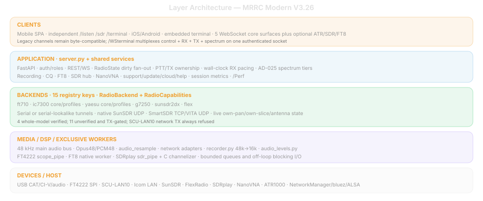

# 1. Executive Summary

## 1.1 Project Overview

MRRC Modern (`mrrc_modern`) is a mobile-first remote radio and receiver system. A Python FastAPI/Uvicorn service connects browsers, native mobile clients and embedded terminals to a selected radio through a pluggable backend. The same service provides control, bidirectional audio, spectrum/waterfall, metering, memories, server-side recording, one-touch CQ, FT8, listen-only and public SDR roles, box administration, diagnostics and optional antenna instruments.

The backend registry contains **15 model keys**. FT-710, IC-7300, IC-7300MK2 and FT-991A are hardware-verified at the whole-model level. IC-705/7610/7760, FTDX10, FTDX101D/MP, FTX-1F, FT-891, G7250, SunSDR2 DX and FlexRadio remain `verified=false`; some have substantial receive-path field evidence, but key-up stays behind AD-019 until the remaining acceptance work closes. `flex` deliberately covers the SmartSDR family through radio-reported capabilities rather than a per-model branch.

The product no longer assumes that a radio means a serial port plus a USB sound card. FT-710 uses ASCII CAT and an FT4222 subprocess; Icom and Xiegu use the shared CI-V core; Yaesu uses a profile-driven ASCII-CAT core; SCU-LAN10 and G7250 place serial-lookalike CI-V/CAT tunnels below those unchanged controllers; SunSDR2 DX and FlexRadio own native network sessions and server-side audio/spectrum adapters.

## 1.2 Current Design Goals

| Goal | Target | Current Evidence |
| --- | --- | --- |
| Mobile-first operation | Phone/desktop browser, native clients and constrained terminals | `static/`, `FT710Mobile/`, `FT710Android/`, `/WSterminal` |
| Honest radio control | Capabilities and tables come from the selected backend; unknown hardware remains TX-gated | `backends/`, AD-016/018/019/033/035/036/037 |
| Real-time spectrum | One stable 850-bin WS contract over SPI, CI-V, SCU-LAN10, SunSDR or Flex sources | `scope_handler.py`, `spectrum_profile.py`, backend scope adapters |
| Bidirectional audio | 48 kHz internal codec domain with explicit backend boundary conversion | `audio_handler.py`, `audio_resample.py`, network audio adapters |
| Safe PTT handling | Independent key-up refusal, ownership, release, heartbeat and shutdown layers | Chapter 15 |
| Field operability | Box setup, networking, local controls, updates, support bundles and observable load | `/setup`, `/settings`, `/Perf`, `support_bundle.py` |
| Protocol continuity | Legacy clients retain their byte contracts; new capabilities are negotiated per socket | AD-024/025/038/039 |

## 1.3 Implemented Core Features

| Feature | Status | Description |
| --- | --- | --- |
| Control WebSocket | Implemented | `/WSradio`: fullState, dirty state updates, set/get, memory, recording, CQ and safety messages |
| Single-socket terminal | Implemented | `/WSterminal` multiplexes control, RX, TX and spectrum; `/terminal` is a self-contained reference page (AD-039) |
| RX/TX audio | Implemented | Tagged Opus48/PCM48 over the legacy endpoints; backend-specific USB or network adapters; negotiated sockets additionally carry `0x02` PCM16 (16 kHz mono, AD-038) |
| Spectrum | Implemented | 1701 B full or 851 B short frames, per-socket AD-025 tiers; real sources plus an S-meter fallback that suppresses identical frames |
| Backend polling | Implemented | Seven adaptive tiers, priority-command preemption, baud-cost pacing and reconnect synchronization |
| Recording and CQ | Implemented | Incremental 16 kHz mono MP3 with disk guards; finite server-side CQ playback through the normal PTT/TX path |
| FT8 | Implemented | 15 s engine, 12 kHz RX tap, native per-platform DSP, fast decode plus adaptive deep cascade |
| Memory and authentication | Implemented | JSON memories; persistent 30-day operator/listen sessions; SDR has a separate password and cookie |
| Public receive roles | Implemented | `/listen` for the selected radio; `/sdr` for an independently shared SDRplay receiver |
| Box and instruments | Implemented on supported Linux boxes | LAN onboarding, Wi-Fi/Bluetooth, local HID control/speaker, `/Perf`, `/Nano`, remote help and Cloud Hub state |
| Support and updates | Implemented | Redacted support bundles, answer/board workflow, manifest checks and platform/box update paths |

## 1.4 Architecture Layers

## 1.5 Current Project Status

As of 2026-11-17, the released box line is v1.28.86 · FP73 and includes the AD-039 terminal endpoint. The architecture is a single application process plus narrowly scoped native/device workers: FT4222 scope, FT8 DSP and optional SDRplay. Network backends share the same server contracts rather than introducing browser-specific branches.

Hardware evidence is tracked per model and per path, not inferred from a successful login or a green offline suite. In particular, FlexRadio RX/FFT/antenna behavior and SCU-LAN10 CAT/RX/scope have real-radio measurements, while their overall `verified` flags remain false; SCU-LAN10 TX is unconditionally refused because its TX audio frame is unknown. PCM16 (`0x02`) and the further Flex receive-hardening design are future implementation work and are not described as shipped behavior.
