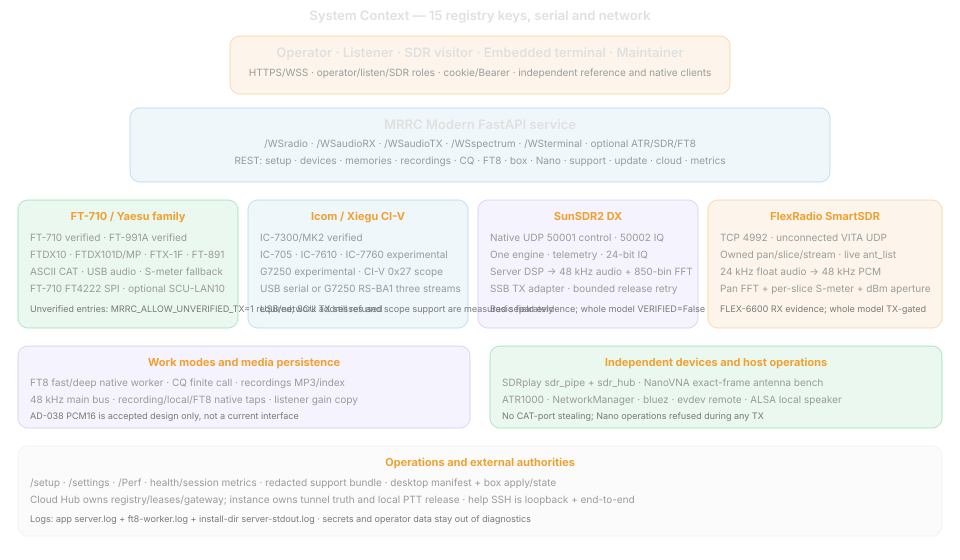

# 4. System Context (APP 011)

## 4.1 Context Diagram

## 4.2 Actors

| Actor | Role |
| --- | --- |
| HAM Operator | Controls the selected radio, listens, transmits where allowed and manages station data |
| Listener | Uses the constrained `/listen` role for frequency/mode/memory recall, RX and spectrum only |
| SDR Visitor | Uses the independent `/sdr` password/cookie and never enters the radio-control authorization domain |
| Embedded Terminal | Uses `/WSterminal` to carry control and media over one authenticated socket |
| System Maintainer | Installs, configures, updates, diagnoses and operates the box/network/Cloud Hub integration |
| Browser Runtime | Supplies WS, Web Audio, microphone, touch, Canvas and service-worker facilities |
| Radio Backend | Owns the selected radio protocol, capabilities, state polling, media and scope adapters |
| SDRplay Device | Optional independent wideband receiver owned by `sdr_pipe.py` |
| NanoVNA-H / ATR1000 | Optional antenna instruments, deliberately isolated from the CAT and audio paths |
| Cloud Hub / Support Receiver | External access and support infrastructure; their internal state machines live outside this repository |

## 4.3 External Interfaces

| Interface | Protocol | Endpoint / Transport | Direction | Description |
| --- | --- | --- | --- | --- |
| Static and REST UI | HTTPS/HTTP | `/`, `/login`, `/settings`, `/api/*` | Browser ↔ Server | Pages, configuration, status, recordings, support and administration |
| Control WS | WS JSON | `/WSradio` | Bidirectional | Commands, state, memories, recording, CQ, heartbeats and safety |
| RX Audio WS | WS binary | `/WSaudioRX` | Server → Client | `0x00` PCM48 or `0x01` Opus48 frames |
| TX Audio WS | WS binary + text | `/WSaudioTX` | Client → Server | Codec-tagged microphone frames and stream control |
| Spectrum WS | WS binary + caps text | `/WSspectrum` | Server → Client | AD-025 1701/851 B frames at the negotiated tier |
| Terminal WS | WS text + binary | `/WSterminal` | Bidirectional | Channel byte plus legacy media body; control JSON is unchanged (AD-039) |
| Optional WS | WS | `/WSatr1000`, `/WSsdr`, `/WSft8` | Bidirectional | Tuner, independent SDR and FT8 event surfaces |
| Yaesu CAT | Serial or SCU-LAN10 | Enhanced/USB COM or UDP 50000–50003 | Bidirectional | Profile-driven ASCII commands; SCU-LAN10 presents a serial lookalike |
| CI-V | Serial or Icom LAN | USB serial or UDP 50001–50003 | Bidirectional | Shared Icom/Xiegu framing, response demux and optional 0x27 scope |
| FT4222 SPI | Native subprocess | FTDI device | Radio → Server | FT-710 scope stream isolated from asyncio/ctypes conflicts |
| SunSDR | UDP | Control 50001, IQ 50002 | Bidirectional | Exclusive native control, IQ, telemetry and DSP media |
| Flex SmartSDR | TCP + UDP | TCP 4992, VITA UDP from radio 4993 | Bidirectional | Text objects/commands plus FFT, audio and meter streams |
| USB Audio | OS audio | Radio/external codec | Bidirectional | PyAudio capture/playback at the backend device rate |
| Box System | Local sockets/CLI | NetworkManager, bluez, evdev, ALSA, root helper | Local only | Network, Bluetooth, local controls, speaker and fixed privileged verbs |

## 4.4 Data Flows

| Flow | Description |
| --- | --- |
| Control | UI/terminal JSON → shared command dispatcher → active backend/controller → radio → `RadioState.update()` → dirty-field fan-out |
| RX audio | USB/network source → backend boundary conversion → 48 kHz PCM → native recording/FT8/local taps → box RX gain → Opus/PCM fan-out |
| TX audio | Client mic → ownership check → decode → mic gain → TX recording tap → backend conversion/modulation → bounded device queue |
| RX pacing | Wall-clock deadline schedules each 20 ms tick; network queues are drained in bounded batches and stale media is dropped rather than played late |
| Spectrum | Backend source → source-specific validation/assembly → `ScopeHandler` → AD-025 frame variant/divider → legacy or terminal WS |
| Flex object flow | SmartSDR status → per-object pan/slice state → own-slice/own-pan selection → antenna/meter/axis derivation → generic state/scope contracts |
| PTT | Key-up gate + ownership → backend key command; release paths always remain accepted and automated TX has a finite end |
| Box operations | Authenticated page → pure validation/orchestration → narrowly owned nmcli/bluez/helper/audio modules → read-back state |
| Support | Local redacted bundle → optional operator-initiated upload → receiver/autopilot/board; no runtime control dependency |

## 4.5 System Boundaries

| Boundary | Inside | Outside |
| --- | --- | --- |
| Client | Rendering, local preferences, jitter buffers, microphone and client watchdogs | OS permissions, browser/native/embedded implementation details |
| Application | Auth, REST/WS, state, backend selection, media fan-out, recording/FT8 and operational routes | Radio firmware, kernel/network/audio drivers |
| Backend | Protocol truth, capabilities, object ownership, device/media/scope adapters | Vendor applications and unrelated models |
| Device workers | FT4222, FT8 native DSP and SDRplay exclusive access | Main event loop; framing is the only coupling |
| Host administration | Validation and fixed verbs through owned modules/helper | Arbitrary root shell and secrets in logs/bundles |
| Hub/support | Instance-side tunnel state and redacted export | Registry/leases/portal and public answer authority outside the runtime path |

## 4.6 Contextual Constraints

- A successful socket/login is not evidence that CAT, audio or spectrum works; each path has its own observable state.
- Serial parameters, CI-V addresses and model capabilities come from profiles/registry metadata; FT-891 and FT-991A factory CAT rate is 4800, not the old family-wide 38400 assumption.
- Network sockets are exclusive resources. Flex UDP must remain unconnected because radio data originates at port 4993; uvloop-incompatible `sock_sendto`/`sock_recvfrom` calls are forbidden.
- Blocking PortAudio enumeration, D-Bus probes and serial/instrument I/O run off the event loop. Native stream rebuilds close live streams under their lifecycle lock first.
- HTTPS is the normal entry (first-run self-signed or enrolled certificate); secure contexts are required for reliable browser microphone use.
- All deployment-specific secrets and paths come from environment/configuration files, never source literals or URLs.
