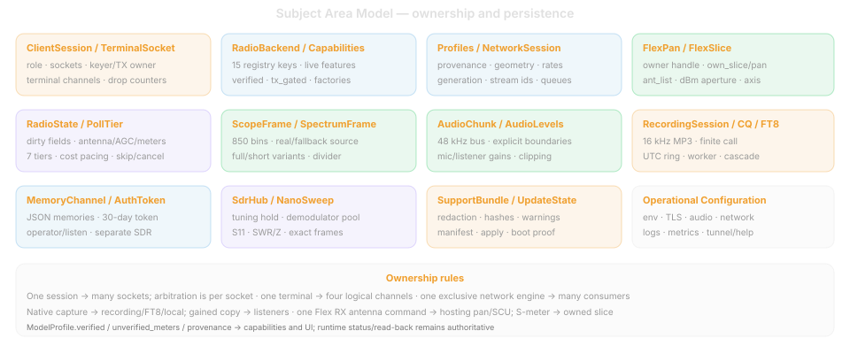

# 7. Subject Area Model (APP 408)

## 7.1 Subject Areas

## 7.2 Entity Definitions

| Entity | Important Attributes | Description |
| --- | --- | --- |
| ClientSession | token role, sockets, connected_at, lifetime | One authenticated operator/listen/SDR session may own multiple sockets; tokens never appear in metrics snapshots |
| TerminalSocket | control registration, RX/TX registration, optional spectrum profile, drop counters | One AD-039 socket multiplexes four logical channels without a second control or TX-owner state machine |
| RadioBackend | model, capabilities, controller, scope/audio factories | Selected registry entry and the server's backend-neutral boundary |
| RadioConnection | serial/network endpoint, baud/ports, connected, identity | Transport-specific state; every controller exposes the common `connected` surface |
| RadioCapabilities | bands, modes, filters, meters, scope spans, verified, tx_gated, feature flags | UI discovery and honesty contract; values derive from profiles or live network-radio state |
| RadioState | VFO/mode/TX/meters/gains/filter/DSP/scope/antenna/AGC/connection fields | Dirty-tracking dataclass; includes `antenna_name/list`, `rf_gain_raw`, `agc_threshold`, `model_mismatch` and RX silence state |
| CivModelProfile | address, scope geometry, bands/modes, meter curves, verified, provenance | Shared Icom/Xiegu facts; G7250 adds address candidates and network behavior |
| YaesuModelProfile | CAT codes, filter prefixes/Hz, bands, receiver flags, rates, verified, provenance | Shared Yaesu facts; dual-receive and model-specific command shapes are data, not server branches |
| FlexPan / FlexSlice | ids, owner handle, center/bandwidth, dBm aperture, own_slice, ant_list | Runtime SmartSDR objects; own-pan/own-slice authority prevents driving another client's objects |
| NetworkSession | generation, stream ids, queues, heartbeat/reconnect state | SCU-LAN10, Icom LAN, SunSDR and Flex exclusive transport sessions |
| RadioCommand | field/value, encoded frame, response/status | Shared set field translated by the active backend; read-back/status is authoritative |
| ScopeFrame | wf1/wf2[850], S-meter, frequency/mode/span/start | Validated real source data in the common scope container |
| SpectrumFrame | version `0x01`, full/short body, socket divider | AD-025 wire frame; Flex currently generates both arrays from its owned pan FFT |
| AudioChunk | PCM bytes, rate, channels, timestamp | Backend/native audio before or after explicit conversion |
| AudioFrame | codec tag, payload | Current tags are `0x00` PCM48 and `0x01` Opus48; negotiated sockets additionally carry AD-038 `0x02` PCM16 (16 kHz mono) |
| AudioLevels | tx_mic_db, rx_db, clipping counters | Box-owned gains with separate source/listener ownership and atomic JSON persistence |
| RecordingSession / File | monotonic timeline, frequency, MP3 writer, bytes/duration | Incremental 16 kHz storage domain, one writer per session, persistent recordings index |
| CQSession | state, frames sent/total, initiator, reason | Finite automated transmission sharing the standard TX queue and PTT release chain |
| FT8Runtime | work mode, UTC ring, worker, cascade policy, counters, QSO repository | Native worker plus orchestration and platform adapters |
| PollTier | interval/cost, queries, skip/cancel state | One of seven adaptive polling tiers |
| MemoryChannel | index, frequency, mode, label | Persistent JSON memory record |
| AuthToken | token hash/value, created_at, role | Persistent 30-day operator/listen token; SDR uses its own cookie/token domain |
| SdrHub / Channel | tuning holder, subscribers, demodulator key, caps | Independent SDRplay sharing and fan-out; no radio-control state |
| NanoSweep | S11 points, frequency axis, derived SWR/Z/resonance, baseline | Exact-frame antenna measurement and pure analysis result |
| SupportBundle | id, manifest, redacted files, warnings, hashes | Operator-initiated diagnostic export with retention and privacy evidence |
| UpdateState | current/latest, manifest facts, installing/ok/error | Versioned update evidence; only the new version's boot can prove success |

## 7.3 Relationships

| Relationship | Cardinality | Description |
| --- | --- | --- |
| ClientSession → sockets | 1:N | A cookie/token can represent several tabs and logical channels; arbitration is per socket |
| TerminalSocket → logical channels | 1:4 | Control/RX always registered, TX for operator only, spectrum after caps |
| RadioBackend → RadioState | 1:1 | The active backend is the sole protocol authority for the shared state |
| Backend profiles → capabilities | 1:N | Static model facts and live network state produce the UI capability surface |
| FlexPan → FlexSlice | 1:N | RX antenna is a pan/SCU-wide effect; S-meter remains per slice |
| NetworkSession → consumers | 1:N | Scope, audio, recording and FT8 share one exclusive device engine |
| ScopeFrame → SpectrumFrame | 1:N variants | One source frame produces full/short variants, then per-socket dividers gate delivery |
| AudioChunk → consumers | 1:N | Recording/FT8/local taps take native capture; network listeners receive the separately gained/encoded copy |
| RadioState → clients | 1:N | Dirty fields fan out to `/WSradio` and terminal control sockets |
| SdrHub → demodulators | 1:N | Subscribers sharing `(offset, mode, bw)` share one demodulator |

## 7.4 State Ownership

| State | Owner | Persistence |
| --- | --- | --- |
| Connected sockets and TX/key ownership | `server.py`, per socket | Runtime only |
| Radio and backend object state | `RadioState` + active backend/engine | Runtime only; radio status is authoritative |
| Poll schedule | `PollScheduler` | Runtime only |
| Scope and audio queues | Scope/backend producers and audio adapters | Bounded runtime memory |
| Memories | Memory API + `MRRC_MEM_FILE` | JSON filesystem |
| Auth tokens | Auth store | Atomic JSON, 0600, 30 days |
| Audio levels | `audio_levels.py` | Atomic JSON |
| Recordings/FT8 QSO data | Recorder / FT8 repository | MP3/index/SQLite and settings |
| Box/network credentials | Environment + NetworkManager/bluez owned paths | Platform stores; secrets never enter metrics/logs/bundles |
| Update proof | `upgrade_core.py` and box updater | Versioned state files/manifests |
| UI preferences and waterfall pixels | Browser/native client | Cookies/local settings and runtime canvas |
