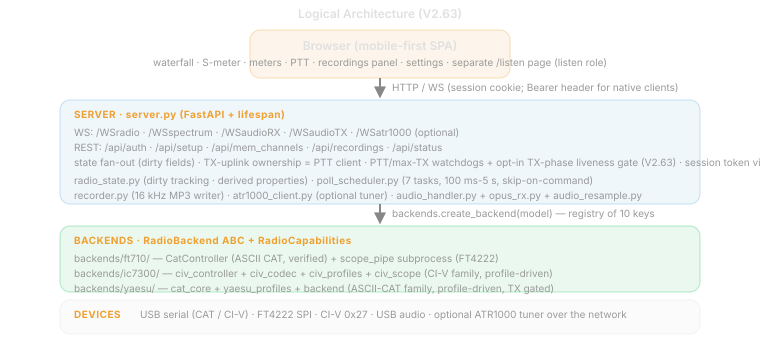
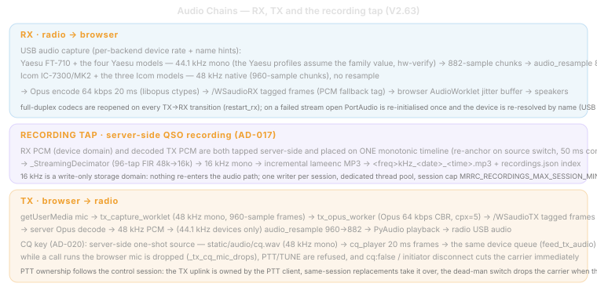
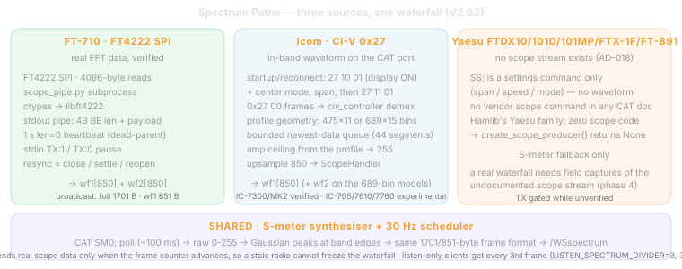
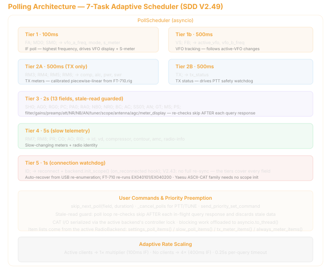
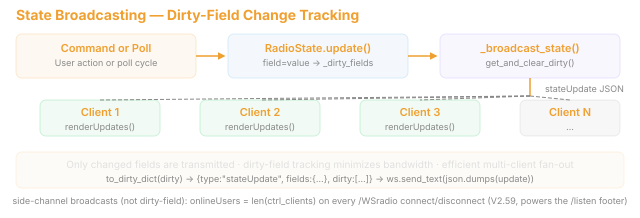
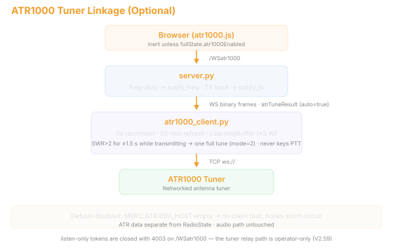

# 9. Architecture Overview (ART 0512)

## 9.1 Logical Architecture



## 9.2 WebSocket Endpoints

### 9.2.1 /WSradio (JSON text)

Control channel. Carries all radio commands, state updates, and memory management.

**Server → Client:**

- `{"type":"fullState","data":{...},"radioModel":"...","radioDisplayName":"...","capabilities":{...},"bands":[...],"modes":[...]}` — initial sync on connect; `capabilities` is backend-specific (bands, modes, filters, ATT/PRE steps, meter visibility, scope banner, etc.)
- `{"type":"stateUpdate","fields":{...},"dirty":[...]}` — partial changed-field update
- `{"type":"value","field":"...","value":...}` — single-value query response
- `{"type":"memChannels","channels":[...]}` — memory channel broadcast
- `{"type":"recordingState","recording":{...}}` — server-side QSO recording snapshot (AD-017), broadcast on change
- `{"type":"cqState","cq":{...}}` — one-shot CQ call snapshot (AD-020): `state` = `idle|calling|complete|aborted`, plus `frames_sent`/`frames_total`/`started_by`/`reason`; broadcast on change and at 1 Hz while calling
- `{"type":"onlineUsers","count":N}` — online control-client count, broadcast on every /WSradio connect/disconnect (V2.59; shown in the listen page footer, ignored by UIs that do not know the type)
- `{"type":"pong"}` — keepalive response

**Client → Server:**

- `{"type":"set","field":"...","value":...}` — command (40+ supported fields, incl. `recording` and `cq`)
- `{"type":"get","field":"..."}` — query current value
- `{"type":"memSave","channels":[...]}` — save memory channels
- `{"type":"memDelete","index":N}` — delete memory slot
- `{"type":"ping"}` — keepalive

**Listen-only role (V2.59):** a session authenticated with `MRRC_LISTEN_PASSWORD` gets its token tagged in `_listen_tokens` and is redirected to the `/listen` page. Enforcement is server-side: `_handle_ws_message` refuses every message except `ping`/`get`/`memLoadAll`/`memRecall` and `set` on {`freq`, `vfo_a_freq`, `vfo_b_freq`, `mode`} (legacy `field:value` text goes through the same gate); `/WSaudioTX` and `/WSatr1000` close listen tokens with code 4003; the auth middleware returns 403 for non-GET `/api/*` (except `/api/auth/logout`). RX audio and spectrum stay open — listening is the point.

### 9.2.2 /WSaudioRX (binary)

**Format:** 1-byte codec tag (0x00=PCM, 0x01=Opus) + payload.

Server captures Int16 mono from the selected radio's USB audio (44.1kHz for FT-710, 48kHz for IC-7300/MK2) → resamples to 48kHz if needed → Opus encodes (64kbps default) → broadcasts to all `audio_rx_clients` at 20ms intervals. Parallel to the encode path, `_rec_tap_rx()` hands the same device-domain PCM to the recorder (which is why the RX loop no longer idles while a recording runs). Browser decodes via WASM OpusDecoder (or Int16→Float32 for PCM) → AudioWorklet playback with jitter buffer.

### 9.2.3 /WSaudioTX (binary + text)

**Binary:** 1-byte codec tag + encoded mic audio. Server decodes (Opus→PCM or pass-through PCM) → `_rec_tap_tx()` copies it to the recorder (only while not transmitting, to avoid the radio's sidetone) → queues to PyAudio output stream → played to the selected radio's USB audio input (44.1kHz for FT-710 with resample, 48kHz native for IC-7300/MK2).

**Text:** `"s:"` = stop TX; `"m:rate,encode,..."` = settings.

### 9.2.4 /WSspectrum (binary)

**On the wire there is one version byte, `0x01`, and two lengths.** `full` = `0x01` + 850 bytes wf1 + 850 bytes wf2 = 1701 bytes. `wf1` = `0x01` + 850 bytes wf1 = 851 bytes. The 851-byte frame is what this section used to call "v1": it was specified here and **never shipped** — every server build sent the `0x01` byte with the 1701-byte length. The "v2" naming is retired rather than implemented, and the full frame must **not** be re-tagged `0x02`: iOS guards `version == 0x01` (`SpectrumProcessor.swift:57`) and would silently drop every frame. No client draws wf2 anyway — it is all zeros on both radio families.

Which length a socket gets, and how often, is its **profile** (`spectrum_profile.py`, AD-025): `high` = full every tick, `mid` = wf1 every 2nd tick, `low` = wf1 every 4th. A socket declares its tier with a text frame `{"type":"spectrumCaps","profile":"mid"}`; **until it does, the server sends `high`** — byte-for-byte the pre-AD-025 stream, because the shipped Android parser rejects any length that is not 1701 (`SpectrumFrame.kt:14-15`). Listener-password sockets default to the server-internal `listen` tier (full, every 3rd tick), which is the behaviour they have had since V2.59.

The broadcaster is scheduled at 30 Hz. Real scope data (FT4222 SPI for FT-710, CI-V 0x27 for the Icom family) is sent only when `ScopeHandler._frame_count` advances — **measured 11.1 fps on the FT-710**, so clients do not receive duplicate hardware frames; the S-meter fallback is regenerated on every broadcast tick (~30 fps) and passes through the same per-profile gate. A divider is a ratio, not an absolute rate: `LISTEN_SPECTRUM_DIVIDER = 3` yields ~3.7 Hz on the real-scope source and ~10 Hz in the fallback state, cutting bandwidth by two thirds either way (V2.59).

## 9.3 RX Audio Signal Chain



*See upper half of diagram.*

## 9.4 TX Audio Signal Chain


*See lower half of diagram.*

**TX runs at 48 kHz throughout the codec domain** — browser capture and Opus encode/decode. The server bridges to the radio's native USB audio rate: the FT-710 uses 44.1 kHz with frame-aligned resampling (960↔882 = exactly 20 ms, ratio 160:147); the IC-7300/MK2 uses 48 kHz native with no resample. This eliminates the v1.0 sample-rate mismatch (16 kHz mic → 48 kHz playback) and prevents a Windows shared-mode mix rate from bypassing the device-domain bridge.

The playback queue pre-buffers 60 ms and caps latency at 400 ms. Oldest-frame drops at that cap are counted as `queue_drops` in the per-PTT session log alongside received, decoded, written, write-error, peak, and non-owner counters. A healthy RF acceptance run therefore requires `decode_fail=0`, `write_err=0`, `queue_drops=0`, and `non_owner_drops=0`; sustained queue drops identify a host-output pacing problem even when Opus decoding succeeds. Startup and stream-open logs identify the selected device index/name, PortAudio host API, advertised default rate, actual opened rate, and channel count; IC-7300/MK2 should report `actual=48000Hz` for both RX and TX.

## 9.5 Spectrum Signal Chain

### 9.5.1 Real Scope Path (FT4222 SPI for FT-710, CI-V 0x27 for IC-7300/MK2)

FT-710: FT4222 SPI → `scope_pipe.py` subprocess → 850-point wf1/wf2 → `ScopeHandler`.

IC-7300/MK2: startup/reconnect sends scope display ON (`27 10 01`), Center mode, span, then waveform-data output ON (`27 11 01`).

Yaesu FTDX10 / FTDX101D / FTDX101MP / FTX-1F / FT-891: **no scope path exists.** The Yaesu scope waveform is not part of any CAT reference (`SS` sets span/speed/mode only) and Hamlib's entire Yaesu family contains no scope-data code, so these backends return no scope producer; the server's S-meter synthesiser keeps `/WSspectrum` alive and the frontend is unchanged. CI-V `27 00` frames → `civ_controller.py` demux → bounded queue sized `4 × scope_seq_max` (44 segments on 475-bin models, 60 on the 689-bin IC-7610/IC-7760; drop oldest on overflow) → bin scale (0..160 or 0..200 from the profile) → upsample to 850 → `ScopeHandler`. A bin count or segment count that disagrees with the profile logs once and is adopted, so a wrong profile cannot freeze the waterfall. Center information carries center frequency plus half-span; Fixed, SCROLL-C, and SCROLL-F carry lower and upper edges. The browser constrains CI-V scope speed to FAST/MID/SLOW.



### 9.5.2 S-Meter Fallback (Synthetic Spectrum)


*See lower half of spectrum diagram.*

## 9.6 Backend Polling Architecture



## 9.7 State Broadcasting



## 9.8 ATR1000 Tuner Linkage (optional)



Four linkage behaviors:

1. **Freq change → relay apply** — `_broadcast_state` on vfo_a_freq/vfo_b_freq/active_vfo dirty calls `notify_freq`; learned LC values from `atr1000_tuner.json` (TunerStorage: learn gate SWR 1.0–1.8, 1kHz keys ±5kHz nearest, atomic writes) are pushed to the tuner (5s write throttle).
2. **TX on/off → `notify_tx`** — switches the tuner to device push mode and opens the learning window (LearningBuffer, 4-sample stability).
3. **Tune assist** — client `{"type":"atrTune"}` runs `_atr_tune_assist()` server-side: TX2 carrier → skip if SWR≤1.6 → snapshot relays → full tune (mode=2) → keep+learn if SWR improved ≥0.02 else rollback → carrier always dropped in `finally` (ATR_TUNE_* constants: 0.3s settle, 5s min, 45s deadline, 0.8s compare settle, 2.5s meter wait).
4. **High-SWR auto full tune** — the client's METER path runs a guard (instance state, no module globals): while the operator transmits (measured power ≥5 W) and SWR stays >2.0 for ≥1.5 s, it queues ONE full-tune frame (mode=2, sent by the worker through the existing `_pending_*`/`_wake` channel). 30 s cooldown; 3 consecutive no-improvement tunes per frequency, then `auto_giveup` until the frequency changes or the SWR recovers; a QSY >1 kHz or a fresh relay change restarts the run. After tuning clears (relay-stable >5 s / same-relay confirm / TX end / 45 s timeout / device `TUNE_STATUS=0`), a 0.8 s-later comparison writes the relays back with `learn(force_update=True)` **only when SWR improved ≥0.02 and the result is ≤1.8** — the relays are never rolled back. Auto-tune phases reach the UI as `atrTuneResult` with `auto=true` (6 phases); a disconnect or a failed send emits the `auto_aborted` terminal phase. **The guard never keys the radio**: it acts only inside an existing transmission and sends nothing but a tuner frame (SDD ch15), which is also why learning now keys off measured power (≥3 W) instead of the server-side TX signal — panel PTT and external-software transmissions learn too.

**Default-disabled isolation**: `MRRC_ATR1000_HOST` empty (default) means no client task, no network traffic, linkage hooks short-circuit, `/WSatr1000` closes with code 4000, and the frontend module is never initialized. ATR data is deliberately kept out of RadioState (separate channel, same precedent as spectrum); the audio path is untouched.

## 9.9 FT8 Decode Path: Fast Default + Adaptive Cascade

FT8 decodes each 15 s slot through a **two-stage** decoder (design spec `docs/superpowers/specs/2026-10-13-ft8-fast-path-cascade-design.md`; performance analysis `docs/ft8-w103d-decode-perf-analysis.md` §9):

1. **Fast path (default)** — `wsjt_ft8_decode_fast` in `ft8/dsp/wsjt_fast.c`, the `kgoba/ft8_lib` C decoder (kiss-fft, no AP, no OSD, single pass) compiled into the **same** `libwsjt_core` (so the single locked ctypes boundary is preserved) and reached through the one `ft8/core/binding.py`. This is `DecodePath.FAST`; it measures ~0.15 s on the W103D versus ~2.2 s for the WSJT-X deep path. All its knobs stay at the upstream defaults — the A53 spike (analysis §9) showed every faster setting buys time only by trading away weak-signal sensitivity, which is exactly what the cascade exists to protect.
2. **Adaptive cascade** — `ft8/engine/cascade.py`'s `CascadingDecoder` runs the fast path first, then re-decodes **the same slot** on the deep WSJT-X path only when a criterion fires: AP context active (`my_call` set and `qso_progress > 0`), suspected miss (`len(fast) < min_decodes` or the peak SNR below `min_peak_snr = -26`), or an operator's one-shot "deep decode this slot" request. The two batches are merged (`merge_batches`, keyed on `(frequency, dt)` within tolerance, deep wins; the union is never smaller than always-deep). A budget guard **refuses the escalation** when the time left before the 4.0 s decision cutoff is below the deep path's measured lower bound, counting a `deadline_risk` instead — never a late result. (The cutoff was 2.5 s until 2026-10-13, sized for a single decode path; with the cascade it has to cover the fast path's landing delay *plus* the deep path, and 2.5 s admitted neither, so the guard refused every policy-approved escalation — measured 263 refusals / 0 escalations over one W103D field window.) **Field-validated after the fix** (2026-10-14, same box): 21 escalations over the first 60 slots, `late=0` and `errors=0` in all three counter lines — no batch crossed `boundary + 4.0 s`, so the 4.0 s cutoff and the 2.138 s deep pass fit together in production. The **escalation rate itself is not yet settled** (window deltas 65% / 35% / 5% across 15 minutes, the first window being the 3.4–8.4 min immediately after the restart), and the counter line counts **slots**, not messages (`decodes` is incremented once per decode batch, `orchestrator.py:328`), so it cannot answer "how many extra messages did the deep path earn"; that number does not exist yet (`docs/ft8-w103d-phase-a-baseline.md` §3).

`CascadingDecoder.decode` matches `SupervisorDecoder.decode` exactly, so `Orchestrator` is unaware of which path ran and the `4.0 s` `late` rule is unchanged; the cascade just decides before it. A fast-path failure (or a missing `decode_paths` bit) falls back to the deep path, so the fast path can never decode fewer messages than before. Observability: `OrchestratorCounters` gains `fast_decodes` and `escalations` (`fast_decodes + escalations <= decodes`; a fast-path failure that falls back counts as neither), `CascadingDecoder` carries `deadline_risk`, exposed via `runtime.cascade_stats`, and `LatencyHistogram.record` gained a `path` dimension with bucket key `<path>/p<profile>/t<threads>` (`path ∈ {fast, improved}`). Since 2026-10-14 the same counters also reach the log without an HTTP call: every slot line ends with `[<path> escalated? late?]` and every `runtime._COUNTERS_EVERY_SLOTS` (20) slots a `decode counters after N slot(s): decodes=… fast=… escalations=… (…%) late=… errors=… skipped=…` line is emitted — `N` is `counters.slots_started`, the slots the engine saw, so a skipped slot (no ring data inside the grace window) shows up in the number instead of silently missing (the batch count `_slots_logged` only counts slots that produced a decode and is the log cadence, not the operator's number). The field diagnosis that produced the 4.0 s fix had to be **inferred from publish offsets**, because a *successful* escalation logs nothing (`cascade.py` records only the refusals) and `late` existed only in the WebSocket frame — and two of those inferences were wrong before being retracted. Since 2026-10-14 the decode reply also carries **`cpu_seconds`** — the *Worker process's* CPU time for that one decode (`time.process_time()`, i.e. all of its threads). Wall time cannot show **fake parallelism**: the deep path's OpenMP region recomputes the whole symbol-spectrum per thread, so on the W103D threads 1→3 buys 1.46× less wall for **1.6× more CPU** (analysis `docs/ft8-w103d-decode-perf-analysis.md` §8.2), and re-measuring across the full thread matrix on a second architecture shows the wall curve bottoming at 3 threads while the CPU curve keeps climbing (5.2× at 12 threads). The W103D's own curve (measured on the box, 2026-10-14) bottoms at **2.138 s / 3 threads** — the thread count production already runs — where one deep pass is **53% of the 4.0 s decision budget**; `cycles` 1→3 is ~3×, so it cannot be afforded there at all (`docs/ft8-w103d-phase-a-baseline.md`). The clock is taken **in the Worker**, not in the parent: the parent's `process_time()` would fold in the audio and spectrum threads, and `RUSAGE_CHILDREN` does not update for a child that is still alive. Measurement only — no decode, sequencing or TX behavior reads it.

## 9.10 FT8 Native Library: Built Per Platform, Shipped In Every Artifact

The FT8 engine is Python plus **one native library** (`libwsjt_core.so` / `libwsjt_core.dylib` /
`wsjt_core.dll`), and since v1.27.0 that library is a component of every artifact rather than a
hand-compiled extra (design spec `docs/superpowers/specs/2026-10-13-ft8-packaging-design.md`):

| Platform | Where the library comes from | What travels with it |
| --- | --- | --- |
| W103D + Raspberry Pi images | built during the image build (`packaging/common/mrrc-service-layer.sh` runs `ft8/dsp/build.sh`), rebuilt by `linux/mrrc_update.sh` whenever the DSP sources' digest changes | the runtime packages (`libgfortran5`, `libgomp1`, `libfftw3-single3`) |
| macOS DMG | `packaging/macos/build.sh` builds it and `packaging/macos/ft8_bundle.py` collects the transitive dependency closure | five dylibs (FFTW, gfortran, gomp, quadmath, libgcc_s), every load command rewritten to `@loader_path` — the build fails if any `/opt/local` reference survives |
| Windows installer | `packaging/windows/build.ps1` builds it with MSYS2 mingw-w64 (cmake + ninja) | the runtime DLL closure, **walked with `objdump -p`** rather than hard-coded (9 files, ~16 MB) |

`ft8/core/worker.py:default_library_path()` resolves the platform's own name at the PyInstaller
`_internal` root (`app_root()`), and the binding **hard-checks the ABI** on load, so an old library
next to new Python refuses to start instead of silently decoding differently. `<boost/crc.hpp>`'s
include closure is vendored (`ft8/dsp/vendor-boost/`) so no platform needs Boost installed.

Two defects this layering was hiding, both found by clean-room runs of the *packaged* apps
(2026-10-13) and both fixed here:

* a fresh install has no `<runtime>/ft8/` directory, and `sqlite3` cannot create missing parents —
  `Repository` raised `OperationalError` and the composition guard silently ran SSB-only;
* a frozen bundle must call `multiprocessing.freeze_support()`, or the DSP worker's spawn child
  re-enters `main()`, argparse exits 2, and FT8 reports `spawn_failed`.

## 9.11 NanoVNA Antenna Bench (AD-030)

A second **serial instrument** on the box, deliberately outside the radio's CAT path
(design spec `docs/superpowers/specs/2026-10-18-nano-vna-design.md`, operator manual
`docs/nano_vna.md`):

```
browser ──REST /api/nano/*──> server.py（守卫 + 一把 asyncio.Lock）
                                └── asyncio.to_thread ──> nano/vna.py ──> /dev/ttyACM*
                                                          nano/analysis.py（纯数学）
                                                          nano/flash.py（ROM DFU）
```

- **Data path**: one command, one frame. `scan_bin <start> <stop> <points> <mask>` returns
  `u16 mask, u16 points` followed by `u32 freq` + `f32 re/im` per enabled array; the frame
  length must equal `4 + points × (4 + 8×(1+s21))` or the **whole frame is discarded and
  rescanned** — half a frame draws a plausible fake curve, which is worse than an error.
  Measured: 401 points 1.0–1.3 s, 101 points 0.32 s.
- **Three field-found transport defects** (2026-10-18, real hardware): a command written right
  after `reset_input_buffer()` is dropped (device still talking — measured as `scan_bin`
  answering nothing at all), a quiet-period frame terminator truncates a 401-point sweep
  between segments, and stripping only the CRLF of the echo line leaves `data 0` as a "data"
  row. Hence: sync to `ch> ` before writing (`in_waiting` first), read **exactly** the frame
  length, drop the echo line whole.
- **Why `scan_bin` and not `data`**: after `sweep`, `data 0` still holds the **previous**
  array (the device sweeps asynchronously) — measured 1.0 apart at 54 MHz. `scan_bin` carries
  frequency and data from the same sweep, so the race cannot exist.
- **Four guards**: refuse everything while transmitting (CH0 sits on the antenna — tens of
  watts is a burnt front end), one operation at a time, never steal the CAT port, and
  `listen`/`sdr` sessions are refused. Status polling shares the same lock as scans (concurrent
  readers on one pyserial handle steal frame bytes) and reports `busy` separately from
  `connected` — conflating them made the page report "device offline" during every scan.
- **Device state**: every scan restores the device's on-screen sweep. Display state (trace
  format, scale, marker) and the sweep live **outside** `config`, so `saveconfig` alone cannot
  persist them; the field preset therefore also writes a SAVE/RECALL slot (slot 4), which is
  what makes the box usable standalone in the field.

