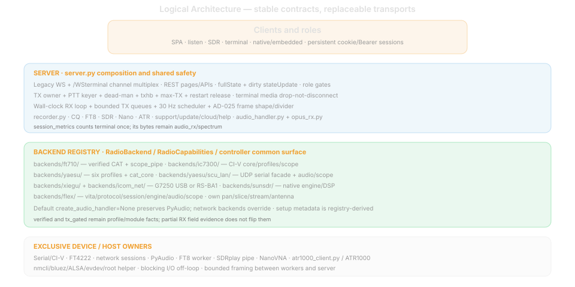
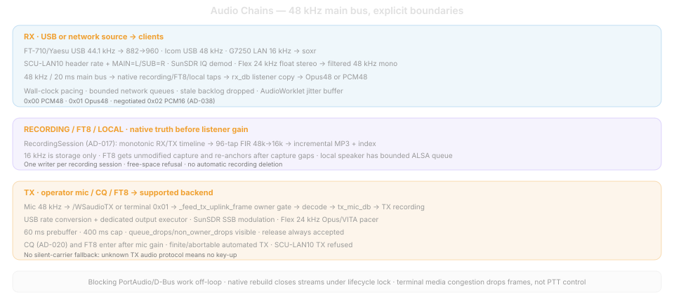
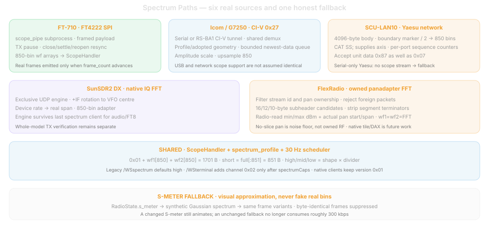
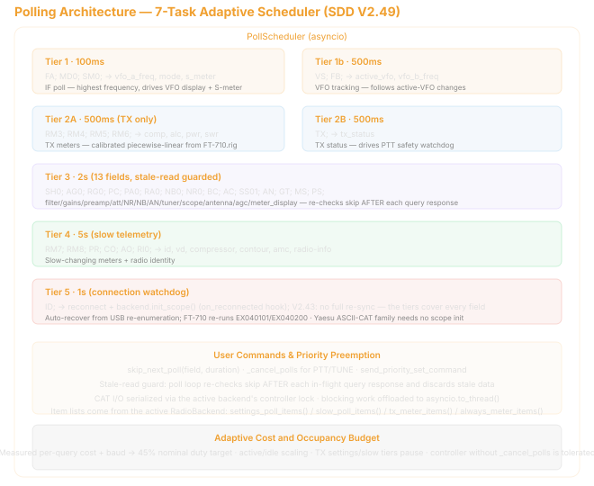
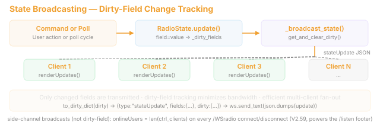
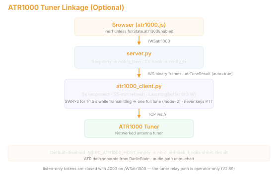

# 9. Architecture Overview (ART 0512)

## 9.1 Logical Architecture



## 9.2 WebSocket Endpoints

### 9.2.1 /WSradio (JSON text)

Control channel. Carries all radio commands, state updates, and memory management.

**Server → Client:**

- `{"type":"fullState","data":{...},"radioModel":"...","radioDisplayName":"...","capabilities":{...},"bands":[...],"modes":[...]}` — initial sync on connect; `capabilities` is backend-specific (bands, modes, filters, ATT/PRE steps, meter visibility, scope banner, etc.)
- `{"type":"stateUpdate","fields":{...},"dirty":[...]}` — partial changed-field update
- `{"type":"value","field":"...","value":...}` — single-value query response
- `{"type":"memChannels","channels":[...]}` — memory channel broadcast
- `{"type":"recordingState","recording":{...}}` — server-side QSO recording snapshot (AD-017), broadcast on change
- `{"type":"cqState","cq":{...}}` — one-shot CQ call snapshot (AD-020): `state` = `idle|calling|complete|aborted`, plus `frames_sent`/`frames_total`/`started_by`/`reason`; broadcast on change and at 1 Hz while calling
- `{"type":"onlineUsers","count":N}` — online control-client count, broadcast on every /WSradio connect/disconnect (V2.59; shown in the listen page footer, ignored by UIs that do not know the type)
- `{"type":"pong"}` — keepalive response

**Client → Server:**

- `{"type":"set","field":"...","value":...}` — command (40+ supported fields, incl. `recording` and `cq`)
- `{"type":"get","field":"..."}` — query current value
- `{"type":"memSave","channels":[...]}` — save memory channels
- `{"type":"memDelete","index":N}` — delete memory slot
- `{"type":"ping"}` — keepalive

**Listen-only role (V2.59):** a session authenticated with `MRRC_LISTEN_PASSWORD` gets its token tagged in `_listen_tokens` and is redirected to the `/listen` page. Enforcement is server-side: `_handle_ws_message` refuses every message except `ping`/`get`/`memLoadAll`/`memRecall` and `set` on {`freq`, `vfo_a_freq`, `vfo_b_freq`, `mode`} (legacy `field:value` text goes through the same gate); `/WSaudioTX` and `/WSatr1000` close listen tokens with code 4003; the auth middleware returns 403 for non-GET `/api/*` (except `/api/auth/logout`). RX audio and spectrum stay open — listening is the point.

### 9.2.2 /WSaudioRX (binary + capability text reserved)

**Wire format:** 1-byte codec tag (0x00=Int16 PCM 48 kHz mono, 0x01=Opus 48 kHz mono, 0x02=Int16 PCM 16 kHz mono) + payload. AD-038's `0x02` is emitted only on sockets that negotiated `{"type":"audioCaps","profile":"pcm16"}`; undeclared sockets keep the byte-for-byte legacy tags. The PCM16 group shares one soxr LQ 48→16 conversion per tick and skips Opus when no legacy listener exists; conversion failure closes only that group with 4004.

USB-audio models capture Int16 through PyAudio and convert their device rate to the 48 kHz main bus. G7250/Icom LAN, SCU-LAN10, SunSDR2 DX and FlexRadio instead supply backend-owned network adapters with bounded queues and explicit conversion. The RX loop feeds recording, FT8 and local speaker from the unmodified capture, applies `rx_db` only to the listener copy, then encodes/fans out. Its schedule is anchored to the wall clock rather than `work + sleep(20 ms)`; bounded batches drain network queues and stale backlog is discarded so a slow host cannot make playback progressively later.

### 9.2.3 /WSaudioTX (binary + text)

**Binary:** 1-byte codec tag + encoded mic audio. `_feed_tx_uplink_frame()` is the single ingress for both this endpoint and `/WSterminal`: per-socket owner arbitration, same-session streaming takeover, codec dispatch and counters. PCM then passes through browser-mic gain and the TX recording tap before the active backend converts/plays/modulates it. CQ and FT8 enter after mic gain and never inherit that control.

**Text:** `"s:"` = stop TX; `"m:rate,encode,..."` = settings. TX prebuffers 60 ms, caps device-queue latency at 400 ms and uses a dedicated output executor on USB models. Releases always remain accepted regardless of codec or model gate.

### 9.2.4 /WSspectrum (binary + caps text)

**On the wire there is one version byte, `0x01`, and two lengths.** `full` = `0x01` + 850 bytes wf1 + 850 bytes wf2 = 1701 bytes. `wf1` = `0x01` + 850 bytes wf1 = 851 bytes. The historical alternative `v2` framing was **never shipped**; the full frame must **not** be re-tagged `0x02`, because native clients guard version `0x01` and would drop every frame.

The per-socket profile (`spectrum_profile.py`, AD-025) is shape × divider: `high` = full every eligible tick, `mid` = wf1 every 2nd tick, `low` = wf1 every 4th. A socket declares `{"type":"spectrumCaps","profile":"mid"}`; until it does, `/WSspectrum` sends `high`, byte-for-byte compatible with the shipped Android parser. Listener-password sockets retain the internal `listen` tier (full, every 3rd tick).

The broadcaster is scheduled at 30 Hz. Real data is sent only when `ScopeHandler._frame_count` advances; at the measured FT-710 11.1 fps, the listen divider yields about **3.7 Hz**. A continuously changing 30 Hz fallback would yield about **~10 Hz fallback**, but the current fallback compares bytes with the previous synthetic frame and suppresses identical copies (reducing an unchanged high-tier fallback from roughly 300 kbps to about 25 kbps). A divider is therefore a **ratio, not an absolute rate**.

### 9.2.5 /WSterminal (single-socket multiplex, AD-039)

Text frames use the `/WSradio` JSON protocol unchanged, except that this endpoint also consumes `spectrumCaps` to subscribe its own socket and `audioCaps` to select its wire audio format. Binary frames are **one channel byte plus the exact legacy media body**:

| Channel | Direction | Body |
| --- | --- | --- |
| `0x00` | Server → Client | `/WSaudioRX` codec tag + payload |
| `0x01` | Client → Server | `/WSaudioTX` codec tag + payload |
| `0x02` | Server → Client | `/WSspectrum` complete 1701/851 B frame |

The terminal enters `ctrl_clients` and `audio_rx_clients`; operators also enter `audio_tx_clients` with the normal connect-order registration. No spectrum is produced before a valid `spectrumCaps`. Listen tokens may tune/receive but never register an uplink; SDR tokens are rejected.

Media send timeout/error on a terminal increments `_terminal_drops` and preserves the socket because it also carries control and PTT safety. Legacy pure-media sockets retain their previous eviction behavior. Disconnect removes all logical registrations and, if the terminal was keyer or TX owner, forces RX exactly once. `session_metrics` counts one `terminal` socket while media bytes remain accounted under `audio_rx` and `spectrum`.

`GET /terminal` serves a self-contained operator reference page (frequency/mode, S-meter, waterfall, AF, PTT/mic and diagnostics). It is intentionally absent from the main menu and service-worker precache.

**Terminal audio profiles (AD-039 amendment, 2026-11-17).** The ESP32-class terminal has no Opus option: `{"type":"audioCaps","profile":"pcm48"}` or `"pcm16"` registers **both directions** of that socket and is answered exactly once (`accepted` carries rate/channels/format/frameMs; an unknown name answers `unknown-profile`, PCM16 without a usable TX path answers `pcm16-tx-unsupported`). RX fan-out splits three ways: PCM16 (the shared 48→16 conversion), PCM48 (raw `0x00` + gained block — never Opus, regardless of libopus availability) and legacy (undeclared sockets keep the byte-for-byte Opus48/PCM48 stream, so the reference page is unchanged). A listen socket registers RX only. Disconnect drops both per-socket profiles and retires the shared PCM16 converter when its last reader leaves, before any await that could be cut short. The dedicated `/WSaudioRX`/`/WSaudioTX` endpoints still accept only `pcm16` (`parse_caps`); the terminal's two-name parser is `parse_terminal_caps`.

### 9.2.6 Other WebSocket surfaces

`/WSatr1000` is optional and disabled without a configured tuner; `/WSsdr` uses the independent SDR cookie/role and never enters radio control; `/WSft8` is mounted by the FT8 composition and reuses platform authentication with listen read-only restrictions. These are separate services, not additional aliases of the terminal multiplexer.

## 9.3 RX Audio Signal Chain



*See upper half of diagram.*

All sources converge on **48 kHz Int16 mono, 20 ms blocks**:

- FT-710 and applicable Yaesu USB codecs capture 44.1 kHz and use the frame-aligned 882→960 bridge; Icom USB uses native 48 kHz.
- G7250/Icom LAN receives 16 kHz PCM and uses streaming soxr, never sample repetition. Its recording/network consumers use the adapter's 48 kHz output, not the lower handler's device rate.
- SCU-LAN10 accepts the rate declared by each audio header (16 kHz observed, 48 kHz supported), selects MAIN=L, SUB=R or their mean, and converts to 48 kHz. Switching receiver clears the old receiver's queue.
- SunSDR2 DX demodulates native IQ; Flex converts 24 kHz big-endian float32 stereo VITA audio through mono/half-band filtering to 48 kHz.

Network handlers start without waiting on the server's RX loop (the 1.28.78 startup-deadlock fix). The server treats browser listeners, FT8, recording and local speaker as reasons to keep capture alive. RX queue trim, first-PCM grace and stall recovery prevent both stale audio and false startup restarts.

## 9.4 TX Audio Signal Chain


*See lower half of diagram.*

**TX input defaults to 48 kHz throughout the codec domain.** USB models bridge to their device rate (FT-710 960→882; IC-7300/MK2 native 48 kHz). AD-038 `0x02` explicitly carries 16 kHz instead: `_feed_tx_from_uplink(..., input_rate=16000)` applies mic gain and recording at that rate, then each backend converts directly to its device rate (16→44.1/48/24 kHz as applicable). Conversion failure forces RX without closing the socket; release never reads profile state. G7250 network CAT still delegates TX audio to the actual sound-card handler. SunSDR2 DX filters/resamples and applies Hilbert SSB modulation. Flex converts to 24 kHz stereo Opus/VITA with a paced 10 ms output queue. SCU-LAN10 refuses start/key-up because its 668-byte TX audio body is unknown.

The playback queue pre-buffers 60 ms and caps latency at 400 ms. Oldest-frame drops are counted as `queue_drops` with received, decoded, written, write-error, peak and non-owner counters. USB TX writes use a dedicated executor so CAT's `to_thread` work cannot starve 50 frames/s audio. Healthy RF acceptance requires `decode_fail=0`, `write_err=0`, `queue_drops=0`, and `non_owner_drops=0`, plus actual on-air modulation.

AD-038 adds explicit 16 kHz client input conversion while preserving the legacy 48 kHz contract: `_feed_tx_uplink_frame()` accepts `0x02` and calls `_feed_tx_from_uplink(..., input_rate=16000)`, with conversion failure forcing RX.

## 9.5 Spectrum Signal Chain

### 9.5.1 Real Scope Paths

| Source | Path and validation |
| --- | --- |
| FT-710 SPI | FT4222 → standalone `scope_pipe` → framed payload → 850-point `ScopeHandler`; TX pauses SPI and reconnect reinitializes scope |
| Icom/Xiegu CI-V | `27 10/27 11` initialization where supported → controller demux → bounded segment queue → profile/adopted geometry → amplitude scaling/upsample 850 |
| G7250 LAN | RS-BA1 CI-V tunnel → same `CivScopeProducer`; USB and network addresses/scope support differ, so transport selection happens below the controller |
| SCU-LAN10 | 4096-byte scope body → boundary marker / 2 → 850 bins; CAT `SS;` supplies the frequency axis. Port-local sequence counters and data frames with direction bit `0x87` are required by hardware |
| SunSDR2 DX | Shared UDP engine IQ → +IF rotation to VFO centre → FFT → 850 bins; engine outlives spectrum-client emit tasks |
| FlexRadio | Owned pan stream only → VITA FFT candidate subheaders/terminator cleanup → segment assembly → read-back pan dBm aperture and actual start/span → both wf arrays from the same `spectrum_rx1` |

Serial-only Yaesu profiles without SCU-LAN10 have no documented scope producer and use the fallback. CI-V geometry mismatches are logged once and adopted rather than freezing the waterfall. Flex drops foreign stream/pan packets and never treats an empty pan's noise floor as owned RF. The further native-waterfall/DAX design dated 2026-11-16 is not current behavior: Flex still uses one FFT for wf1 and wf2.



### 9.5.2 S-Meter Fallback (Synthetic Spectrum)


*See lower half of spectrum diagram.* Fallback remains a visual approximation, never a claim of real RF bins. It follows the same framing/tier contract and skips byte-identical frames; S-meter changes still generate the expected animation.

## 9.6 Backend Polling Architecture



## 9.7 State Broadcasting



## 9.8 ATR1000 Tuner Linkage (optional)



Four linkage behaviors:

1. **Freq change → relay apply** — `_broadcast_state` on vfo_a_freq/vfo_b_freq/active_vfo dirty calls `notify_freq`; learned LC values from `atr1000_tuner.json` (TunerStorage: learn gate SWR 1.0–1.8, 1kHz keys ±5kHz nearest, atomic writes) are pushed to the tuner (5s write throttle).
2. **TX on/off → `notify_tx`** — switches the tuner to device push mode and opens the learning window (LearningBuffer, 4-sample stability).
3. **Tune assist** — client `{"type":"atrTune"}` runs `_atr_tune_assist()` server-side: TX2 carrier → skip if SWR≤1.6 → snapshot relays → full tune (mode=2) → keep+learn if SWR improved ≥0.02 else rollback → carrier always dropped in `finally` (ATR_TUNE_* constants: 0.3s settle, 5s min, 45s deadline, 0.8s compare settle, 2.5s meter wait).
4. **High-SWR auto full tune** — the client's METER path runs a guard (instance state, no module globals): while the operator transmits (measured power ≥5 W) and SWR stays >2.0 for ≥1.5 s, it queues ONE full-tune frame (mode=2, sent by the worker through the existing `_pending_*`/`_wake` channel). 30 s cooldown; 3 consecutive no-improvement tunes per frequency, then `auto_giveup` until the frequency changes or the SWR recovers; a QSY >1 kHz or a fresh relay change restarts the run. After tuning clears (relay-stable >5 s / same-relay confirm / TX end / 45 s timeout / device `TUNE_STATUS=0`), a 0.8 s-later comparison writes the relays back with `learn(force_update=True)` **only when SWR improved ≥0.02 and the result is ≤1.8** — the relays are never rolled back. Auto-tune phases reach the UI as `atrTuneResult` with `auto=true` (6 phases); a disconnect or a failed send emits the `auto_aborted` terminal phase. **The guard never keys the radio**: it acts only inside an existing transmission and sends nothing but a tuner frame (SDD ch15), which is also why learning now keys off measured power (≥3 W) instead of the server-side TX signal — panel PTT and external-software transmissions learn too.

**Default-disabled isolation**: `MRRC_ATR1000_HOST` empty (default) means no client task, no network traffic, linkage hooks short-circuit, `/WSatr1000` closes with code 4000, and the frontend module is never initialized. ATR data is deliberately kept out of RadioState (separate channel, same precedent as spectrum); the audio path is untouched.

## 9.9 FT8 Decode Path: Fast Default + Adaptive Cascade

FT8 decodes each 15 s slot through a **two-stage** decoder (design spec `docs/superpowers/specs/2026-10-13-ft8-fast-path-cascade-design.md`; performance analysis `docs/ft8-w103d-decode-perf-analysis.md` §9):

1. **Fast path (default)** — `wsjt_ft8_decode_fast` in `ft8/dsp/wsjt_fast.c`, the `kgoba/ft8_lib` C decoder (kiss-fft, no AP, no OSD, single pass) compiled into the **same** `libwsjt_core` (so the single locked ctypes boundary is preserved) and reached through the one `ft8/core/binding.py`. This is `DecodePath.FAST`; it measures ~0.15 s on the W103D versus ~2.2 s for the WSJT-X deep path. All its knobs stay at the upstream defaults — the A53 spike (analysis §9) showed every faster setting buys time only by trading away weak-signal sensitivity, which is exactly what the cascade exists to protect.
2. **Adaptive cascade** — `ft8/engine/cascade.py`'s `CascadingDecoder` runs the fast path first, then re-decodes **the same slot** on the deep WSJT-X path only when a criterion fires: AP context active (`my_call` set and `qso_progress > 0`), suspected miss (`len(fast) < min_decodes` or the peak SNR below `min_peak_snr = -26`), or an operator's one-shot "deep decode this slot" request. The two batches are merged (`merge_batches`, keyed on `(frequency, dt)` within tolerance, deep wins; the union is never smaller than always-deep). A budget guard **refuses the escalation** when the time left before the 4.0 s decision cutoff is below the deep path's measured lower bound, counting a `deadline_risk` instead — never a late result. (The cutoff was 2.5 s until 2026-10-13, sized for a single decode path; with the cascade it has to cover the fast path's landing delay *plus* the deep path, and 2.5 s admitted neither, so the guard refused every policy-approved escalation — measured 263 refusals / 0 escalations over one W103D field window.) **Field-validated after the fix** (2026-10-14, same box): 21 escalations over the first 60 slots, `late=0` and `errors=0` in all three counter lines — no batch crossed `boundary + 4.0 s`, so the 4.0 s cutoff and the 2.138 s deep pass fit together in production. The **escalation rate itself is not yet settled** (window deltas 65% / 35% / 5% across 15 minutes, the first window being the 3.4–8.4 min immediately after the restart), and the counter line counts **slots**, not messages (`decodes` is incremented once per decode batch, `orchestrator.py:328`), so it cannot answer "how many extra messages did the deep path earn"; that number does not exist yet (`docs/ft8-w103d-phase-a-baseline.md` §3).

`CascadingDecoder.decode` matches `SupervisorDecoder.decode` exactly, so `Orchestrator` is unaware of which path ran and the `4.0 s` `late` rule is unchanged; the cascade just decides before it. A fast-path failure (or a missing `decode_paths` bit) falls back to the deep path, so the fast path can never decode fewer messages than before. Observability: `OrchestratorCounters` gains `fast_decodes` and `escalations` (`fast_decodes + escalations <= decodes`; a fast-path failure that falls back counts as neither), `CascadingDecoder` carries `deadline_risk`, exposed via `runtime.cascade_stats`, and `LatencyHistogram.record` gained a `path` dimension with bucket key `<path>/p<profile>/t<threads>` (`path ∈ {fast, improved}`). Since 2026-10-14 the same counters also reach the log without an HTTP call: every slot line ends with `[<path> escalated? late?]` and every `runtime._COUNTERS_EVERY_SLOTS` (20) slots a `decode counters after N slot(s): decodes=… fast=… escalations=… (…%) late=… errors=… skipped=…` line is emitted — `N` is `counters.slots_started`, the slots the engine saw, so a skipped slot (no ring data inside the grace window) shows up in the number instead of silently missing (the batch count `_slots_logged` only counts slots that produced a decode and is the log cadence, not the operator's number). The field diagnosis that produced the 4.0 s fix had to be **inferred from publish offsets**, because a *successful* escalation logs nothing (`cascade.py` records only the refusals) and `late` existed only in the WebSocket frame — and two of those inferences were wrong before being retracted. Since 2026-10-14 the decode reply also carries **`cpu_seconds`** — the *Worker process's* CPU time for that one decode (`time.process_time()`, i.e. all of its threads). Wall time cannot show **fake parallelism**: the deep path's OpenMP region recomputes the whole symbol-spectrum per thread, so on the W103D threads 1→3 buys 1.46× less wall for **1.6× more CPU** (analysis `docs/ft8-w103d-decode-perf-analysis.md` §8.2), and re-measuring across the full thread matrix on a second architecture shows the wall curve bottoming at 3 threads while the CPU curve keeps climbing (5.2× at 12 threads). The W103D's own curve (measured on the box, 2026-10-14) bottoms at **2.138 s / 3 threads** — the thread count production already runs — where one deep pass is **53% of the 4.0 s decision budget**; `cycles` 1→3 is ~3×, so it cannot be afforded there at all (`docs/ft8-w103d-phase-a-baseline.md`). The clock is taken **in the Worker**, not in the parent: the parent's `process_time()` would fold in the audio and spectrum threads, and `RUSAGE_CHILDREN` does not update for a child that is still alive. Measurement only — no decode, sequencing or TX behavior reads it.

## 9.10 FT8 Native Library: Built Per Platform, Shipped In Every Artifact

The FT8 engine is Python plus **one native library** (`libwsjt_core.so` / `libwsjt_core.dylib` /
`wsjt_core.dll`), and since v1.27.0 that library is a component of every artifact rather than a
hand-compiled extra (design spec `docs/superpowers/specs/2026-10-13-ft8-packaging-design.md`):

| Platform | Where the library comes from | What travels with it |
| --- | --- | --- |
| W103D + Raspberry Pi images | built during the image build (`packaging/common/mrrc-service-layer.sh` runs `ft8/dsp/build.sh`), rebuilt by `linux/mrrc_update.sh` whenever the DSP sources' digest changes | the runtime packages (`libgfortran5`, `libgomp1`, `libfftw3-single3`) |
| macOS DMG | `packaging/macos/build.sh` builds it and `packaging/macos/ft8_bundle.py` collects the transitive dependency closure | five dylibs (FFTW, gfortran, gomp, quadmath, libgcc_s), every load command rewritten to `@loader_path` — the build fails if any `/opt/local` reference survives |
| Windows installer | `packaging/windows/build.ps1` builds it with MSYS2 mingw-w64 (cmake + ninja) | the runtime DLL closure, **walked with `objdump -p`** rather than hard-coded (9 files, ~16 MB) |

`ft8/core/worker.py:default_library_path()` resolves the platform's own name at the PyInstaller
`_internal` root (`app_root()`), and the binding **hard-checks the ABI** on load, so an old library
next to new Python refuses to start instead of silently decoding differently. `<boost/crc.hpp>`'s
include closure is vendored (`ft8/dsp/vendor-boost/`) so no platform needs Boost installed.

Two defects this layering was hiding, both found by clean-room runs of the *packaged* apps
(2026-10-13) and both fixed here:

- a fresh install has no `<runtime>/ft8/` directory, and `sqlite3` cannot create missing parents —
  `Repository` raised `OperationalError` and the composition guard silently ran SSB-only;
- a frozen bundle must call `multiprocessing.freeze_support()`, or the DSP worker's spawn child
  re-enters `main()`, argparse exits 2, and FT8 reports `spawn_failed`.

## 9.11 NanoVNA Antenna Bench (AD-030)

A second **serial instrument** on the box, deliberately outside the radio's CAT path
(design spec `docs/superpowers/specs/2026-10-18-nano-vna-design.md`, operator manual
`docs/nano_vna.md`):

```
browser ──REST /api/nano/*──> server.py（守卫 + 一把 asyncio.Lock）
                                └── asyncio.to_thread ──> nano/vna.py ──> /dev/ttyACM*
                                                          nano/analysis.py（纯数学）
                                                          nano/flash.py（ROM DFU）
```

- **Data path**: one command, one frame. `scan_bin <start> <stop> <points> <mask>` returns
  `u16 mask, u16 points` followed by `u32 freq` + `f32 re/im` per enabled array; the frame
  length must equal `4 + points × (4 + 8×(1+s21))` or the **whole frame is discarded and
  rescanned** — half a frame draws a plausible fake curve, which is worse than an error.
  Measured: 401 points 1.0–1.3 s, 101 points 0.32 s.
- **Three field-found transport defects** (2026-10-18, real hardware): a command written right
  after `reset_input_buffer()` is dropped (device still talking — measured as `scan_bin`
  answering nothing at all), a quiet-period frame terminator truncates a 401-point sweep
  between segments, and stripping only the CRLF of the echo line leaves `data 0` as a "data"
  row. Hence: sync to `ch>` before writing (`in_waiting` first), read **exactly** the frame
  length, drop the echo line whole.
- **Why `scan_bin` and not `data`**: after `sweep`, `data 0` still holds the **previous**
  array (the device sweeps asynchronously) — measured 1.0 apart at 54 MHz. `scan_bin` carries
  frequency and data from the same sweep, so the race cannot exist.
- **Four guards**: refuse everything while transmitting (CH0 sits on the antenna — tens of
  watts is a burnt front end), one operation at a time, never steal the CAT port, and
  `listen`/`sdr` sessions are refused. Status polling shares the same lock as scans (concurrent
  readers on one pyserial handle steal frame bytes) and reports `busy` separately from
  `connected` — conflating them made the page report "device offline" during every scan.
- **Device state**: every scan restores the device's on-screen sweep. Display state (trace
  format, scale, marker) and the sweep live **outside** `config`, so `saveconfig` alone cannot
  persist them; the field preset therefore also writes a SAVE/RECALL slot (slot 4), which is
  what makes the box usable standalone in the field.

## 9.12 Performance & Load Page (`/Perf`, AD-031)

```
browser ──GET /api/perf (1 Hz)──> server.py
   ├── host_perf.Sampler.tick()  ──> /proc/{stat,loadavg,meminfo,diskstats,net/dev,<pid>/*}, /sys (thermal, cpufreq)
   └── in-process: event-loop lag, socket counts, audio queue, session metrics
```

The page answers one question — *the picture is slow: is the box out of CPU, out of IO, or is
the server itself stuck?* — so the numbers must be attributable, and the three answers have
different fixes.

- **Everything is a delta.** `Sampler` keeps the previous raw reading and a clock; the first
  `tick()` returns `available: false` rather than zeroes ("0 % CPU" and "no idea yet" must not
  look the same). Rates: CPU busy/iowait/steal, per-core busy, disk bytes/s and busy %, network
  bytes/s per interface, per-process CPU % over the interval.
- **Event-loop lag is the one number no external tool can supply.** A 250 ms `sleep` that
  returns after 900 ms means something held the loop (a blocking CAT write, an encoder on the
  loop, a PTY call). It is measured in-process with a slow-decaying peak, and it outranks CPU
  in the verdict: idle CPU with a 900 ms lag is *not* "the box needs a bigger CPU".
- **Attribution, not totals**: top processes are named from `cmdline` because every one of our
  processes is called `python` (`server.py`, `scope_pipe`, `sdr_pipe`, `ft8-worker`); partitions
  are excluded from `/proc/diskstats` (their counters are already inside the whole device, which
  is how a "disk busy 140 %" appears); loopback and tunnels are excluded from the network table
  (the radio's own spectrum/audio would otherwise look like network load).
- **Absent ≠ zero**: a missing thermal zone is omitted from the snapshot, never reported as
  0 °C — on this box that reads as "cool, keep going", the opposite of the truth.
- **Guards**: full session only — `listen` and `sdr` sessions get 403 (host internals are not
  for strangers), plus the usual token check (401). Read-only; no new privilege surface.
- **Verdict** (`host_perf.verdict`) is deliberately conservative and lives in one place: it names
  a bottleneck only when the number is unambiguous, and says "看不出来" otherwise. Load 3.0 on
  four cores is not reported as a problem.

## 9.13 Box-Level Audio Gains (AD-032)

```
/WSaudioTX mic ──decode──> _feed_tx_from_uplink() ──[+ tx_mic_db]──> _rec_tap_tx ──> feed_tx_audio ──> radio
                                    (CQ player / FT8 TxSink enter *after* this point: untouched)

read_rx_chunk() ──> pcm (native) ──┬──> recording tap
                                   ├──> FT8 rx_tap      (a decoder wants the truth)
                                   ├──> local speaker
                                   └──[+ rx_db]──> encode_rx_audio ──> /WSaudioRX clients
```

Two numbers, and the rule that makes them safe to hand to an operator: **each has exactly one
owner, and neither is allowed to touch anything that is not a listener.**

- **`tx_mic_db`** (−20…+25 dB, default 0) scales the operator's microphone only. CQ playback and
  the FT8 waveform are fixed sources whose level is not a person's voice; lifting them would move
  FT8's ALC without anybody asking. The TX recording tap sits **after** the gain, so a recording
  is what the radio was actually given — gain and clipping included.
- **`rx_db`** (−20…+30 dB, default 0) scales only the copy encoded for clients. The recording,
  the FT8 tap and a local speaker take the capture unmodified: a software gain cannot add
  information, and clipping here corrupts a decode or a QSO log to make one phone louder.
- **0 dB is the identity, byte for byte** (`apply_gain` returns the caller's own bytes object):
  the day-one stream is the pre-feature stream, which is also why no other client — Android, iOS,
  `/listen`, `/sdr` — had to change. The price is that the box's RX level multiplies with each
  browser's own 🔊 boost, and that sentence is printed on the card where the slider lives.
- **A bad value is refused, never clamped** (`400` + the allowed range); the one exception is a
  hand-edited file on disk, which is clamped with a warning. Nothing here is fatal: an unreadable
  JSON file or an unwritable directory falls back to 0 dB in memory and says so once.
- **Clipping is counted per direction** and warned about at most once per 30 s — when the box is
  the thing distorting, the log has to say so instead of letting the operator blame the band.
- **One shape everywhere**: `GET/POST /api/audio/levels`, the `fullState` field and the
  `{"type":"audioLevels"}` push carry the same keys, so a second device's slider follows the box
  and there is no second parser to drift.

## 9.14 Receiver and Object Selection (Yaesu Dual RX / FlexRadio)

SCU-LAN10 dual-receive Yaesu models expose `MRRC_RX_SOURCE=both|main|sub` and `POST /api/box/scu-lan/rx-source`. `both` preserves the old L+R mean. `main`/`sub` select one audio channel and move the P1-bearing mode/filter/S-meter/AG commands to that receiver. The active VFO follows MAIN=A/SUB=B; `both` and startup synchronization do not unexpectedly rewrite the customer's selected receiver, and returning from SUB to both/main restores VFO-A on an operator action. Filter trailing digits are **bandwidth indices**, resolved through the mode-specific Hz table rather than a generic slot list.

Flex uses a different object model (AD-036/037): the server must own or explicitly adopt a slice and the pan containing it. All slice mutation is `slice set <n> …`; `slice s` is silently accepted and ignored. `rxant` names come from live `ant_list` and affect the whole hosting pan/SCU, while `SLC/LEVEL` is resolved by `own_slice`. Pan centre/bandwidth/min/max dBm are per-object radio state, and the displayed scope follows the owned slice's pan. These paths have FLEX-6600 RX field evidence but do not lift the whole-model TX gate.

## 9.15 Event-Loop and Media Scheduling

The event loop is a shared RF-safety resource. Serial reads/writes, PortAudio stream operations and enumeration, NanoVNA access, D-Bus Bluetooth probes and blocking helper calls run off-loop or in owned processes. `read_rx_chunk()` does not wait behind a native PortAudio rebuild. `_event_loop_lag_probe()` supplies `/Perf` with direct evidence.

The RX broadcaster computes the next deadline from a monotonic wall clock. Work and WS fan-out consume part of the 20 ms period instead of being added to it; after an overrun the loop skips missed deadlines and trims stale queued media. A terminal's media backpressure drops only that media frame. These rules address different failures than CPU saturation and are verified independently.
