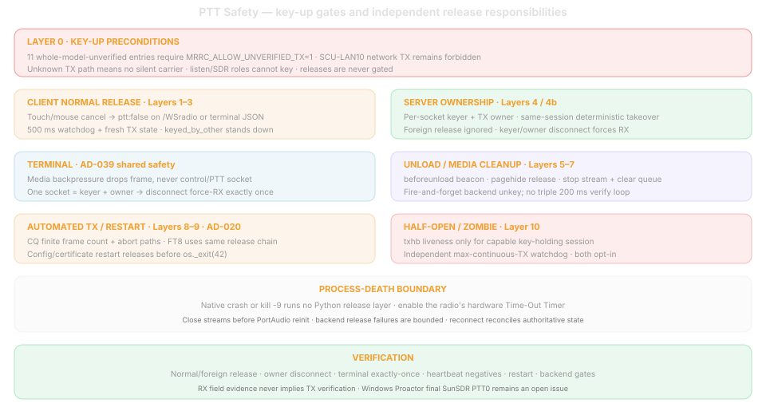

# 15. PTT Safety Architecture (ART 0535)

> **Principle**: Release is more safety-critical than keying. A lost PTT release command can leave a radio transmitting indefinitely — causing harmful interference, overheating the radio, and violating spectrum regulations. Every layer must have an independent path to force RX.

## 15.1 Safety Model — Defense in Depth

The MRRC Modern PTT safety architecture provides multiple independent release layers against stuck-TX scenarios for every supported backend, preceded by configuration/backend preconditions (Layer 0) that decide whether a path may key at all. The layers below are numbered by responsibility, not by a claim that any one count is sufficient.

| Layer | Location | Mechanism | Failure Mode Caught |
| ------- | ---------- | ----------- | --------------------- |
| 0 | Server (backend, precondition) | `set_ptt(True)`/`set_tune(True)` enforce AD-019 and backend-specific media gates. Whole-model unverified radios require `MRRC_ALLOW_UNVERIFIED_TX=1`; SCU-LAN10 network TX is still refused even with that opt-in because its TX audio is unknown. Releases are never gated | Keying an unmeasured model or producing a silent network carrier |
| 1 | Browser UX | Touch-and-hold: release on `mouseup`/`touchend`/`mouseleave`/`touchcancel` | User intentionally releasing PTT |
| 2 | Client → Server | `sendCommand('ptt', false)` over `/WSradio` or unchanged terminal control JSON | Normal network path |
| 3 | Browser | PTT Watchdog: 500 ms interval checks authoritative `tx_status`; up to 3 retries; foreign-keyer push stands it down | Release command/state broadcast lost without unkeying another client |
| 4 | Server | Per-socket dead-man and ownership: keyer/uplink-owner disconnect forces RX even if other clients remain. Same-session TX replacement is deterministic and different sessions cannot steal. `/WSterminal` keyer and owner are the same socket, so its single cleanup forces RX **exactly once**, then removes all four logical registrations | Browser/terminal crash, tab close, network loss, audio socket drop and multi-client ownership |
| 4b | Server | `_ptt_key_ws` accepts only the keyer's own release while keyed; foreign `ptt:false` gets authoritative `tx_status` + `ptt_keyed_by_other` | Idle tab watchdog unkeying the live operator |
| 5 | Browser | `beforeunload` → `navigator.sendBeacon()` release attempt | Tab/browser close during TX |
| 6 | Browser | `pagehide` → `sendCommand('ptt', false)` | Mobile app switch/backgrounding |
| 7 | Server + Browser | Stop TX audio, clear queue, send `s:` where applicable | Audio continuing after release |
| 8 | Server | One-touch CQ and other automated TX have finite ends and abort on initiator/last-client disconnect, external release or shutdown | No operator finger on PTT |
| 9 | Server (restart path) | `_schedule_restart()` releases PTT with a bounded call before `os._exit(RESTART_EXIT_CODE)` and tolerates degraded/missing controller attributes | Config/certificate restart while keyed |
| 10 | Server (hub/timeout extension) | Opt-in TX heartbeat liveness and independent maximum-continuous-TX watchdog release only the eligible owner/session | Half-open NAT/Wi-Fi connection or connected-but-hung client |

**The release layers are not the whole story — the process must survive to run them (2026-10-16).** Every layer above assumes a live server process. A field report (`按发射 → 电台一直发射 → MODERN SERVER 进程消失`, Windows 11 + FT-710) showed how the two interact: `ptt:true` keys the radio **before** the TX audio stream is opened, and `audio_handler.start_tx()`'s USB-re-enumeration recovery (`_reinit_pyaudio()`) called `Pa_Terminate()` while the RX capture stream was still being read on the event-loop thread — a use-after-free, i.e. a native access violation that kills the process with **no Python traceback**, so none of Layers 2–9 ever runs and the radio stays keyed. The fix is to close both streams under a lifecycle lock (`_stream_lock()`) before terminating PortAudio, to take that lock non-blockingly in `read_rx_chunk()`, and to treat a *raised* `start_tx()` as a release trigger in the `ptt:true` handler. The operational lesson stands regardless: when the process itself can die, the radio's own Time-Out Timer (TOT) is the only layer that survives it.

**Removed layer — Triple TX0 Verify (removed in V1.2, 2026-07-08):** earlier releases queried `TX;` three times at 200ms intervals after every release and re-sent `TX0;` on non-zero. This added ~600ms to every release, and field observation showed the radio obeys `TX0;` on the first write (fire-and-forget). Stuck-keyup detection is now covered by the server-side TX-status poll (500ms) feeding the browser PTT watchdog (Layer 3).



## 15.2 Layer Details

**Layer 0 (AD-019 plus backend-specific gates): key-up eligibility.** The active backend decides key-up on every attempt. The 11 whole-model-unverified registry entries (experimental Icom/Yaesu, G7250, SunSDR2 DX and FlexRadio) require `MRRC_ALLOW_UNVERIFIED_TX=1`; the settings page can apply that opt-in without a restart, using exact confirmation. This is not a blanket capability override: SCU-LAN10 network mode still refuses PTT/TUNE because its 668-byte TX audio frame is unknown, and a backend that cannot prove a supported mode/path refuses rather than emit a silent carrier. Partial real-radio RX evidence (including FLEX-6600 and FTDX101MP) does not clear the whole-model flag. PTT **releases are never gated**, so every layer below can always unkey.

### Layer 1: Touch-and-Hold UX

PTT only transmits while the user is actively touching the PTT button:

```javascript
pttBtn.addEventListener('mousedown', handlePTTStart);
pttBtn.addEventListener('touchstart', function(e) { e.preventDefault(); handlePTTStart(); });
pttBtn.addEventListener('mouseup', handlePTTEnd);
pttBtn.addEventListener('touchend', function(e) { e.preventDefault(); handlePTTEnd(); });
pttBtn.addEventListener('mouseleave', handlePTTEnd);
pttBtn.addEventListener('touchcancel', handlePTTEnd);
```

### Layer 2: Normal WebSocket Command

```javascript
function handlePTTEnd() {
    sendCommand('ptt', false);
    // ...
}
```

Server receives `{"type":"set","field":"ptt","value":false}` → sends the backend-specific PTT unkey command (FT-710 CAT `TX0;`, IC-7300/MK2 CI-V 0x1C 0x00 unkey) fire-and-forget (see removal note in §15.1).

### Layer 3: PTT Watchdog (Browser)

```javascript
// ptt_manager.js
pttVerifyTimer = setInterval(function() {
    if (!pttActive && !tuneActive) {
        if (radioState.tx_status !== 0) {
            retries++;
            sendCommand('ptt', false);
            if (retries >= 3) {
                // Force locally
                radioState.tx_status = 0;
                radioState.is_transmitting = false;
                renderPTTState();
                renderStatusBar();
                stopPTTWatchdog();
            }
        } else {
            stopPTTWatchdog();
        }
    }
}, 500);
```

The watchdog's input is the server-side TX-status poll (500ms), which keeps `radioState.tx_status` fresh even if the release command's state update was lost. The same ownership/dead-man logic applies to the IC-7300/MK2 backend, where PTT key/unkey is sent as CI-V 0x1C 0x00 frames.

**Cross-client false positive (fixed 2026-09-25, SDD I6 PTT half):** the watchdog cannot tell "my release did not land" from "another client just keyed" — with two tabs open, the idle tab's watchdog re-sent `ptt:false` on the *other* tab's key-up and unkeyed the live transmission (field log: 75 TX sessions in 5 minutes, 16 with zero mic frames, three releases 30 ms apart). Two layers now stop this: the server ignores a release from any socket that is not the current keyer (`_ptt_key_ws`, Layer 4b) and pushes the authoritative `tx_status` back with `ptt_keyed_by_other: true`; on that flag the browser calls `PTTManager.cancelWatchdog()` and stands down instead of retrying.

### Layer 4: Dead-Man Switch (Server)

```python
# In /WSradio disconnect handler:
if not ctrl_clients and radio.is_transmitting and backend and backend.connected:
    logger.warning("Last client disconnected during TX! Forcing RX.")
    await backend.set_ptt(False)
    radio.update(tx_status=0)
    if audio:
        audio.stop_tx()
```

**Uplink ownership is per socket, but a session token is not (fixed 2026-10-05, SDD I6 uplink half):** the token is a 30-day cookie, so ONE browser session can hold several `/WSaudioTX` sockets at once — a page reload leaves its predecessor half-open for tens of seconds, and two tabs of one login share the token outright. `_claim_tx_owner_for_token()` resolved that token by taking the **first** match scanned out of `audio_tx_clients`, a set, so the key-up claim was decided by iteration order. Field log 2026-10-05 on a hub instance: the claim landed on the dead predecessor, `TX audio ownership → PTT client` was logged as usual, and the reloaded page's every mic frame was then dropped as non-owner — `frames=0 non_owner_drops=236`, `peak=0%` (a keyed carrier with no modulation) for 58 s, until the stale socket was reaped and `_promote_tx_owner()` handed the uplink to the survivor (`frames=78 written=72 peak=99%`). Two layers now:

- **Deterministic claim** — `_register_tx_socket()` records each socket's connect order and the key-up claim takes the **last-connected** socket of that session, which is what "a same-session replacement audio socket supersedes a half-open page-reload socket" always meant; a first-match scan only ever satisfied it by luck.
- **Streaming takeover** — `_same_session_uplink_takeover()` hands the uplink to a non-owner socket whose token equals the owner's, on the first frame it actually streams. This covers the case a connect-time rule cannot: two same-session sockets that are *both* live, where the operator happens to work in the one that connected first. Self-heals within one 20 ms frame instead of muting the whole transmission.

A **different** session still cannot steal an active uplink — neither by connecting (`_assign_tx_owner_on_connect`) nor by streaming at it — because interleaving two microphones into one playback queue is exactly what the single-owner guard exists to prevent. Ownership moving away from a socket also keeps the dead-man switch correct: the `finally` block only forces RX when the socket that disconnects *is* the owner (`TXUplinkOwnershipTests`).

**Single-socket terminal (AD-039):** an operator `/WSterminal` is registered as control, RX and TX at once, so its media ingress uses `_feed_tx_uplink_frame()` and exactly the same owner rules. A media send timeout drops only that audio/spectrum frame; it must not close the socket that carries PTT release. On disconnect, `_terminal_disconnect()` first determines `was_keyer` and `was_owner`, clears both authorities and all logical registrations, and executes one shared force-RX branch. This avoids the otherwise possible duplicate unkey/warning from the keyer and owner rules firing on the same object. A plain RX/listen terminal disconnect never touches PTT.

**ATR1000 tune assist (server-side TX2 keying):** the optional ATR tune assist (`_atr_tune_assist()`, §9.8) keys a TX2 carrier server-side for up to 45 s (ATR_TUNE deadline). Safety: the carrier drop is guaranteed by a `finally` block on every exit path (skip/success/rollback/error); the Layer 4 last-client-disconnect dead-man switch still applies while the carrier is up; an SWR≤1.6 gate skips tuning entirely; relays roll back when SWR does not improve. All ATR I/O runs in its own asyncio task — never on the audio path.

### Layer 4b: Control-Plane PTT Arbitration (Server)

The TX-audio uplink has had a single owner since V2.4x; the **control plane** did not — any full-control client could send `ptt:false` at any time (last-writer-wins, SDD I6). Since 2026-09-25 the socket that sends `ptt:true` is recorded as `_ptt_key_ws`, and while it holds the key:

```python
# /WSradio "set ptt" handler:
if not _ptt_release_allowed(ws):        # ws is not the keyer
    # ignore the release, push the authoritative state back:
    await ws.send_text(json.dumps({
        "type": "stateUpdate",
        "fields": {"tx_status": radio.tx_status},
        "dirty": ["tx_status"],
        "ptt_keyed_by_other": True,     # browser watchdog stands down
    }))
    return
```

- A key-up from any client is still honored (takeover by re-keying), and the keyer's own release always passes — the stuck-keyup retry path (Layer 3) is untouched.
- `_ptt_key_ws` is cleared on every server-initiated unkey: normal release, audio-open-failure unkey, `MRRC_PTT_MAX_TX_SECONDS` watchdog, /WSaudioTX owner-disconnect force-RX.
- **Zombie keyer:** when the keying control socket disconnects mid-TX the server forces RX immediately — even with other clients still connected (they are not the keyer, and their releases are exactly what the arbitration ignores). Mirrors the /WSaudioTX owner rule.
- Trade-off: while a keyer is connected but unresponsive (browser frozen, socket alive), other clients cannot unkey it; the coverage is the keyer-disconnect rule, the Layer 4 dead-man, and the opt-in `MRRC_PTT_MAX_TX_SECONDS` watchdog.
- Tests: `PTTControlArbitrationTests` (tests/test_server_ws_protocol.py).

**ATR1000 auto full tune (no self-keying):** the high-SWR guard (`atr1000_client.py`, §9.8 behaviour 4) never keys the radio — it only acts while the operator is already transmitting (measured power ≥5 W) and emits nothing but an ATR-1000 tune frame; `atr1000_client.py` holds no CAT/PTT reference at all (a source-level test pins this). The manual assist's TX2 carrier path above is unchanged and remains the only ATR-initiated keying, with its `finally` drop rule.

### Layer 5: Beforeunload Beacon

```javascript
window.addEventListener('beforeunload', function() {
    if (pttActive || tuneActive) {
        if (navigator.sendBeacon) {
            const blob = new Blob([
                JSON.stringify({type:'set', field:'ptt', value:false})
            ], {type: 'application/json'});
            navigator.sendBeacon('/WSradio', blob);
        }
    }
});
```

### Layer 6: Pagehide Handler

```javascript
window.addEventListener('pagehide', function() {
    if (pttActive || tuneActive) {
        sendCommand('ptt', false);
    }
});
```

### Layer 7: TX Audio Stream Stop

Server-side on PTT release:

```python
if audio:
    audio.stop_tx()
```

Browser-side on PTT release:

```javascript
function stopTXAudio() {
    txAudioRunning = false;
    // ...
    if (wsAudioTX && wsAudioTX.readyState === WebSocket.OPEN) {
        wsAudioTX.send('s:');  // Flush server TX queue
    }
}
```

### Layer 8: Server-Side CQ Call (AD-020)

The CQ key transmits without a human holding PTT, so it is the one path where
"the operator lets go" cannot be the safety net.  Instead the *player* is the
safety net:

- The call is a single finite asset (<= 30 s guard) played once; the player
  knows the frame count, so `complete` is reached by arithmetic, not by a timer.
- While it runs, a manual key-up (PTT), a second CQ start, and TUNE are all
  refused — one carrier, one source.
- Any external release of the carrier (`MRRC_PTT_MAX_TX_SECONDS` watchdog,
  TUNE, another client, dead-man switch) is observed through
  `radio.is_transmitting` and ends the call as `aborted`/`unkeyed`.
- The initiator's disconnect aborts immediately (`reason:"client_gone"`),
  never leaving a bystander's carrier on the air.
- `cq:false` cuts the tail (no graceful drain) because the operator asked to
  stop *now*; a natural end drains gracefully so the last syllable is not
  chopped.

## 15.3 Safety Flow Diagram

```text
Normal Release Path:
  PTT Button Release (any trigger)
    → handlePTTEnd()
      → sendCommand('ptt', false)          [Layers 1+2]
      → stopTXAudio() + wsAudioTX.send('s:') [Layer 7]
      → Server: backend-specific PTT unkey command (fire-and-forget)
      → Server: TX-status poll (500ms) tracks RX
      → PTT Watchdog starts                 [Layer 3]

Emergency Paths:
  Browser crash / tab close:
    → beforeunload → sendBeacon PTT=false;  [Layer 5]
    → pagehide → sendCommand PTT=false;     [Layer 6]
    → WS disconnect → server dead-man switch [Layer 4]
    → Server stops TX audio                 [Layer 7]

  Network loss during TX:
    → WS disconnect → server dead-man switch [Layer 4]
    → Server stops TX audio                 [Layer 7]
    → Radio returns to RX (protocol timeout)
```

## 15.4 Testing the Safety Layers

| Test | Expected Behavior | Layers Tested |
| --- | --- | --- |
| Normal PTT press/release | TX → RX without a post-release verification delay | 1, 2 |
| Foreign client sends `ptt:false` | Live keyer stays keyed; sender receives authoritative keyed-by-other state | 4b |
| Keyer or TX owner disconnects | Force RX even when other clients remain | 4 |
| Force-close browser during TX | Release beacon/disconnect paths return to RX | 4, 5, 6 |
| Network packet loss during release | Browser watchdog re-sends using fresh TX-status state | 3 |
| Terminal media backpressure | Drop media, retain control/PTT socket | 4, AD-039 |
| Terminal keyer/owner disconnect | Clean every registry and force RX exactly once | 4, AD-039 |
| Half-open heartbeat-capable session | Only the key-holding session times out and releases | 10 |
| Non-heartbeat/legacy client | Never gated merely for lacking `txhb` | 10 |
| Restart request during TX | Release completes before process replacement | 9 |
| Pull USB/network cable during TX | Software cannot guarantee delivery while the link is gone; reconnect reconciles state and hardware TOT is required for process/link catastrophe | Hardware boundary |
| Server `kill -9` during TX | No Python layer runs; radio hardware TOT is the only surviving mitigation | Hardware boundary |

## 15.5 Safety Design Principles

1. **Release is more important than keying.** Every release path works even if key-up/media negotiation is broken.
2. **No claimed single count guarantees safety.** Layers address different faults and process death remains a hardware-TOT boundary.
3. **Fail safe, not fail dangerous.** If a backend cannot prove its key-up/media path, refuse key-up; if releasing, do not wait for repeated proof.
4. **Server owns arbitration.** Browser state alone cannot decide whose carrier may be released.
5. **Read state without blocking release.** Poll/status/watchdog provide subsequent evidence; the V1.2 fire-and-forget release remains authoritative.
6. **Media congestion is not a reason to kill control.** This is explicit for AD-039's multiplexed terminal socket.
7. **Hardware evidence is scoped.** RX success does not lift a model's TX gate and the global opt-in does not override an unknown TX protocol.

## 15.6 Hub-Mode Liveness Extension (implemented, opt-in)

V2.62 identified the missing failure mode; **V2.63 implemented it**. Layer 4 requires an actual WebSocket disconnect, while dropped NAT entries, Wi-Fi changes and silently discarded packets can leave a half-open socket alive. The original `MRRC_PTT_MAX_TX_SECONDS` fallback also shipped disabled. Hub mode therefore uses two independent controls, not a cloud-dependent release:

| Failure | Local coverage |
| --- | --- |
| Browser/process close or TCP RST | Layer 4 disconnect path |
| Half-open connection during TX | `MRRC_REMOTE_SESSION_TX_HEARTBEAT_S` for sessions that actually send `txhb` |
| Connected-but-hung/zombie transmission | `MRRC_PTT_MAX_TX_SECONDS`, independently optional |
| Server process/native crash | No software path; enable the radio's hardware Time-Out Timer |

`MRRC_REMOTE_SESSION_TX_HEARTBEAT_S` defaults to 0 (off). The server `_tx_liveness_watchdog()` ticks at 0.25 s; heartbeat-capable browsers send `{"type":"txhb"}` every 500 ms during PTT/TUNE. Detection latency is bounded by threshold + one tick. Three deliberate negative cases remain: a client that never declares `txhb` is not gated; a stale listener cannot release another session's carrier; and a just-keyed session with no first heartbeat yet is not immediately treated as stale. Release is one fire-and-forget `set_ptt(False)` with state/media cleanup, never a verify loop. Terminal control uses the same `txhb` message and keyer state.

`MRRC_PTT_MAX_TX_SECONDS` is a maximum-duration policy, not a liveness protocol. Hub deployments should set both deliberately and validate the `mrrc_hub/SDD/15-ptt-safety-hub-mode.md` injection matrix, including single-packet loss and foreign-listener negative cases. The historical proposal values (for example a fixed 1.0 s heartbeat threshold) are not current defaults; `config.py` and the running instance are authoritative.
