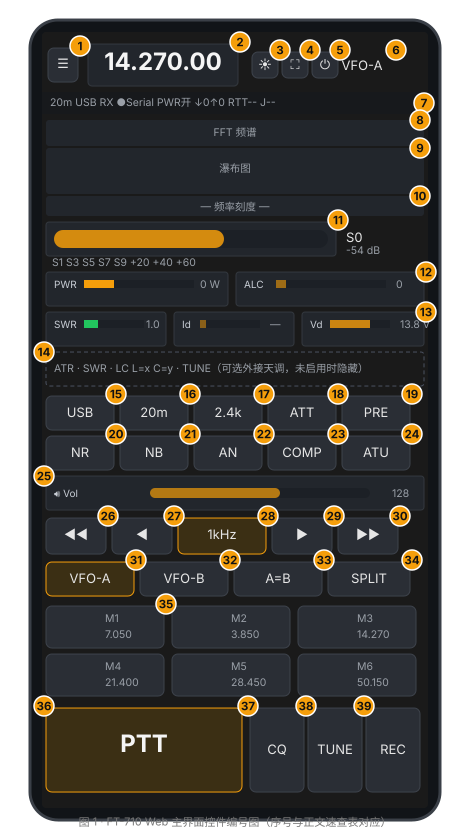
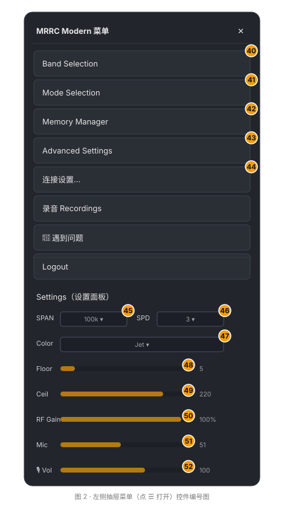

# MRRC Web 遥控 — 操作指南

> 适用于当前 MRRC Modern 界面（**基线 v1.28.x**；**权威版本号是安装目录里的 `version.txt`** —— 菜单底部那个 `v1.0` 是前端资源串，见 §0.10）。支持 Yaesu FT-710、Icom IC-7300 / IC-7300MK2（另含 IC-705 / IC-7610 / IC-7760 预览配置）与 Yaesu SDR 机型族 FTDX10 / FTDX101D / FTDX101MP / FTX-1F / FT-891（实验性、默认只收不发，`MRRC_ALLOW_UNVERIFIED_TX=1` 解锁；这些机型无真机频谱源，界面用 S 表合成频谱。**FT-891 另有两个例外**：USB 口只做 CAT、不带 USB 声卡，音频须外接接口到 DATA/ACC 口并在设置里显式选设备；无内置天调，界面不显示 ATU 键，TUNE 发载波供外接天调调谐）。本文档逐项说明界面上每一个按钮、滑杆、下拉框的功能与用法，编号与文末插图（图 1 主界面、图 2 菜单）中的琥珀色序号一一对应。云端接入见 §0.9，版本与更新见 §0.10。

---

## 0. 开始之前：连接与登录

| 步骤 | 说明 |
| ------ | ------ |
| 1. 启动服务 | 在电台电脑上运行 `python server.py`（或 Windows 安装版/桌面启动器），服务默认监听 `0.0.0.0:8888`，HTTPS 优先（首次运行自动生成自签名证书）。 |
| 2. 打开页面 | 手机/电脑浏览器访问 `https://<服务器IP>:8888`。**两处都写 `https://`** —— 服务只为 TLS 监听，同一端口的明文 HTTP 不应答（v1.24.5 的"装完黑屏"正是这么来的：启动器把人送到 `https://`，而服务器退回了 `http://`）。自签名证书首次会警告一次，点「继续」即可。默认监听所有接口（`MRRC_WEB_HOST=0.0.0.0`），所以局域网内直接用 IP 就能打开；只想本机可达就把它改回 `127.0.0.1`。iPhone 上建议用 Safari 并「添加到主屏幕」以获得 PWA 全屏体验。 |
| 3. 登录 | 输入共享密码（服务启动时由 `MRRC_WEB_PASSWORD` 或安装向导设置），点 **Login**。成功后在 `mrrc_auth` Cookie（30 天有效）；密码错误返回 401，5 分钟内连续 5 次失败会触发 429 限流，需等待后再试。 |
| 4. 建立连接 | 手机端：点顶栏 **⏻** 开始连接（见控件 5）；桌面端打开页面后自动连接。状态栏 ●Serial 变绿表示与电台的 CAT 串口已连通。 |

> ⚠️ 顶栏 **⏻** 只控制浏览器与服务器的 Web 连接，**不是**电台电源开关。电台电源在 ☰ 菜单里，
> 分成「重开电台…」与「关机…」两项（见 §2.11 末尾）——为什么要分成两项、以及为什么开机不保证成功，那里写清楚了。
> 页头状态栏的 `PWR 开/关`（救援期间显示 `PWR 唤醒中 N`，点一下可取消）反映的是电台真实的电源状态。

---

## 0.5 电台型号差异

服务器通过 `MRRC_RADIO_MODEL` 选择后端，前端会根据后端上报的 `capabilities` 自动调整可用控件。
已注册的型号键（连接设置对话框的下拉列表与之一致）：

- **完全支持**：`ft710`（Yaesu FT-710）、`ic7300`（Icom IC-7300）、`ic7300mk2`（IC-7300MK2）
- **实验性（默认只收不发，`MRRC_ALLOW_UNVERIFIED_TX=1` 解锁）**：Icom CI-V 族 `ic705` / `ic7610` / `ic7760`；
  Yaesu ASCII-CAT 族 `ftdx10` / `ftdx101d` / `ftdx101mp` / `ftx1`（FTX-1F）/ `ft891`（FT-891）

**选型只有一条硬规矩（v1.28.2 起）**：连接设置里选中的机型会被**保留**，启动器的串口探测只填空、
不会覆盖它 —— 在此之前任何不在旧白名单里的机型（FT-891 / FTX-1 / FTDX10 / IC-705 / 7610 / 7760）
每次启动都会被改回 `ft710`，然后用 FT-710 的后端去驱动它（现场症状正是"选了 FT-891 但什么都对不上"）。

**Yaesu 族的串口速率**：FT-710/FTDX/FTX-1 出厂 38400；**FT-891 的菜单 05-06 `CAT RATE` 出厂是 4800**
（Yaesu 手册；常见改法是 38400）。配置的速率下电台一个字节都不回时，控制器会自己按
4800 → 9600 → 19200 → 38400 试一遍，命中后**本次会话**就用它并在日志里留一条告警 ——
它不会改你的配置文件；要让下次启动也用对，把电台菜单和连接设置改成一致即可。

下表以最常用的两台为例对比；**CI-V 族（ic7300/mk2/705/7610/7760）行为对齐 IC-7300 一列**
（细节按型号配置档略有差异，如 IC-7610/7760 的 ATT 为 0–45 dB 每 3 dB 一档、频谱几何不同），
**Yaesu ASCII-CAT 族行为大体对齐 FT-710 一列**，但无 FT4222/CI-V 真频谱源，界面一律用 S-meter 合成频谱。

| 功能 | FT-710 | IC-7300 / IC-7300MK2 |
| ------ | -------- | --------------------- |
| 串口协议 | Yaesu CAT，38400 baud | Icom CI-V，115200 8N1，默认地址 `0x94` |
| 频谱来源 | FT4222 SPI（或 S-meter 回退） | CI-V `0x27` 帧（或 S-meter 回退） |
| USB 音频 | 44.1 kHz，需重采样到 48 kHz | 48 kHz，无需重采样 |
| AN（自动陷波） | 有 | **无**，界面隐藏 |
| Vd / Id 仪表 | 有 | **无**，界面隐藏 |
| 滤波器 | 多档语音/窄带宽度 | FIL1–FIL3 循环 |
| ATT | `OFF` / `6dB` / `12dB` / `18dB` 四档 | `OFF` / `20dB` 两档（7610/7760 为 3 dB 步进 16 档） |
| VFO-B 直接选择 | 有 | 无 |
| 内置天调 | 无（ATU 键控制外接 FC-40 类天调；也可外接 ATR1000） | 有 |
| 70 MHz | 无 | 视地区版本而定 |
| 发射时频谱 | 暂停并显示「频谱暂停」 | 继续显示（CI-V 频谱不受发射影响） |

---

## 0.6 Windows 配置与运行

本章说明 IC-7300 与 FT-710 在 **Windows 桌面版（MRRC-Modern-Setup.exe）** 下分别如何配置并使其工作：装驱动 → 确认串口 → 编辑配置 → 电台侧设置 → 启动验证。

> 配置统一写在 `%LOCALAPPDATA%\MRRC-Modern\mrrc_modern.env`（开始菜单里的 **Edit Configuration** 快捷键会打开它）。变量名用新的 `MRRC_*` 前缀；旧的 `FT710_*` 前缀仍被兼容接受（`MRRC_*` 优先），升级用户可保留原配置。修改后需重启 MRRC Modern 生效。

### 0.6.1 通用步骤（两台都适用）

1. 安装 **MRRC-Modern-Setup.exe**（开始菜单出现 `MRRC Modern` 与 `Edit Configuration` 两个快捷方式）。
2. 用 USB 线连接电台到电脑，并**开机**。
3. 打开 **设备管理器**，在「端口 (COM 和 LPT)」下确认电台的串口：
   - **IC-7300**：一个 COM 口（USB CI-V）。
   - **FT-710**：两个 Silicon Labs CP210x COM 口（较低编号通常是 CAT 用的 Enhanced COM Port）。
4. 打开 `mrrc_modern.env`，设置 `MRRC_RADIO_MODEL`（`ic7300` / `ic7300mk2` / `ft710`，或 §0.5 列出的其它实验性型号键），并确保 `MRRC_SERIAL_PORT` 指向第 3 步确认的串口。
5. 启动 `MRRC Modern`，浏览器自动打开登录页。输入 `MRRC_WEB_PASSWORD` 后，状态栏 ●Serial 变绿即表示 CAT 已连通。

> 换电台时**不需要重装**：改 `MRRC_RADIO_MODEL` 和串口/波特率即可，其余步骤照对应小节核对。

### 0.6.2 IC-7300 / IC-7300MK2

**驱动**：IC-7300 用标准 Windows USB-serial 驱动（通常自动安装），**不需要** FTDI 驱动。

**设备管理器确认**：「端口 (COM 和 LPT)」显示一个 COM 口，即 USB CI-V。

**`mrrc_modern.env` 完整示例**：

```ini
MRRC_RADIO_MODEL=ic7300        # 或 ic7300mk2
MRRC_SERIAL_PORT=COM5          # 改成设备管理器里看到的 CI-V COM 口
MRRC_BAUD_RATE=115200
MRRC_WEB_HOST=0.0.0.0        # 随包默认值（所有接口）；改成 127.0.0.1 则仅本机可达
MRRC_WEB_PORT=8888
MRRC_WEB_PASSWORD=change_this_password
MRRC_AUDIO_RX_DEVICE=USB Audio
MRRC_AUDIO_TX_DEVICE=USB Audio
# IC-7300 地址覆盖（默认 0x94）：
#IC7300_CIV_ADDR=0x94
# IC-7300MK2 地址覆盖（默认 0xB6）：
#IC7300MK2_CIV_ADDR=0xB6
# IC-7300 用 CI-V 0x27 频谱，无需 FTDI 库——删掉/注释 MRRC_FTDI_LIB_DIR
```

**电台侧设置**（面板菜单，开机时设置一次）：

- `CI-V USB Port` = **Unlink from [REMOTE]**。
- `CI-V USB Baud Rate` = **115200**，必须明确选择 115200，不能保留 `Auto`；Icom 规定 `27 11` 波形输出仅在 Unlink + 115200 下可设置。选择 `ic7300`/`ic7300mk2` 后服务端默认即为 115200；显式设置 `MRRC_BAUD_RATE` 时必须一致。
- `CI-V Address`：IC-7300 默认 **94h**（`IC7300_CIV_ADDR`）；IC-7300MK2 默认 **B6h**（`IC7300MK2_CIV_ADDR`）。
- 建议开启 `CI-V Transceive`（连接时服务端会按型号自动发送开启命令：IC-7300 项目 0071，MK2 项目 0089）。
- **`SET` → `Connectors` → `MOD Input`（语音发射必查：这一组不对，PTT 按下只有载波、没有调制）**：
  - `DATA OFF MOD` = **`USB`** —— **非 DATA 模式**（SSB / AM / FM 语音）的调制输入源。停在 `MIC` 时对方听到的是「有发射、没声音」（FM 死载波），SSB 则表现为「功率很小或没有」（SSB 无调制＝无射频功率）。想同时保留手咪就选 `MIC, USB`。
  - `DATA MOD` = **`USB`** —— 数字 / DATA 模式的调制输入源。
  - `USB MOD Level` = **50 左右**（不要为 0）—— USB 调制输入电平。
- `SET` → `Connectors` → **`USB SEND` 保持 `OFF`**（MK2 同组另有 `USB Keying (CW/RTTY)`）：它把 USB 口的 DTR/RTS 当作 PTT，一旦设为 `USB(A) DTR/RTS`，电脑打开串口就等于按下 PTT。
- 接收侧：`SET` → `Connectors` 里的 USB 音频输出选择保持 **AF**（不是 IF）、输出电平不为 0，否则网页接收无声（日志出现 `RX audio is near-silent`）。

**音频**：IC-7300 的 USB 音频是 **48 kHz 原生**，服务端直接透传，**无需重采样**。Windows 下该声卡以 `USB Audio CODEC` / `USB Audio Device` 形式枚举（本地化系统可能是「麦克风 (USB Audio Device)」）。`MRRC_AUDIO_RX_DEVICE` / `MRRC_AUDIO_TX_DEVICE` 填 `USB Audio` 即可同时匹配两种形式。启动及 RX/TX 打开日志会列出 `host`、`default`、`actual`、`channels`；IC 正常值应为 `actual=48000Hz`。

**频谱**：来自 CI-V `0x27` 帧，走 CAT 串口，**不需要 FT4222**。启动时依次发送 Scope Display ON（`27 10 01`）、Center、±100 kHz Span、Data Output ON（`27 11 01`）；两个 ON 开关缺一不可。分片队列最多保留 44 个片段，积压时丢弃最旧数据；WebSocket 以 30 Hz 调度且只发送新完成的真实帧。菜单 SPAN 可调跨度，SPD 对 IC 只提供 FAST/MID/SLOW。

**验证清单**：

1. 状态栏 ●Serial 变绿。
2. 频率、模式、S 表跟随电台面板变化（面板改动也会回传——Transceive）。
3. 浏览器能听到接收声音（📶 音量滑杆、状态栏无「无声」告警）。
4. 瀑布图有信号（频谱来自 CI-V `0x27`；发射期间**仍会刷新**，这是与 FT-710 不同之处）。
5. 长按 PTT 说话，功率/ALC 表有反应（首次发射请用小功率确认）；**ALC 表不动＝调制没进来**，回去核对上面的 `MOD Input` 三项。

### 0.6.3 FT-710

**驱动**：

- **必须**：Silicon Labs CP210x Universal Windows Driver（CAT 串口用）。
- **可选**：FTDI D2XX 驱动 —— 仅当需要 **FT4222 真频谱**时。没装则自动回退到 S-meter 合成频谱（可用但不含真实 FFT 数据）。

**设备管理器确认**：「端口 (COM 和 LPT)」显示**两个** Silicon Labs CP210x COM 口。**较低编号**的那个通常是 CAT 用的 **Enhanced COM Port**；另一个是 FT4222 频谱口（`MRRC_SCOPE_PORT`，留空即自动探测）。

**`mrrc_modern.env` 完整示例**：

```ini
MRRC_RADIO_MODEL=ft710
MRRC_SERIAL_PORT=COM3          # 改成 Enhanced COM Port（两个 CP210x 里较低编号）
MRRC_BAUD_RATE=38400
MRRC_WEB_HOST=0.0.0.0        # 随包默认值（所有接口）；改成 127.0.0.1 则仅本机可达
MRRC_WEB_PORT=8888
MRRC_WEB_PASSWORD=change_this_password
MRRC_AUDIO_RX_DEVICE=USB Audio
MRRC_AUDIO_TX_DEVICE=USB Audio
MRRC_FTDI_LIB_DIR=vendor\ftdi\windows\bin\x64
#MRRC_SCOPE_PORT=              # 留空自动探测 FT4222 频谱口
```

**电台侧设置**（FT-710 面板，四项都设好再开始）：

1. **`FUNC` → `RADIO SETTING` → 各模式 `MOD SOURCE` = `USB`**。SSB 必设；AM / FM / PSK/DATA 若要用也设 USB，否则 PTT 按下没有调制。
2. **`FUNC` → `RADIO SETTING` → `RPTT SELECT` = `OFF`**。PTT 由 CAT 命令控制，不走 RTS/DTR。
3. **`FUNC` → `OPERATION SETTING` → `GENERAL` → `SCU-LAN10` = `ON`**，并把同一页最底下那条
   **`CAT-1 RATE` = `38400`**。本服务端走 USB CAT（`MRRC_BAUD_RATE=38400` 要与之相同），
   但**很多第三方远程软件靠 SCU-LAN10 这条通道取频谱**；把 CAT-1 速率固定成 38400，
   两边（本项目与第三方）就都读得懂，不必来回改菜单。
4. **`FUNC` → `OPERATION SETTING` → `GENERAL` → `TX TIME OUT TIMER`（TOT，发射超时定时器）**：
   连续发射到设定时间后**自动切回接收**，防止 PTT 卡住打出一条长时间的死载波。

**TOT 怎么设**：`FUNC` 旋钮 → `OPERATION SETTING` → `GENERAL` → `TX TIME OUT TIMER` →
旋转 `FUNC` 或点数值两侧的 `<` / `>` 选值 → **再按一下 `FUNC`**（或等约 3 秒自动保存）→
多点几次 `BACK` 回到正常画面。可选 `OFF` 或 **1–30 分钟**；出厂默认 `OFF`（欧洲版默认 10 分钟）。

**设好后的表现**：只要开始发射就倒计时，快到点时**提前约 10 秒「嘀」一声**提醒，时间一到
强制回到接收状态。远程操作建议设 **3 分钟**做兜底；**FT8 / RTTY 这类长时间连续发射的数字模式
建议设 `OFF`**，否则一个时隙序列会被中途切断。

> **别设错的那一项**：同一页里还有 `CAT-1` / `CAT-2` / `CAT-3` 的 `TIME OUT TIMER`，
> 那是 **CAT 指令超时**（单位毫秒），与发射超时是两码事。名字很像，位置相邻。

**两层兜底各管一段**：电台侧 TOT 管「物理上不许一直发」，服务端 `MRRC_PTT_MAX_TX_SECONDS`
（W103D 镜像默认 `120`）管「远端会话断了也要松键」。两个都开才是完整的——只开一个，
另一条路上仍然可能留下长发射。

**音频**：FT-710 的 USB 音频是 **44.1 kHz 原生**，服务端会把它重采样到 48 kHz 再走网络。Windows 下该声卡同样以 `USB Audio CODEC` / `USB Audio Device` 形式枚举，`MRRC_AUDIO_RX_DEVICE` / `MRRC_AUDIO_TX_DEVICE` 填 `USB Audio` 即可。

**频谱**：真频谱来自 **FT4222 SPI**（需要 `MRRC_FTDI_LIB_DIR` 指向含 `FT4222.dll` / `ftd2xx.dll` 的目录）；缺失时回退到 **S-meter 合成频谱**。发射期间频谱**暂停**并显示「频谱暂停」，属正常现象。

**验证清单**：

1. 状态栏 ●Serial 变绿。
2. 频率、模式、S 表跟随电台。
3. 浏览器能听到接收声音。
4. 瀑布图有信号；若只有 S-meter 合成频谱，说明 FTDI 库缺失或未指向正确目录。
5. 长按 PTT 说话，功率/ALC 表有反应（确保 `MOD SOURCE=USB`）。

### 0.6.4 常见问题（FAQ）

| 问题 | 解答 |
| ------ | ------ |
| 我该选 `ft710`、`ic7300` 还是 `ic7300mk2`？ | 看你手头的电台：Yaesu FT-710 用 `ft710`；Icom IC-7300 用 `ic7300`；IC-7300MK2 用 `ic7300mk2`。MK2 默认地址为 0xB6，且 Transceive 菜单项与普通 7300 不同，不能混选。其它型号（IC-705/7610/7760、FTDX10/101D/101MP、FTX-1F、FT-891）见 §0.5 的实验性列表 —— 默认只收不发。 |
| 换了一台电台，要重装软件吗？ | 不用。改 `MRRC_RADIO_MODEL` 和串口/波特率，重启即可。 |
| Serial 一直是红点 / 灰点 | CAT 未连通。逐项检查：电台开机、USB 线、`MRRC_SERIAL_PORT` 是否指向设备管理器里的正确串口、波特率（IC-7300=115200、FT-710=38400）与电台菜单一致。 |
| IC-7300：设备管理器里没有 COM 口 | 驱动未装或 USB 线是纯充电线。换数据线，检查「端口 (COM 和 LPT)」是否有 `USB Serial Port`。 |
| FT-710：两个 COM 口，选哪个？ | 选**较低编号**的 CP210x（Enhanced COM Port，CAT）。`MRRC_SCOPE_PORT` 留空自动探测另一个。 |
| 没声音 / 只听到电脑音箱声音 | 音频设备没锁对。把 `MRRC_AUDIO_RX_DEVICE` / `MRRC_AUDIO_TX_DEVICE` 设为 `USB Audio`；若有多台同类 USB 声卡，用启动日志里 `PyAudio initialized. Available devices:` 列出的**索引号**锁定。 |
| FT-710：瀑布图有图形但不是真频谱 | 这是 S-meter 合成频谱。确认 `MRRC_FTDI_LIB_DIR` 指向含 `FT4222.dll` / `ftd2xx.dll` 的目录，并已装 FTDI D2XX 驱动。 |
| IC-7300：瀑布图不动 | 确认 `CI-V USB Port=Unlink from [REMOTE]`、`CI-V USB Baud Rate=115200`（不是 Auto）、CI-V 地址及 `MRRC_SERIAL_PORT`，再运行 `python _diag_ic7300_scope.py <PORT> 115200 0x94`（MK2 用 `0xB6`）；脚本会开启显示+数据输出，并在退出时关闭数据输出。 |
| 状态栏出现红色「无声」 | RX 音频流 20 秒全零，电台 USB 音频接口可能卡死。重启电台或重插 USB 线。 |
| 改了配置没生效 | 改完 `mrrc_modern.env` 必须**重启 MRRC Modern**（关掉窗口重新启动）。 |
| 双击没反应 / 黑窗口一闪就没了 | 先看 `launcher.log` 与 `server.log`，再用开始菜单里的 **MRRC Modern Server** 绕开启动器判断是谁的问题 —— 见 §6.1。 |
| 卡在 `Detecting the radio on N serial port(s)` 不动 | 有一个「不是电台的串口」占着号（最典型是 Intel AMT 的 Serial over LAN）。**v1.25.0 起会跳过这类口、探测写入带 1 秒超时**，不再卡死；老版本请先在设备管理器里禁用那个口。见 §6.1 第 4 条。 |

---

## 0.7 macOS 安装与初始化

本章面向 **macOS 桌面版（`MRRC-Modern-v1.28.2-arm64.dmg`）**：安装 → 首次启动（零配置）→ 连接设置 → 局域网访问。**全程不需要打开终端、不需要编辑配置文件**；安装包把最常用的设置都做成了图形化。

> 适用：Apple Silicon（M1/M2/M3/M4），macOS 11 及以上。应用是**自包含**的，拖到「应用程序」只是标准做法；从桌面/下载文件夹直接双击也能运行。

### 0.7.1 安装（5 步）

1. 打开官网 <https://www.vlsc.net/mrrc_modern/> ，点 **Download for macOS** 下载 `MRRC-Modern-v1.28.2-arm64.dmg`（约 81 MB）。
2. 双击刚下载的 `.dmg` → 弹出窗口里看到 **MRRC Modern** 图标和一个 **Applications** 文件夹。
3. 把 **MRRC Modern** 图标**拖进 Applications** 文件夹（松手即完成安装）。
4. **第一次启动**请右键点 Applications 里的 **MRRC Modern** → 选 **打开** → 弹窗里再点一次 **打开**（因为免费签名，系统会拦一次；只第一次需要）。
5. 以后双击即可直接打开。

> **两种弹窗必须分清**（含义完全不同）：
>
> - 「**无法验证开发者**」/「无法检查是否包含恶意软件」= **正常**。本应用使用自签名（ad-hoc），系统"不认识"它 → 用第 4 步的 **右键 → 打开 → 打开** 放行一次即可，之后双击可用。
> - 「**已损坏，无法打开。你应该将它移到废纸篓**」= **不正常**：应用签名无效，**这个提示右键也绕不过去**。说明你拿到的是 **v1.18.0 或更早**的包 —— 请重新下载 **v1.18.1 或更新**版本。
>
> 详见 `docs/MACOS_INSTALLER_GUIDE.md` 第 3 章（含 `xattr` 应急解封与签名自检命令）。

> **FT-710 USB 驱动：macOS 11.3+ 免驱**（2026-09-18 实测：macOS 15.3 从未装过任何第三方驱动，内核日志显示 CP2105 `0x10c4/ea70` 由系统直接枚举）。仅 **macOS 10.11–11.2** 需要先装 Silicon Labs CP210x VCP 驱动 v6.0.3：下载 <https://www.vlsc.net/mrrc_modern/downloads/SiLabsUSBDriverDisk.dmg> → 挂载 → 双击「Install CP210x VCP Driver」→ 系统设置里批准内核扩展；**Apple Silicon 需先把启动安全性降到「允许用户管理内核扩展」**（恢复模式 → 启动安全性实用工具）——所以能免驱就不要装。验证：插入电台后 `ls /dev/cu.usbserial-*` 应出现设备。FT4222 真频谱库已随应用打包，无需另装 D2XX。

### 0.7.2 首次启动：零配置 + HTTPS

启动后**什么都不用配**，软件会自动完成：

1. 屏幕**右上角菜单栏**出现 `MRRC Modern :8888` 图标。
2. **浏览器自动打开**登录页。首次访问是 HTTPS，浏览器会提示**「连接不安全 / 您的连接不是私密连接」**——这是**正常的**，因为用的是软件自动生成的**自签名证书**：点 **高级 → 继续访问** 即可（只需这一次）。
3. 登录页顶部显示**自动生成的登录密码**；忘记就点菜单栏 **Show Password…** 随时查看。
4. 用这个密码登录，进入主界面。
5. **插上电台**（FT-710 或 IC-7300/MK2，USB 线 A→B 或 C→B）：首次运行自动探测电台型号、串口和音频设备，**插上就能用**。
6. **首次启动会弹一次「麦克风」权限询问 → 点「允许」**：这是**接收**电台声音所必需（macOS 把"音频输入"统一归入麦克风权限类，不是只有麦克风才需要）。

> **为什么需要麦克风权限？** 应用要把电台 USB 声卡收到的声音送到浏览器播放，就必须读取"音频输入"。macOS 对"未授权"的回应**不是报错，而是沉默**：捕获流照样显示"已启动"，但数据全为 0 —— 于是**控制、频谱、PTT 都正常，就是接收没有声音**。当时点了「不允许」也可以补救：**系统设置 → 隐私与安全性 → 麦克风** → 打开 **MRRC Modern**。注意**每次升级都会再问一次**（自签名应用的授权绑定当次构建，属正常现象）。

> **为什么默认 HTTPS？** 局域网里密码和遥控数据默认加密传输，避免被同网段的人抓包。自签名证书不代表"不安全"，只是浏览器不认识签名者；点一次「继续访问」即可。

### 0.7.3 连接设置（改电台 / 串口 / 音频 / 密码）

想换电台、换串口、换声卡或改密码，**不用重装、不用碰配置文件**：

1. 登录后点网页**顶栏菜单 →「连接设置…」**。
2. 在弹出的对话框里修改：
   - **电台型号**（下拉列出全部已注册型号：FT-710 / IC-7300 / IC-7300MK2 + 实验性型号，见 §0.5）
   - **串口**（下拉列表自动列出可用的 `/dev/cu.*`）
   - **RX 音频设备** / **TX 音频设备**（下拉列表列出本机音频设备，FT-710 一般是 `USB Audio Device`，IC-7300 一般是 `USB Audio Codec`）
   - **登录密码**
3. 点 **保存并重启** —— 软件自动重启生效；只点 **重启服务** 则不改设置、仅重启。

### 0.7.4 进阶：Edit Configuration（可选）

普通用户用不到。高级用户可在菜单栏 **Edit Configuration…** 用文本编辑器打开配置文件：

```
~/Library/Application Support/MRRC-Modern/mrrc_modern.env
```

- 变量用 `MRRC_*` 前缀（旧的 `FT710_*` 仍兼容）；改完在菜单栏 **Restart Server** 重启生效。
- **HTTPS 默认开启**（无需任何配置）；仅当想退回明文 HTTP 时才加一行 `MRRC_SSL=off`。
- 配置、自签名证书、记忆频道都在这一个目录里；**彻底卸载**时把应用拖进废纸篓、再删掉 `~/Library/Application Support/MRRC-Modern/` 即可完全清除。

### 0.7.5 手机 / 其他设备访问（局域网）

1. Mac 和手机连**同一个 Wi-Fi / 局域网**。
2. 查看 Mac 的 IP：**系统设置 → Wi-Fi → 详细信息 → IP 地址**（或以太网同理）。
3. 手机上浏览器打开 **`https://你的Mac的IP:8888`**（例如 `https://192.168.1.50:8888`）。
4. 首次同样会提示证书不受信任，点**高级 → 继续访问**。
5. 用登录页上的密码登录，手机就能遥控电台、看频谱、说话。

### 0.7.6 常见问题（FAQ）

| 问题 | 解答 |
| ------ | ------ |
| 双击打不开，提示「无法验证开发者」 | 右键应用 → **打开** → 再点一次**打开**（0.7.1 第 4 步）。 |
| 浏览器红色「您的连接不是私密连接」 | **正常**。自签名证书未被浏览器厂商信任，点**高级 → 继续访问**即可，只第一次出现。 |
| 「应用程序」里找不到它 | 用 Spotlight（⌘+空格）搜 `MRRC`，或 Finder → 应用程序；Launchpad 对拖入的应用有时要等一会儿才显示。 |
| 从 DMG 里运行的 app 导致安装盘弹不出 | 先**退出**那个从安装盘运行的 MRRC Modern（菜单栏 Quit），再弹出安装盘。 |
| 手机上连不上 `https://ip:8888` | 确认同一网络、IP 正确、地址写的是 `https://`（不是 http）、Mac 的防火墙允许接收连接。 |
| 换了台电台要重装吗？ | 不用。网页「连接设置…」改**电台型号 + 串口**，保存并重启即可。 |
| 串口下拉列表是空的 / 找不到电台串口 | 确认 USB 线是**数据线**（不是纯充电线）、电台已开机；列表只显示真实串口（已过滤蓝牙等假端口）。 |
| 怎么完全卸载？ | ① 菜单栏 Quit；② 把 `MRRC-Modern.app` 拖进废纸篓；③ 如需连密码/证书/录音一起清掉，删 `~/Library/Application Support/MRRC-Modern/`；④ 可选：清掉系统里的麦克风授权 `tccutil reset Microphone net.vlsc.mrrc-modern`。 |
| 提示「**已损坏，无法打开**」（右键也无效） | 旧版包的签名缺陷 → **重新下载 v1.18.1 或更新**；v1.18.0 及更早请勿使用。 |
| 控件都正常，但**接收没有声音** | 最常见是**麦克风权限**（0.7.2 第 6 步，或 系统设置 → 隐私与安全性 → 麦克风）；其次是电台 AF 增益太低、RX 音频设备选错。 |
| **麦克风列表里找不到 MRRC Modern** | 当前运行的包缺少权限说明键（v1.18.0 及更早）→ 换新版。 |
| **每次升级都问一次麦克风权限** | 正常：自签名应用的授权绑定"当次构建"，新版本会被再问一次。 |
| WSJT-X / FLDIGI 报 Port busy、打不开串口 | CAT 串口被独占了——退出菜单栏的 MRRC Modern 再开电台软件（反之 MRRC 启动失败也先关它们）。详见 §0.8；另确认用的是 `cu.` 开头而非 `tty.`。 |
| 浏览器打开是**空白页**、或报「网址协议不受支持 / 无法访问此网站」 | 多半是**浏览器被送到了服务器没在监听的那个协议**上（启动器算的是 `https://`，而服务器退回了纯 HTTP）。**v1.25.0 起启动器会先问服务器到底在哪个地址应答**，再打开浏览器；若它提示「已切换到 `http://`」，说明证书没签出来 —— 界面能用，但请到日志（macOS `~/Library/Application Support/MRRC-Modern/logs/server.log`、Windows `%LOCALAPPDATA%\MRRC-Modern\logs\server.log`）看 `could not create a certificate` 那一行的原因，别把警告当噪音忽略。 |
| 端口 8888 被占用 | **v1.25.0 起第二个实例会明确报错并退出**（Windows 上此前两个实例可以**同时**绑同一端口，浏览器可能落到没拿到电台那一个）。报错里会点名「另一个 MRRC Modern 还在跑」：先关掉已有窗口/菜单栏图标；确实要并行就高级用户在 `mrrc_modern.env` 里改 `MRRC_WEB_PORT`，重启生效。 |

---

## 0.8 与第三方电台软件共用串口（WSJT-X / JTDX / FLDIGI / rumLogNG 等）

在 WSJT-X 等软件里直接对照以下参数填入（FT-710，macOS 串口名为例；Windows 填对应的 Enhanced COM 口）：

| 参数 | 填入 | 为什么 |
| --- | --- | --- |
| Serial Port | **`/dev/cu.usbserial-0121DB3A0`** | 必须 `cu.` 开头——`tty.` 是等载波的调制解调器语义，极易报「Port busy」 |
| Baud Rate | **38400** | Yaesu 官方默认；电台菜单 **CAT RATE 必须同为 38400**（MRRC Modern 默认值相同） |
| Handshake / Flow Control | **None**（或 Hardware RTS/CTS） | **禁选 Xon/Xoff**——软件流控会把 0x11/0x13 当控制字节，CAT 问答直接失灵 |
| Data/Parity/Stop | 8N1 | 与电台菜单 CAT 设置一致 |

> ⚠️ **串口独占法则（最容易撞的坑）**：同一时刻**只能有一个程序**打开 CAT 串口。要用 WSJT-X/JTDX/FLDIGI，先退出菜单栏的 MRRC Modern（它持有 CAT 口）；反过来 MRRC 启动时串口打不开，先关掉正在运行的其它电台软件。FT-710 的 CP2105 双口里只有 **Enhanced**（`…A0`）是 CAT，另一个 `…A1`（Standard）跑不了 CAT。占用排查：`lsof /dev/cu.usbserial-0121DB3A0`。

## 0.9 接入云端（Cloud Hub）

给这台机器一个公网入口 `https://<你的呼号>.mrrc.vlsc.net/`：**不需要**自己有公网 IP，也**不用**在路由器上开端口。
应用**出站**连到中转（hub），入口的 TLS 在中转处终结，中转再回连本机。

**准备**：一个有效呼号。门户地址 `https://portal.mrrc.vlsc.net/`（对话框顶部「服务器」一行显示的就是它）。

**申请**（两条路，进的是同一个队列）：

1. **应用里申请**（推荐；抽屉菜单 → **接入云端（Cloud Hub）…**）：填 **呼号**（大小写不敏感；
   `BG1SB/P`、`4X/BG1SB` 这类便携/前缀写法会被拒绝 —— 登记的是身份，而且标签要当 DNS 名用），
   可选的 **联系方式** 便于运维核对，点 **申请入口 / 接入**。
2. **网页上申请**：任何浏览器打开 `https://portal.mrrc.vlsc.net/` 提交呼号。批准后运维会给一串
   **登记口令**；回到应用的同一个对话框，把它填进「登记口令」一栏点接入即可。为什么网页申请的
   要这么绕一圈：应用只能看见**它自己提交**的那条申请，凭口令「认领」才能把网页上批准的那条接回来。

**核验与批准**：呼号命中 **Club Log** 呼号库（27 万余条）会**当场自动核验**；查不到的转人工核验。
核验通过后才由运维**分配入口**（标签 + 端口）—— 这一步是人工的，通常在核验后很快完成。

**等待时**：对话框中部有一行 **自动接入** 状态，写着本机上次询问 hub 的时间与结果
（已提交 / 已核验 / 已批准 / 已接入 / 联系不上 hub…），**不必守着这个窗口**。
想立刻问一次就点 **刷新状态**（它一直可以点 —— 早先版本里它看着像禁用，其实不是）。

**批准之后什么都不用做**：服务端每 30 秒自查一次（v1.25.0 起），发现批准就自己签证书、登记入口、
把隧道拉起来。

**首次接入**会提示 **重启应用以启用新证书**：TLS 上下文是在进程启动时建立的，新证书要重启才生效
（不重启入口会一直 502）。接入完成后对话框显示入口链接、证书与隧道状态。

**入口地址的规则**：就是呼号本身，**没有端口、没有路径、没有产品后缀**（早期的 `:9988` 与
`/mrrc_modern/<呼号>/` 写法都已取消）。同一个呼号再次申请会**复用原来的标签与端口**，不会越排越多。

**别把入口名当安全边界**：呼号是公开标识、入口可枚举，所以防线在「核验通过才给访问」，
而不在「别人猜不到」；入口后面仍是本机的登录口令（§0 第 3 步）。

**出问题**：抽屉菜单 → **🐞 遇到问题** → 生成并上传诊断包（§6），答复发布在
`https://www.vlsc.net/mrrc_modern/answers/`。

## 0.10 版本与更新

- **真实版本号**：安装目录里的 `version.txt`（Windows 默认 `C:\Program Files\MRRC Modern\`，
  macOS 在 `MRRC Modern.app/Contents/Resources/`）；诊断包里也带一份。
  **抽屉菜单底部那行**（形如 `FT-710 v1.0`）里的 `v1.0` 是**前端资源串**，既不是发布版本也不是电台固件版本 ——
  报版本时别拿它当依据。
- **应用能查新版，但还不能自己装**：服务端有只读的 `GET /api/update/check`，拿运行版本与站点上的
  `latest.json` 比对，只回答「有没有更新」，**不下载、不写任何文件**；**界面上目前没有升级按钮** ——
  升级器会改动它运行的机器，所以要么完整要么不做，不做半成品。
- **升级怎么做**：到 <https://www.vlsc.net/mrrc_modern/> 下载对应平台的安装包**覆盖安装**一次即可。
  配置、证书、录音都在**用户数据目录**（Windows `%LOCALAPPDATA%\MRRC-Modern`，
  macOS `~/Library/Application Support/MRRC-Modern`），不在安装目录里，所以覆盖安装不会动它们。
  想彻底重来见 §6.2。
- **换电脑**：不要重配。用下载页的 `MRRC-Modern-Backup.cmd` 把用户数据目录（配置 + 证书 +
  记忆频道 + 天调学习值 + 云隧道配置）打成一个包，在新机器上装好应用后一次恢复。**证书不能重签**
  （云入口钉的是它），详见网站指南 §6.5。

## 0.11 分享一个「只收听」入口

想让别人听你这里的守听声、但不给发射与设备设置，就再设一个**互不相同的口令**：`MRRC_LISTEN_PASSWORD`
（空 = 关闭）。用这个口令登录会直接进入 `/listen` 收听页（而不是主界面）：

- **能做的**：改频率 / 模式（含波段快捷与记忆频道调出）、S 表与瀑布、接收音频 + 浏览器侧音量，
  外加一个「测试音」按钮；
- **不能做的**：发射（PTT / TUNE / CQ / FT8）、天调、录音，也改不了任何设备设置。

这是**服务端**限制，不是把按钮藏起来：`/WSradio` 只放过频率/模式/记忆类命令，`/WSaudioTX` 与 `/WSatr1000`
直接以 4003 关闭，非 GET 的 `/api/*` 返回 403。页面底部那行写着「收听模式仅允许调整频率与模式」。
**两个口令设成同一个值 = 不再有只读角色**，能看到主界面的全部能力。

要把收听页开放到公网（`deploy_listen_proxy.sh` 默认发到 `https://www.vlsc.net/mrrc_modern/listen`），
用仓库里的那个脚本即可（幂等，直接反代到本机服务，见 README 的 Listen-only 一行）。

---

## 1. 主界面控件编号图



**图 1** 为主界面（手机竖屏布局，桌面端宽度放大但控件一致）。琥珀色圆点为控件序号，与第 2 节速查表一一对应；**图 2** 的序号与 §2.11 一一对应。



**图 2** 为点顶栏 ☰ 后滑出的左侧抽屉菜单。

---

## 2. 控件速查表（编号 → 名称 → 功能 → 操作）

### 2.1 顶栏（图 1 序号 1–7）

| # | 控件 | 功能 | 操作 |
| --- | ------ | ------ | ------ |
| 1 | ☰ 菜单 | 打开左侧抽屉菜单（波段/模式/记忆/设置/退出） | 单击 |
| 2 | 频率显示 | 显示当前 VFO 的频率（7 位：MHz.kHz.Hz 十位） | **单击**切换为输入框，直接键入 MHz（如 `14.270`）或 kHz（如 `14270`）后回车生效；`Esc` 取消 |
| 3 | ☀ 屏幕常亮 | 屏幕唤醒锁（Wake Lock），防止操作中熄屏；浏览器不支持时自动降级为每 30 秒模拟点按的兜底方案 | 单击开关；**首次任意触摸页面会自动开启** |
| 4 | ⛶ 全屏 | 浏览器全屏/退出全屏（沉浸式操作） | 单击切换 |
| 5 | ⏻ 连接开关 | 启动 / 停止 Web 客户端连接（4 路 WebSocket：控制/收音频/发音频/频谱）。**不是电台电源开关**（电台电源在 ☰ 菜单，见 §2.11） | 单击：断开时点击开始连接，连接中点击断开并停止自动重连 |
| 6 | VFO-A / VFO-B | 当前活动 VFO 指示（琥珀色高亮 = 活动 VFO） | 只读指示；切换活动 VFO 用序号 31/32 按钮 |
| 7 | 状态栏 | 一行显示：当前波段（如 `20m`）、模式（如 `USB`）、收/发状态（`RX`/`TX`/`TUNE`，发射时变红）、**电台电源**（`PWR 开` / `PWR 关`；「重开电台」的唤醒循环进行中变成 `PWR 唤醒中 N`）、串口连接点（绿=已连接）、⚠`无声`告警（RX 音频持续 20 秒全零，电台 USB 音频可能卡死）、实时码率 `↓↑`（下行/上行 kbps）、`RTT` 往返延迟与 `J` 抖动（ms） | 只读；`PWR 唤醒中 N` **可单击取消**（确认后电台保持关闭，不会自己上电）；`无声` 告警出现时应检查电台 USB 连接或重启电台 |

> **首次运行的横幅**：服务端还在用自动生成的口令时，第一次打开页面会在顶栏上方多出一条琥珀色横幅
> 「已自动配置：电台 `ft710` · 串口 `…`」，把首次探测的结果直接摆给你看；点右侧按钮关闭后记在浏览器
> `localStorage`（`mrrc_welcome_dismissed`），此后不再出现。内容来自只读的 `GET /api/setup`。

### 2.2 频谱区（序号 8–10）

| # | 控件 | 功能 | 操作 |
| --- | ------ | ------ | ------ |
| 8 | FFT 频谱折线 | 实时幅度-频率折线（青绿色），叠加频率刻度 | **单击**：把当前 VFO 直接 QSY 到点击位置对应的频率（位移 ≤8px 才算点击，滑动不触发） |
| 9 | 瀑布图 | 频谱随时间滚动的热力图（颜色主题可在菜单调） | 同上，单击跳频；发射（TX/TUNE）期间瀑布暂停并显示「频谱暂停」 |
| 10 | 频率刻度 | 以当前 VFO 为中心的频率标尺（跨度由菜单 SPAN 决定） | 只读 |

> 点击 8/9 实现「指哪打哪」跳频；按住拖动则是页面滚动，不会误触发。

### 2.3 仪表区（序号 11–14）

| # | 控件 | 功能 | 操作 |
| --- | ------ | ------ | ------ |
| 11 | S 表 | 信号强度表：S1–S9+60 渐变刻度 + 数值（`S0` 起）+ 相对电平（`S9 = 0 dB` 参考） | 只读（CAT `SM0` 或频谱帧数据） |
| 12 | PWR / ALC 表 | 发射功率（W）与 ALC 电平横向条 | 只读（CAT `RM`，0–255 原始值经分段线性标定） |
| 13 | SWR / Id / Vd 表 | 驻波比（SWR）、末级电流（A）、供电电压（V） | 只读；Id/Vd 仅在 TX 时有效，TX→RX 会清零。**IC-7300 不显示 Id/Vd** |
| 14 | ATR 行（可选） | 外接 ATR1000 网络天调的功率/SWR/LC 显示 + TUNE 调谐按钮 | 仅当服务端启用了 `MRRC_ATR1000_HOST` 且天调在线时显示；否则整行隐藏。TUNE 按钮点击触发服务端调谐辅助（SWR≤1.6 自动跳过，成功后记忆 LC 值） |

### 2.4 快捷控制区（序号 15–19）

| # | 控件 | 功能 | 操作 |
| --- | ------ | ------ | ------ |
| 15 | 模式按钮（如 `USB`） | 显示**当前**模式（v1.26.0 起；此前显示下一个），单击循环切换。FT-710：LSB → USB → CW-U → AM → FM → RTTY-L → DATA-L；IC-7300：依后端模式表 | 单击循环；需要精确选择时用菜单 → Mode Selection（序号 41） |
| 16 | 波段按钮（如 `20m`） | 显示当前波段，单击循环切换；切换后频率跳到该波段默认频率并自动选 VFO-A。FT-710 含 4m；IC-7300 可能含 70 MHz（视地区） | 单击循环；菜单 → Band Selection（序号 40）可精确选 |
| 17 | 滤波按钮（如 `2.4k`） | 显示当前滤波宽度，单击循环切换。FT-710：多档语音/窄带宽度；IC-7300：FIL1 → FIL2 → FIL3 | 单击循环 |
| 18 | ATT 衰减 | 射频衰减器，显示当前档位（FT-710：`OFF` / `6dB` / `12dB` / `18dB`）。档位表来自机型配置档（IC-7300 为 `OFF` / `20dB` 两档；IC-7610/7760 为 3 dB 步进多档） | 单击循环 |
| 19 | PRE 前置放大 | 前置放大器，显示当前档位（`OFF` / `AMP1` / `AMP2`）。FT-710：3 档；IC-7300：依后端支持 | 单击循环 |

### 2.5 DSP 开关区（序号 20–24）

| # | 控件 | 功能 | 操作 |
| --- | ------ | ------ | ------ |
| 20 | NR | 数字降噪（DNR，电台硬件 DSP）开关 | 单击开/关，开启时按钮琥珀色高亮 |
| 21 | NB | 噪声抑制（DBF 类脉冲抑制）开关 | 单击开/关 |
| 22 | AN | 自动陷波（Auto Notch）开关。**IC-7300 无此功能，按钮隐藏** | 单击开/关 |
| 23 | COMP | 语音压缩器开关（CAT `PR00`/`PR01`） | 单击开/关 |
| 24 | ATU | 天调开关（`AC000`/`AC001`）。FT-710 无内置天调，此键控制**外接** FC-40 类天调；无内置/外接天调的机型（如 FT-891）此键按 capabilities 隐藏 | 单击开/关 |

> NR/NB 的**强度**滑杆（NR Level 1–15、NB Level 0–10）保留在 DOM 中但默认隐藏（移动端空间不足）；如需调节可在浏览器开发者工具中显示或留待后续版本。
> `RF PWR` 滑杆同理（默认隐藏）—— 发射功率请在电台面板上调；后台仍按 `PC` 轮询把电台的实际功率读回来，不会和电台脱节。

### 2.6 音量滑杆（序号 25）

| # | 控件 | 功能 | 操作 |
|---|------|------|------|
| 25 | 🔊 Vol | **浏览器端** RX 播放音量（0–255，带 10 倍增益补偿电台 USB 音频偏小的问题）。注意它**不是**电台 CAT 的 AF 增益——两者刻意解耦，轮询不会覆盖你的设置 | 拖动实时生效，松手保持；值存入 Cookie（`ft710_afVol`）。发射（TX/TUNE）期间接收增益自动静音（消自监听回音），松 PTT 后恢复 |

> 电台侧的 AF 增益（AF Gain）不受本滑杆控制；需要调电台面板音量时请用实体旋钮。

### 2.7 调谐区（序号 26–30）

| # | 控件 | 功能 | 操作 |
| --- | ------ | ------ | ------ |
| 26 | ◀◀ | 频率下移 **5×当前步进**（快退） | 单击 |
| 27 | ◀ | 频率下移 **1×当前步进** | 单击 |
| 28 | 步进按钮（`1kHz`） | 循环切换调谐步进：10Hz → 100Hz → 1kHz → 5kHz → 10kHz → 25kHz，按钮文本实时显示 | 单击 |
| 29 | ▶ | 频率上移 **1×当前步进** | 单击 |
| 30 | ▶▶ | 频率上移 **5×当前步进**（快进） | 单击 |

> 调谐作用于**活动 VFO**（VFO-A 或 VFO-B，见序号 31/32）。

### 2.8 VFO 区（序号 31–34）

| # | 控件 | 功能 | 操作 |
| --- | ------ | ------ | ------ |
| 31 | VFO-A | 选 VFO-A 为活动 VFO（频率显示/调谐/PTT 均以它为准） | 单击（已是活动态时忽略） |
| 32 | VFO-B | 选 VFO-B 为活动 VFO | 单击 |
| 33 | A=B | 把 VFO-B 的频率复制到 VFO-A（电台 `A=B` 语义：A 变 B） | 单击 |
| 34 | SPLIT | 收发异频（Split）开关：发射用 VFO-A、接收用 VFO-B（或反之，依电台设定） | 单击开/关，开启时按钮高亮 |

### 2.9 记忆频道（序号 35）

| # | 控件 | 功能 | 操作 |
|---|------|------|------|
| 35 | M1–M6 | 6 个记忆槽，每格显示编号 + 频率（MHz） | **单击**：调出该频道（频率+模式，写入当前活动 VFO）；**长按 0.8 秒**：把当前活动 VFO 的频率+模式保存到该槽（带震动反馈），同时写入服务端 `mem_channels.json` 与本机 Cookie |

> 频道编辑/清空：菜单 → Memory Manager（序号 42）里对每个槽点 **Clear** 清空。频道数据由服务端持久化，换浏览器也能读到（Cookie 只做首屏快速回显）。

### 2.10 底部 PTT 区（序号 36–39）

| # | 控件 | 功能 | 操作 |
| --- | ------ | ------ | ------ |
| 36 | PTT | 按下发射（载波 + 语音），松开停止 | **按住发射、松开停止**（触摸按住/鼠标按住均可）；发射期间按钮变红。内置三重保险：①500ms 客户端看门狗（卡死自动松开发射）②页面关闭/断线的死手开关（服务端强制 `TX0`）③发射期间滑出页面也会自动释放 |
| 37 | CQ | **一键 CQ 呼叫**：服务端自动按键、播送内置 CQ 录音、播完自动松键 | 单击开始（按钮变绿色 STOP）；呼叫中再单击 = 立即中止（不排空尾音）。呼叫期间 PTT/TUNE 会被拒绝、浏览器麦克风不发射；发起端页面断开则呼叫立即中止。详见下方「一键 CQ 呼叫」 |
| 38 | TUNE | 发射调谐载波（用于天调/驻波调整），仅按住期间发射 | **长按**：按住出载波，松开即停（无自锁，防止误触长发射）。发射期间频谱暂停显示 |
| 39 | REC | **服务端 QSO 录音**（RX + 你的麦克风 → 16 kHz 单声道 MP3，64 kbps） | 单击开始/再单击停止；录音在**服务端**进行，页面切后台/关闭仍在录。菜单 →「录音 Recordings」里可播放/下载/删除。详见下方「QSO 录音」 |

> PTT 键盘快捷键：桌面端按 **空格键** 切换发射（按一下开、再按一下关，**不是**按住式），详见第 3 节。

### 2.11 抽屉菜单（图 2 序号 40–63）

| # | 控件 | 功能 | 操作 |
| --- | ------ | ------ | ------ |
| 40 | Band Selection | 弹窗列出该机型的全部波段（含频率范围），精确选段 | 单击波段项；选中后跳到该波段默认频率 |
| 41 | Mode Selection | 弹窗列出该机型的全部模式，精确选择 | 单击模式项 |
| 42 | Memory Manager | 弹窗列出 M1–M6 的当前内容，可逐个 **Clear** 清空 | 单击 Clear / Close |
| 43 | Advanced Settings | 平滑滚动回 DSP 控制面板区（快捷定位） | 单击 |
| 44 | FT8 模式（切到 FT8 界面）… | 切到 FT8 工作界面：解码列表 / 瀑布 / TX 面板 / QSO 面板；点右上「←」回到 SSB，台况逐字段恢复 | 单击（详见 §5.5「FT8 工作模式」） |
| 45 | 连接设置… | 打开连接设置对话框（机型 / 串口 / 波特率 / 音频设备） | 单击 |
| 46 | 接入云端（Cloud Hub）… | 打开云端接入对话框：呼号 / 联系方式 / 登记口令 → 申请或认领 → 自动接入状态行（本机上次询问 hub 的时间与结果）→ 刷新状态；批准后应用自己签证书、登记并起隧道 | 单击（详见 §0.9） |
| 47 | 重开电台（关闭后自动尝试唤醒）… | 先关闭电台，随后**持续尝试唤醒**：每 30 秒一轮，最多 15 分钟；期间顶栏显示 `PWR 唤醒中 N`，点它可取消 | 单击 → 确认 |
| 48 | 关机（保持关闭）… | 只关闭电台，**不会**自己上电 —— 要再开机只能到现场按面板 | 单击 → 确认 |
| 49 | 录音 Recordings | 打开录音面板（列表 / 播放 / 下载 / 删除） | 单击 |
| 50 | 🐞 遇到问题 | 打开诊断包页面（新标签页）：填写现象 → 生成 → 上传，或只保存到本地；同一页下方还有**远程协助**卡片（§6.4） | 单击（不打断当前连接） |
| 51 | Logout | 退出登录：调 `/api/auth/logout` 作废会话并跳回登录页 | 单击 |
| 52 | FT8 引擎开关（`Settings` 区第一行，`ON`/`OFF`） | FT8 解码引擎是否**开机就常驻**。`ON`：服务启动即开始解码、出瀑布（**只收不发**，发射仍需手动按键）；`OFF`：停掉 runtime、DSP worker 退出、RX tap 释放 —— 在小盒子上就是一个核的算力。它与 FT8 页设置抽屉里的「引擎常驻」是**同一个设置** | 单击切换 `ON`/`OFF`，立即生效并落盘（`PUT /api/ft8/station`），重启后保持 |
| 53 | SPAN 下拉 | 频谱显示跨度：10k/20k/50k/100k/200k/500k/1M（Hz），即瀑布图横轴宽度 | 选择后立即下发电台（`scope_span`）并重绘频谱 |
| 54 | SPD 下拉 | 频谱刷新速度。FT-710 为 1–5；IC-7300/MK2 按 CI-V `27 1A` 仅显示 FAST/MID/SLOW | 选择后立即下发 |
| 55 | Color 下拉 | 瀑布图配色主题：Jet / Hot / Cold / Thermal / Night / Gray | 选择后本地生效并存入 Cookie（`scopeTheme`） |
| 56 | NET 下拉 | 频谱带宽档位（v1.26.0 起）：**Full** = 完整帧 30 Hz；**Half** = 半帧（去掉未渲染的第二路 waterfall）15 Hz；**Quarter** = 半帧 7.5 Hz。弱网/热点省带宽用 | 选择后立即作为 `spectrumCaps` 上报服务端（无需重连），并存入 Cookie（`scopeProfile`） |
| 57 | Floor 滑杆 | 瀑布图噪声底限（0–200）：低于该值显示为背景色，值越高背景越黑、弱信号越不可见 | 拖动实时预览，松手存 Cookie |
| 58 | Ceil 滑杆 | 瀑布图信号上限（50–255）：决定满刻度对应的信号强度，值越低强信号越早饱和变色 | 拖动实时预览，松手存 Cookie |
| 59 | Spec H 滑杆 | **频谱折线高度**（20–120 px，默认 22）：手机竖屏嫌折线太薄、想多看瀑布时调它 | 拖动实时改高度，松手存 Cookie（`fftHeight`）；纯前端，不发电台命令 |
| 60 | WF H 滑杆 | **瀑布图高度**（30–200 px，默认 45）：与 Spec H 一起决定频谱区在屏幕上占多少 | 同上（`wfHeight`） |
| 61 | RF Gain 滑杆 | 电台射频增益（CAT `RG` 0–255 映射为 0–100%）：调低可防强信号过载削波 | 拖动实时显示，**松手生效**下发电台 |
| 62 | Mic 滑杆 | 电台侧麦克风增益（CAT `MIC`/`MG`，0–100）：控制 TX 语音进入电台的输入电平 | 松手生效并写入 Cookie；每次重连后若与电台实际值不同会自动回推 |
| 63 | 🎙 Vol 滑杆 | **浏览器端**麦克风软件增益（0–200 → 线性 0–2×，100 = 原声）：在采集后、编码前放大，与电台侧 Mic 相互独立 | 拖动实时生效（作用于麦克风 GainNode），值存 Cookie |

**电台电源那两项**（v1.27.x 起）刻意分成两种意图，因为「开机」在 FT-710 上**不保证成功**：
实测（2026-07-27/28）`PS1;` 唤醒在健康电台上也常常被忽略，而且 `PS0;` 若落在 `PS1;` 之后十几秒的启动窗口内
会把电台的 CAT 单片机卡死（要拔电才能救）——当年的做法是把整个电源键撤掉。现在的做法是把守卫做进服务端，
并让两种意图互不混淆：

- **重开电台**：关机之后每 30 秒再试一次，直到电台回话（用 `FA;` / CI-V 回读确认，不是「我发过命令」）、
  或 15 分钟用尽、或你点顶栏 PWR 取消。每轮都会重新武装那条 15 秒保护窗口，所以**救援期间点「关机」会被拒**
  （消息里带剩余秒数）——想停下来请用「取消」，它不发任何电台命令。
- **关机**：先取消可能在跑的救援，然后只发关机命令，**绝不**自己上电。确认框里写明了「远程将不可用」。
- 两种动作在**发射中（含 FT8 正在发射）都会被拒绝**；`PS0` 连发两次（第一次偶发丢失）；关机前会跳过一次电源轮询。
- 如果 15 分钟没醒，界面会明说「需要到现场按面板开机」——这是诚实的结论，不是失败重试的提示。

> 菜单底部那行里的型号来自当前后端；`v1.0` 是**前端资源串**，既不是发布版本也不是电台固件版本 ——
> 真实发布版本看安装目录的 `version.txt`（§0.10）。

---

## 3. 键盘快捷键（桌面端）

| 按键 | 功能 |
| ------ | ------ |
| 空格（Space） | **切换**发射：按一下开始，再按一下停止（不是按住式；鼠标/触摸按住 PTT 才是按住式）。FT8 正在发射时不会抢发射 |
| ← / → | 频率下移 / 上移 1×当前步进 |
| ↑ / ↓ | 频率上移 / 下移 5×当前步进（快调） |
| 回车（在频率输入框内） | 提交输入的频率 |
| Esc（在频率输入框内） | 取消编辑 |

> 安全细节：键盘事件忽略长按自动重复（`e.repeat`），也不在输入框内触发 PTT/调谐，避免打字时误发射。

---

## 4. 安全须知（请先阅读）

1. **PTT 是「按住才发射」**，没有任何自锁模式；松开即停。若页面或浏览器崩溃，服务端死手开关会在最后一个客户端断开时自动强制释放发射（`TX0`）。
2. **TUNE 同理**，长按出载波、松手即停——调谐时请确认天线已接好、SWR 正常，长时间发射前建议先用小功率。
3. 发射期间**频谱暂停**（FT-710 电台会干扰频谱数据流），瀑布图显示「TX 发射中 — 频谱暂停」是正常现象。IC-7300 使用 CI-V `0x27` 频谱，发射期间通常继续刷新。
4. **无声（🔇）告警**：状态栏出现红色「无声」表示 RX 音频流 20 秒全零——电台 USB 音频接口可能卡死，请重启电台或重插 USB 线。
5. 多人共用时，PTT 所有权按 **socket** 仲裁，不按登录令牌：按下时服务端把上行音频交给这台浏览器**最近连接**的那条音频 socket；同一会话里另一条 socket 一旦真的开始送音频，会在一帧（约 20 ms）内接管 —— 这是给「一个登录开了两个标签页」用的。**别人的会话**既不能靠连接、也不能靠发流抢走你的发射；你在按键期间收到别人的 `ptt:false` 也不会松开，界面会收到 `ptt_keyed_by_other` 提示。别在别人发射时抢按。
6. 无线局域网内建议使用 HTTPS（自签名证书首次会有浏览器警告，属于预期行为）；`http://` 明文下浏览器会禁用麦克风与音频工作线程（AudioWorklet），iPhone 上尤其如此。

---

## 5. 常见问题（FAQ）

| 问题 | 解答 |
| ------ | ------ |
| 页面打开一直停在登录页 | 检查密码；若提示 429，等 5 分钟限流窗口结束。 |
| 状态栏 ●Serial 是红色/灰点 | CAT 串口未连通：检查 USB 线、串口号（`MRRC_SERIAL_PORT`）、电台是否开机。 |
| 点击 ⏻ 后没声音 | 检查浏览器麦克风/扬声器权限（HTTPS 下才允许）；确认电脑选择了电台的 USB 音频设备。 |
| 瀑布图不动 | 发射期间属正常；接收时不动请检查 FT4222 驱动与 `MRRC_FTDI_LIB_DIR` 配置，或查看是否触发「无声」告警。 |
| 记忆频道丢了 | 服务端文件是 `mem_channels.json`（随服务保存）；浏览器本地 Cookie 只作首屏回显。 |
| 录音文件在哪 | REC 是**服务端**录音（页面切后台或关掉也继续录）。停止后在 ☰ 菜单 → **录音 Recordings** 面板里播放 / 下载 / 删除；文件落在 `MRRC_RECORDINGS_DIR`（安装版默认在用户数据目录的 `recordings/`）。 |
| 发射时听到自己声音 | 这是自监听回音，正常；接收音量在 TX 期间自动静音，松 PTT 后恢复。 |

---

## 5.5 FT8 工作模式

主菜单 → **FT8 模式** 打开独立的 FT8 界面（`/static/ft8.html`）：左侧是解码列表（呼号 / 网格 / SNR / 距离），
中间是音频瀑布，右侧是 TX 面板（CQ / 呼号、Grid、射频模式设置）与 QSO 面板。

- **切换语义**：进入 FT8 时电台切到 FT8 频点与 DATA-U，滤波 3 kHz；点右上「←」回到 SSB 时，
  频率 / 模式 / 滤波 / 功率 / AGC / ATT / PREAMP **逐字段恢复**。两个模式共用同一条 TX 门控，
  **结构上不可能同时键控**——所以在 FT8 里发射时，SSB 页面的 PTT 不会（也不能）抢走发射。
- **解码**：默认走快路径（C 解码器），命中判据（正在通联的 AP 上下文、疑似漏解、或按「深度解码本槽」）
  才对**同一时隙**补跑 WSJT-X 深路径并取并集——解出的条数不会比纯深路径少。
- **引擎开关（v1.28.x 起）**：菜单 `Settings` 区的 `FT8 ON/OFF`（§2.11 序号 52）与 FT8 页设置抽屉里的
  「引擎常驻」写的是**同一个** `engine_always_on`。`ON` = 服务启动即开始解码、出瀑布（**只收不发**）；
  `OFF` = runtime 停、DSP worker 退出、RX tap 释放 —— 在小盒子上是**一个核**的差别，
  不用 FT8 时关掉更划算。切换立即生效并落盘，重启后保持。
- **设置**：呼号 / Grid / 射频模式（`DATA-U` / `USB`）/ 发射音频频率 / 引擎常驻，在 FT8 页面的设置抽屉里，
  与 Cloud Hub 呼号无关。
- **紧急停止**：任意已认证会话都可以按 STOP，FT8 的发射立即中止并释放 PTT。
- **只读角色**：`listen` 角色可以看解码与瀑布，不能切模式、不能发射。

设计与验收：`docs/superpowers/specs/2026-10-12-ft8-work-mode-design.md`、
`docs/superpowers/specs/2026-10-13-ft8-fast-path-cascade-design.md`、`docs/ft8-m5-acceptance.md`。

---

## 6. 遇到问题怎么报（诊断包）

菜单（图 2）→ **🐞 遇到问题**，会新开一个标签页（不打断当前的电台连接）：

1. 写清现象：什么表现、什么时候开始、电台型号与频率（越具体越省一轮往返）；
2. 点 **生成诊断包** —— 服务端收集日志尾部、脱敏配置、环境/电台/音频状态快照与自动体检结论；
3. 点 **上传给维护者**（需要这台机器能访问互联网），界面会给出一个**编号**；
   答复会发布在 <https://www.vlsc.net/mrrc_modern/answers/>：自动分诊每 10 分钟看一次新包，
   结论以卡片形式出现在该页（可用编号或关键词搜索；证据不足时会被标为「需要更多信息」）；
4. 没有网络时（例如脱网的树莓派）点 **只保存到本地**，把生成的 `support-<编号>.zip` 用邮件/微信发给我。

同一页下方还有一张 **远程协助** 卡片：不想先传包、想让维护者直接进来看时用它（§6.4）。

**包里有什么**：`logs/`（日志）、`state/config-redacted.env`（脱敏配置）、
`diagnostics/summary.txt`（**先看这个**：启动次数/崩溃痕迹/数据新鲜度/音频与串口事实）、
`diagnostics/env.json`（机型、串口、频谱模式、音频设备表与采样率）、`diagnostics/client.json`（浏览器侧上下文）。

**包里绝不包含**：登录密码、证书私钥、任何令牌，也不包含录音、记忆频道与天调学习值 ——
生成时按白名单裁剪 + 值替换，替换次数写在 `manifest.json` 里。

日志位置：桌面安装版在用户数据目录（Windows `%LOCALAPPDATA%\MRRC-Modern\logs`，
macOS `~/Library/Application Support/MRRC-Modern/logs`）：`server.log`（轮转 2 MB × 2）与
`server-stdout.log`（启动窗口，每次启动重建）；源码与树莓派模式写在程序目录的 `logs/` 下。

### 6.1 启动器打不开（黑窗口、闪一下就没了）{#launcher-trouble}

按层排查，别急着重装：

1. **看日志**：同目录下的 `launcher.log` 与 `server.log`。启动器会把服务器的输出也抄一份到那里 ——
   黑窗口里来不及看清的东西，日志里通常在。
2. **绕开启动器**：开始菜单 → **MRRC Modern Server**（macOS：`MRRC Modern Server.app`）。
   它直接把服务器跑起来、把地址与口令打印在窗口里，不碰浏览器 —— 用它区分"是启动器的问题"还是
   "服务器起不来"。
3. **端口被占**：日志里若有 `Address already in use`（或启动器提示已自动换端口），把配置文件里的
   `MRRC_WEB_PORT` 改成别的（如 8889），或先关掉占用它的进程。
4. **首次探测看着像卡住**：第一次启动会逐个试串口，日志里是
   `Detecting the radio on N serial port(s): ...`。若停在这里，多半是有一个"不是电台的串口"占着号
   （最典型的是 Intel AMT 的 Serial over LAN）。**v1.25.0 起这类口会被跳过、探测写入带 1 秒超时**，
   不会再卡死；升级前的老版本则可能一直停住 —— 先把那个口在设备管理器里禁用即可。
5. 还是黑屏：按下面从零开始，或按上一节给我一份诊断包。

### 6.2 一键清理脚本（从零开始）{#clean-slate}

Windows 用站上 **下载页 → 清理脚本**：`downloads/MRRC-Modern-Cleanup.cmd`
（源码在仓库 `tools/windows/MRRC-Modern-Cleanup.ps1`）。它会：

1. **先列出**它找到的一切：程序目录、历代用户数据目录（`%LOCALAPPDATA%\MRRC` 与 `MRRC-Modern`
   两代名字）、开始菜单/桌面快捷方式、注册表里的卸载项；
2. **把用户数据目录里的配置、证书、日志、fleet 复制到桌面**的 `MRRC-backup-<时间戳>\`，**再**删除；
3. 让你确认后才动手（输入 `clean`），卸载项走静默卸载（`/VERYSILENT`）。

**两件必须知道的事**：

- **录音（`recordings/`）不进备份**（可能上 GB），但**会被一起删除** —— 要留就先自己拷走；
- 清完等于全新机器：首次启动会重新探测串口、重新生成自签名证书，密码回到你安装时设的那个。

macOS 没有对应脚本，手动即可：先备份 `~/Library/Application Support/MRRC-Modern/mrrc_modern.env`
与其中的证书，再删 `~/Library/Application Support/MRRC-Modern` 与 `/Applications/MRRC Modern.app`。

### 6.3 接入云端报 certificate has expired（Windows）{#cloud-cert}

**现象**：设置里点「申请入口 / 接入」，界面报这么一句，但**同一个浏览器**打开
`https://portal.mrrc.vlsc.net/` 却一切正常：

```
portal did not answer (https://portal.mrrc.vlsc.net): cannot reach the portal
(URLError: <urlopen error [SSL: CERTIFICATE_VERIFY_FAILED] certificate verify failed:
certificate has expired (_ssl.c:1000)>)
```

**这不是门户、也不是网络的问题**：这句话本身就说明 DNS、TCP、TLS 握手都已打通 —— 是应用在
**拿到证书之后自己拒绝**的。原因是这台 Windows 的**本机证书库**里留着一份与被服务链条同名同密钥、
却已经过期的证书（Windows 会把见过的中间证书缓存进 CA 存储；Let's Encrypt 的中间证书会换代重签，
缓存那份到期后正是这个形态）。应用走的那条 Python/OpenSSL 路径只认本机证书库，于是把库里那张
放进链里判它过期 —— 而**浏览器用自己那套根与链构建，不吃本机 CA 缓存**，所以照常能开。
「浏览器能上、应用不能」正是这个故障最好认的特征。

**处理办法**：下载 [MRRC-CertDoctor.zip](downloads/MRRC-CertDoctor.zip)（约 4.6 MB，**整个解压**后
双击 `MRRC-CertDoctor.cmd`；源码在仓库 `tools/windows/MRRC-CertDoctor.ps1`）。它只做三件事：

1. **体检（默认只读，不改任何东西）**：时钟/校时、代理设置、DNS 与 TCP、应用日志里那条报错原文、
   门户实际下发的证书链、本机四张证书库里 Let's Encrypt / ISRG 家族的清单；
2. **判定**：把本机证书库导出成 PEM，用随包自带的 openssl 对那条链做 `verify` —— 给出的判词与
   应用那条路径一致（这就是它自带 openssl 的原因：换别处的 openssl，判词就不可比了）；
3. **修复（`MRRC-CertDoctor.cmd -Fix`）**：把能证明是它的过期证书**备份后**删掉；删完若变成
   「找不到签发者」，再问你是否导入当前的两张 Let's Encrypt 根证书。每删一张都先备份，
   报告里写着 `certutil` 恢复命令。

结束后桌面会多出 `MRRC-CertDoctor-<时间>\report.txt` 与同名 `.zip`：修好了就退出应用、重启它，
再点一次接入；**修不好就把那个 zip 发给我们** —— 报告里已经包含继续判断所需的全部事实。
另外注意：**诊断包上传与软件更新检查走的是同一条 HTTPS 路径**，会一起坏，属同一个原因
（所以那时也没法自己升级，得手工装新包）。

### 6.4 远程协助（限时窗口，你自己开、自己关）{#remote-help}

「🐞 遇到问题」页上的 **远程协助** 卡片（v1.26.0 起）：维护者不用先拿到诊断包，直接进来看。

1. **选窗口**：30 分钟 / 60 分钟 / 3 小时 —— 到点**自动关**，**不自动续期**；
2. **点「开启协助」**：页面给出 **用户名 + 口令**（口令只显示在这个页面上，请口头或短信告诉维护者），
   并显示剩余时间与「已连接」状态；
3. **维护者从 hub 侧用原生 `ssh` 进来**：SSH 只绑本机回环，公网上没有任何 SSH 端口，
   窗口一关监听与口令一起消失；
4. **随时可以停**：点「停止协助」即可（门户侧也能强制结束）；会话拿到的是 MRRC Modern 自己的权限
   （盒子 / 树莓派上是 `mrrc` 用户，**不会提权**），连接与认证失败都写审计。

维护者那一侧的操作与排障见 `docs/remote_help.md`。

### 6.5 换电脑：配置与证书一键备份/恢复（Windows）{#move-computer}

**换机时不要把安装目录拷过去，也不要手抄配置**：真正要带走的是用户数据目录
`%LOCALAPPDATA%\MRRC-Modern` —— 里面有电台机型/串口/声卡名/网页口令、HTTPS 证书与私钥、
记忆频道、天调学习值、云入口隧道配置。其中**证书尤其不能重签**：云入口钉住的就是这张证书，
换一张那条入口会 502。

用站上 `downloads/MRRC-Modern-Backup.cmd`（源码在仓库 `tools/windows/MRRC-Modern-Backup.ps1`）。
**不需要管理员权限。**

1. **旧电脑**：双击 `MRRC-Modern-Backup.cmd` → 选 `1`。桌面会多一个
   `MRRC-Modern-backup-<主机名>-<时间>.zip`，包里附清单（每个文件的大小与 SHA-256）。
   它**不含** `logs\` 与 `recordings\` —— 录音要留请自己拷走。
2. **想加口令**：用 `-Export -Encrypt`（会提示输两遍，口令不经过命令行、不落盘）。
   加密后是一个 `.zip.enc`，**丢了口令只能重新配置**。
3. **新电脑**：先装好 MRRC Modern（先不要打开），把 `.cmd` 与 `.ps1` 放同一个文件夹，
   双击 `.cmd` → 选 `2` → 选中那个包。脚本会先把新电脑现有的配置备份到桌面
   `MRRC-restore-pre-<时间>\`，再逐项写入。

**三件必须知道的事**：

- 包里同时有**网页口令、TLS 私钥和云隧道凭据** —— 像对待钥匙一样对待它，别放公共网盘、别发聊天群；
- 恢复 `auth-tokens.json` 只是**服务端那一半**，浏览器里的 cookie 不会跟着走，
  新电脑仍然要输一次登录口令（口令就是恢复过来的那个）；
- 证书来自另一台机器，浏览器会照常对自签名证书告警一次；**不要为了消警告重新签证书**，
  那会让已接入的云入口变成 502。

---

## 附：界面元素与后台命令对照（供高级用户/排障）

> 下表的 CAT 命令是 **FT-710（Yaesu ASCII-CAT）** 写法；IC 机型走 CI-V 帧、Yaesu SDR 族走各自的
> profile 命令，同一界面元素在不同后端下的报文不同（`capabilities` 是唯一权威）。

| 界面元素 | 后台命令/通道（FT-710） |
| ---------- | -------------- |
| 模式按钮 | `MD` / `MD0`（模式查询与设置） |
| 波段按钮 | `BS`（波段选择，服务端 `band` 命令） |
| 滤波按钮 | `SH` / `SH0`（滤波宽度，读回实际索引） |
| ATT / PRE | `RA0`–`RA3` / `PA0`–`PA2` |
| NR / NB / AN / COMP | `NR1/0`、`NB1/0`、`AN1/0`、`PR01/PR00` |
| ATU | `AC001`（开）/ `AC000`（关）；调谐 `TX2`+`AC003` |
| RF Gain | `RG`（0–255） |
| Mic | `MIC`/`MG`（0–100，电台侧） |
| 频率显示/调谐 | `FA` / `FB` / `VS`（活动 VFO 跟踪） |
| S 表 | `SM0`（+ 频谱帧 S 值） |
| 多路仪表 | `RM3`–`RM8`（PWR/ALC/SWR/Id/Vd） |
| 记忆频道 | `/api/mem_channels`（GET/POST）+ `memRecall`/`memSave` WS 消息 |
| 频谱 | `/WSspectrum` + 菜单 NET 档位协商（`spectrumCaps`：Full 1701 B / Half·Quarter 851 B 帧，v1.26.0 起）；FT-710 初始化 `EX040101`/`EX040200` |
| 音频 | `/WSaudioRX`（下行 Opus 48k/PCM）、`/WSaudioTX`（上行 Opus 48k CBR 64kbps） |
| CQ 按键 | `{"type":"set","field":"cq","value":true | false}` → 状态由 `cqState`广播（`idle/calling/complete/aborted`）；录音默认`static/audio/cq.wav`，用`MRRC_CQ_FILE` 替换 |
| 天调（可选） | `/WSatr1000`（JSON）+ `MRRC_ATR1000_HOST` 环境变量 |
| FT8 引擎开关 / 「引擎常驻」 | `GET`+`PUT /api/ft8/station`（`engine_always_on`；开=服务启动即解码，关=停 runtime、释放 DSP worker） |
| 电台电源（重开 / 关机 / 取消唤醒） | `{"type":"set","field":"power","value":"restart"｜"cancelrescue"｜true｜false}`；进度广播 `{"type":"powerRescue","state":"running/woke/timeout/cancelled","attempt":N}` |
| 频谱高度（Spec H / WF H） | 纯前端：Cookie `fftHeight` / `wfHeight`，不发任何电台命令 |
| 远程协助 | `/api/help/enable`、`/api/help/disable`、`/api/help/status`（`static/support.html` 的卡片） |

---

*文档维护：与 `static/index.html`、`static/ft710_main.js`、`static/ft710_ui.js` 保持一致；界面改动后请同步本指南与编号图。*

### 升级到含录音的版本（与旧安装/旧镜像的差异）

`requirements.txt` 在 v2.42 增加了 **`lameenc`**（服务端 MP3 编码器）。升级代码后**必须同步依赖**，否则 REC 会拒绝并提示原因（不会影响 CAT/音频/频谱）：

```bash
# 源码/脚本部署（start.sh 用的 venv/）
venv/bin/pip install -r requirements.txt
./restart.sh
```

启动日志会出现二者之一，据此判断是否就绪：

```
[INFO] mrrc: Recording ready: /opt/mrrc_modern/recordings (16 kHz mono MP3)
[WARNING] mrrc: Recording disabled: the MP3 encoder is missing — run `pip install -r requirements.txt` …
```

**已烧录的树莓派镜像**里没有 `lameenc`（镜像构建时该依赖还不存在）：在设备上执行 `venv/bin/pip install lameenc && sudo systemctl restart mrrc-modern` 即可；或重新烧录由 v2.42 之后源码构建的新镜像（其构建门禁已含该依赖）。

## 一键 CQ 呼叫（服务端，v1.17 起）

点按底部 **CQ** 键即可发起一次完整呼叫：**服务端**按下 PTT、播送内置的 CQ 录音、
播完自动松开。再点一次（按钮此时显示 **STOP**）可立即中止。

- 音频：`static/audio/cq.wav`（48 kHz 单声道，约 6.1 秒）。整段音频从服务器磁盘直接
  送进声卡，**不经过网络**，因此网络抖动不会影响发出去的内容。
- 状态：按钮与所有已连接客户端同步显示 `cqState`——`idle`（就绪）→ `calling`（呼叫中，
  1 秒刷新进度）→ `complete`（已完成）/ `aborted`（已中止，鼠标悬停显示原因）。
- 替换录音：把任意 16-bit WAV（单声道或立体声、任意采样率）放到服务器上，启动时用
  `MRRC_CQ_FILE=/path/to/cq.wav` 指定即可；服务端启动日志会打印
  `CQ ready: <路径> (…)`。文件缺失/损坏/超过 30 秒时日志打印
  `CQ key disabled: <原因>`，按钮失效但**不会静默失败**。
- 安全：一次呼叫只有一个音频来源——呼叫期间浏览器麦克风不上行、PTT 与 TUNE 会被拒绝。
  发起呼叫的页面断开、最后一个客户端断开、外部松键（含 `MRRC_PTT_MAX_TX_SECONDS` 看门狗）
  或服务端退出，都会立即切断载波。未验证机型（TX 门禁）下 CQ 与 PTT 一样被拒绝。
- 常见现象：呼叫刚开始就有 `aborted`，先看悬停提示——`unkeyed` 表示载波被外部释放
  （常见于开了最大发射时长看门狗），`client_gone` 表示发起端页面断开了。

## QSO 录音（服务端，v2.42 起）

点按 **REC** 开始录制、再点按停止。录制在**服务端**进行（不是浏览器），
因此：页面切到后台/关闭标签、甚至电台 CAT 断线都仍在录。

- 内容：接收音频 + 你的麦克风（单声道 MP3，16 kHz，64 kbps ≈ 28.8 MB/小时）。
  发射期间不录接收（避免录到电台自监听），电台暂停处补静音，时间轴与真实时间一致。
- 位置：`MRRC_RECORDINGS_DIR`（打包安装默认在用户数据目录；
  树莓派镜像为 `/opt/mrrc_modern/recordings`；源码运行默认 `recordings/`）。
- 回放：菜单 →「录音 Recordings」，列表里点「播放」（可拖动进度），
  也可「下载」或「删除」。**正在录制的那一份不能删除**。
- 保留：**不自动删除**。面板顶部显示条数与总占用；磁盘紧张时请手工清理
  （或把 `MRRC_RECORDINGS_DIR` 指向更大的卷）。
- 保护：单次录音超过 `MRRC_RECORDINGS_MAX_SESSION_MIN`（默认 240 分钟）会自动停止
  （只停，不删），防止忘记停止把磁盘写满。

### 录音出现"丢失 N 块"怎么办

录制按钮提示或面板行里出现 `⚠ 丢失 N 块`，表示**写入端跟不上音频输入**，该录音会有空洞。服务端日志会打印首条丢弃与原因。常见原因：磁盘/网络盘写入太慢（把 `MRRC_RECORDINGS_DIR` 换成本地盘）、CPU 长时间满载。编码本身极快（实测 80 ms 音频块约 0.04 ms，约 1900 倍实时），所以几乎不会是编码器的问题。

**整段录音全哑（能播但没声音）**：若日志里 `Recording started` 之后**立刻**出现「正在丢弃」、丢弃数一路涨，最后以 `Recording queue full on stop` 收尾 —— 或录音面板每次都显示 `⚠ 丢失 N 块`、文件明显是静音 —— 那是 v1.16.0 的录音写入端生命周期缺陷（同一进程里从第二次录音起没有消费者）。升级到含该修复的版本并**重启服务**即可；判定办法：`REC` → 停止 → 从菜单「录音」播放，听第一秒有没有声音。

---

## 相关手册（本指南之外的部分）

本指南只讲**浏览器里那个电台界面**。装机、盒子、遥控器各有自己的手册：

| 你要做什么 | 看哪本 |
| ---------- | --------- |
| Windows 安装包（含音频 / FT4222 真频谱 / Opus 运行库） | `docs/WINDOWS_INSTALLER_GUIDE.md` |
| macOS 安装（含两个弹窗与麦克风权限） | `docs/MACOS_INSTALLER_GUIDE.md` |
| 树莓派镜像（烧卡 → 首启 → 接电台） | `docs/RASPBERRY_PI_GUIDE.md` |
| W103D 盒子：烧镜像 / 刷机验收 | `docs/W103D_GUIDE.md` |
| W103D 盒子：出厂设置、Wi-Fi、系统口令、公网入口 | `docs/W103D_USER_GUIDE.md` |
| 蓝牙遥控器（不离座操作电台） | `docs/W103D_REMOTE_GUIDE.md` |
| 独立 SDR 接收机（`/sdr`，盒子上的 RSP1，10 kHz–2 GHz） | `docs/sdr_receiver.md` |
| 天线诊断台（`/Nano`，NanoVNA 测驻波与阻抗、修剪建议、标定、固件升级） | `docs/nano_vna.md` |
| 维护者侧的远程协助（SSH 进去看） | `docs/remote_help.md` |
| 设计记录（全部决策 / 需求 / 风险） | `SDD/README.md` |
