# W103D 盒子完整指南：从开箱到 MRRC 干活

面向**手里刚拿到一台 W103D、什么都没做过**的人。全程分两大段：**先把系统刷进去**（§1–§8），
**再把 MRRC 配到能用**（§9–§16）。最后一节是一张打勾清单。

> **盒子是卖家刷好、直接交给你的？** 那不用读本文，看 [`W103D_USER_GUIDE.md`](W103D_USER_GUIDE.md)。
> 速查版（已熟悉流程时看）：`packaging/box/README.md`
> 要自己出镜像才看：`docs/w103d_pack.md`

**三条前置说明，先说清楚：**

1. **走 U 盘路线：Android 的分区与数据不动**（只写一次 u-boot 环境，见 §5）。刷坏了拔掉 U 盘重新上电就回到原厂安卓。验收通过后把系统**固化进 eMMC**（§17）
   —— 那是推荐的最终形态：盒子 + 一根电源线 + 一根网线，不再需要 U 盘。
2. **镜像里没有任何私钥。** 自签证书在**盒子首启时**现生成。对外下载的 1.28.1 镜像是
   **发货版**：带的是一组**公开的**预置口令（§7），**第一件事就是改掉它们**；自己构建且
   不传 `--preflash` 时，Web 口令才每台现生成。
3. **§5（让盒子从 U 盘启动）是最容易卡住的一步**，因为那一段在**原厂安卓**里操作，各家固件的菜单路径
   不一致。我把三种手段都写了，按你的机器试。

---

## 1. 先认清你的盒子

| 项 | 必须是 |
| --- | --- |
| 型号 | **ZTE W103D**（中兴云电脑 / 电视盒子） |
| 芯片 | **Amlogic S905L3A**（G12A 家族，4×Cortex-A53） |
| 内存/存储 | 2 GB / eMMC **8 GB 或 32 GB 两种**（实测 7.3 GB 与 28.9 GB，以实物为准）|
| 网口 | **100M 有线**（够用：一路客户端约 60 KB/s） |
| 无线 | MT7663S，**只用 2.4 GHz**。对外下载的镜像**自 1.26.0 起**就带出厂 2021 版 N9 固件（`7663mp1827`，见 §20.5），1.28.1 同样如此。5 GHz 能关联但数据面不通，还会把芯片拖到 MCU 超时（2026-10-12 实测）。**实时音频优先走有线**） |

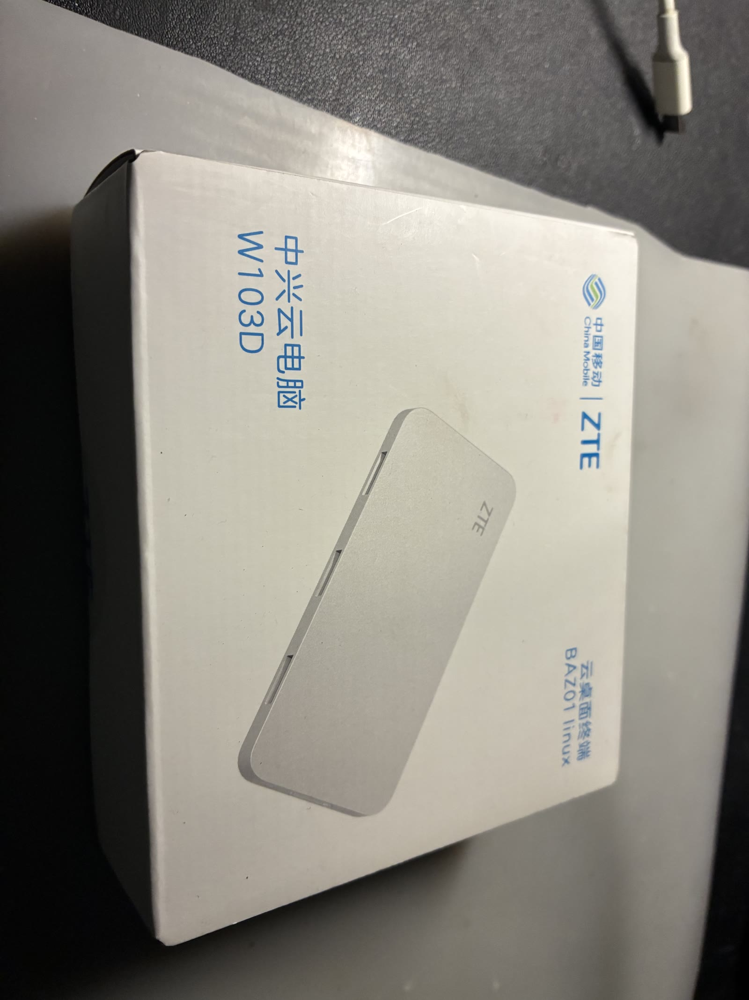

⚠️ **认准芯片**。国科 GK6323、RK3566 的同名/同形盒子**不适用**——那份镜像的内核补丁与 WiFi 固件
是专门烘给 S905L3A-w103d 的。

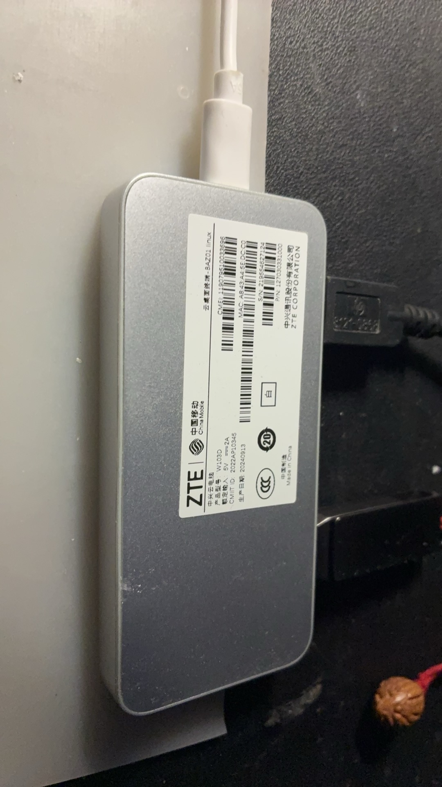

#### 芯片叫法对照（**别被卖家说晕**）

| 你在哪看到 | 名字 |
| --- | --- |
| **卖家 / 线刷包 / 论坛** | 晶晨 **S905X2** |
| **ophub 板级库 / 本文档** | **`s905l3a`** |
| **设备树 / 平台** | `meson-g12a`（G12A 家族） |

**三个说的是同一颗芯片的家族**：`S905L3A` 属于 **G12A**，市面俗称 **S905X2**，ophub 钉的是具体变体名。
所以卖家说"S905X2"、而本文档说"S905L3A"，**不矛盾** ✅

#### 同族的几个兄弟型号（**固件通刷**）

```
中兴云电脑  W100D / W102D / W103D / W105D      ← 论坛实测：这几款固件通刷
```

| | W100D（太极） | W105D（玲珑） | **W103D（本指南）** | W102D |
| --- | --- | --- | --- | --- |
| 芯片 | 晶晨 S905X2 | 晶晨 S905X2 | 晶晨 S905X2（=`s905l3a`） | 同类 |
| 内存 / 存储 | 2 G + **8 G** | 2 G + **8 G** | 2 G + **32 G** | — |
| 系统 | 安卓 9 | 安卓 9 | 安卓 9 | 安卓 9 |

（W100D 与 W105D 的公开配置**完全一样**，差别在形态与命名：W100D 属"太极"、W105D 属"玲珑"名片式。）

**"通刷"说明硬件几乎同源** ✅ 但**存储差 4 倍**（8 G vs 32 G）——本镜像装完约占 3 GB、载荷仅 145 MiB，
8 G 型号**够用** ✅

**关于无线网卡**：论坛资料**没有一款写明**（四款都没写）。但"**固件通刷**"是一条支持性证据 ——
一份线刷包能同时驱动四款的 WiFi，说明它们**多半是同一颗或兼容网卡** ✅（**这是推断，不是确证** ⚠️）。
真要买之前，**以实物为准**：`getprop` 或拆机看丝印。

⚠️ **但有一处本指南无法替你确认**：**W105D/W100D 用的是不是同一颗 MT7663S 无线网卡**（论坛资料没写）。
本镜像最难的部分正是 MT7663S 的驱动适配，**这块不一样的话，WiFi 就要重新适配**。
另外 ophub 的板级库里**只有 W103D（`s905l3a-w103d`）**，没有 W105D 的条目——同族不等于配置可直接复用。

**盒子上的口要认一遍**（拍照存着，接线时省事）：

- 网口、HDMI、电源
- **USB 口 ≥ 2**：一个插 U 盘（走 U 盘路线时），一个给电台
- 复位孔（AV 孔里那个小按钮）——§5 的兜底手段要用

## 2. 准备清单

- [ ] W103D 盒子 + 原装电源
- [ ] **≥8 GB U 盘**（会被完全擦除）
- [ ] **网线**（必须——首启要联网）
- [ ] 电台 USB 线。**FT-710 要插盒子/电台的上方 `Enhanced` 口**（不是 Standard 口）
- [ ] 电脑（烧盘用）
- [ ] **原厂线刷固件包**（兜底；走 U 盘路线时用不到，但建议先下载好放在手边）

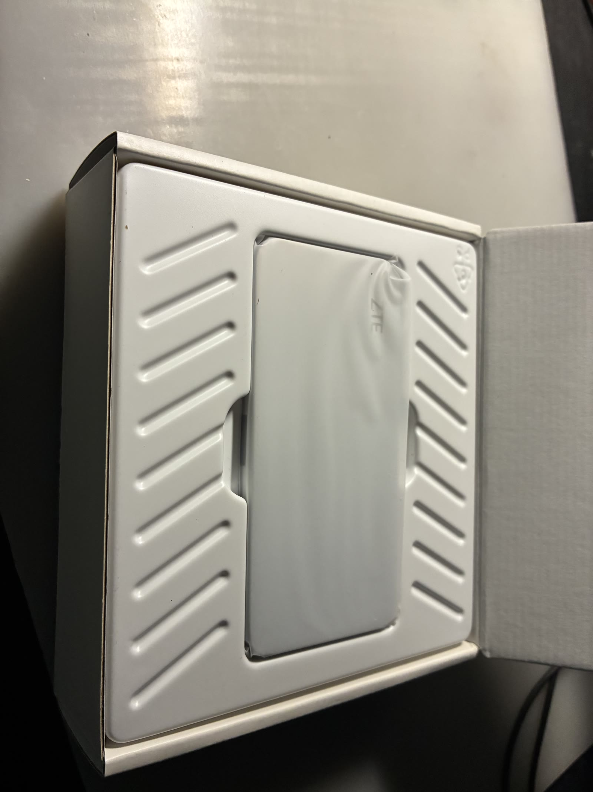

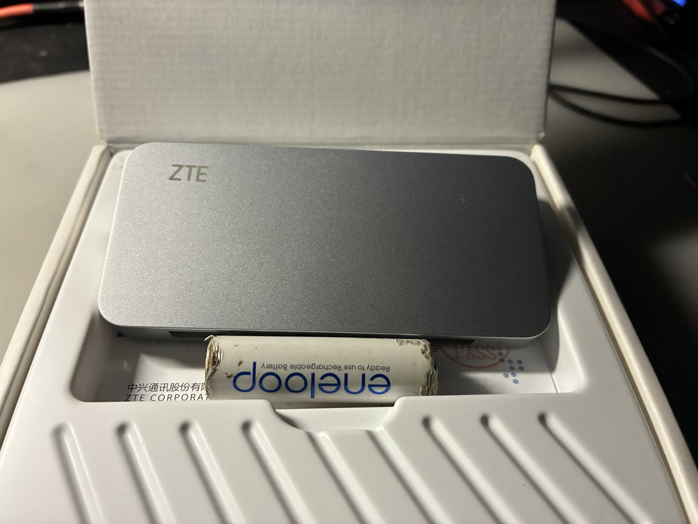

## 3. 下载镜像并校验

```bash
mkdir -p ~/w103d && cd ~/w103d
# 稳定别名：总是指向最新版；具体版本号见下载页
curl -LO https://www.vlsc.net/mrrc_modern/downloads/MRRC-Modern-w103d.img.gz
curl -LO https://www.vlsc.net/mrrc_modern/downloads/MRRC-Modern-w103d.img.gz.sha256
```

**校验**（这一步别跳——1.22 GB 下坏了是能下坏的）：

```bash
# macOS
shasum -a 256 -c MRRC-Modern-w103d.img.gz.sha256
# Linux
sha256sum -c MRRC-Modern-w103d.img.gz.sha256
```

命令会打印 `MRRC-Modern-w103d.img.gz: OK`。**不是 OK 就别往下走** —— 1.2 GB 是会下坏的，而坏在中间不容易看出来。`.sha256` 随镜像一起发布更新，所以这份文档里不再写死某一版的哈希（那张表每发一版就过期一次）。

## 4. 烧到 U 盘

**认准盘符，别烧错盘。**（这一步会把目标盘整个擦掉。）

**macOS：**

```bash
diskutil list                      # 找到你的 U 盘，记下 /dev/diskN（N 是数字）
diskutil unmountDisk /dev/diskN
gzip -dc MRRC-Modern-1.28.1-w103d.img.gz | sudo dd of=/dev/rdiskN bs=4m
sync                               # 等它真的写完
```

⚠️ 用 `/dev/rdiskN`（**裸设备**）不是 `/dev/diskN`——后者慢十倍以上。

**Windows（一键）**：下载 [`MRRC-W103D-Flash.cmd`](@@ROOT@@downloads/MRRC-W103D-Flash.cmd)，双击运行（它会自己请求管理员权限）。它会自动下载镜像（可断点续传）、核对 SHA-256、列出可写的 U 盘、写入，再把整份镜像从盘上读回来比对。**只认 USB / 可移动介质** —— 系统盘和内置盘不会出现在可写列表里；选定后还要手输 `ERASE` 才动第一笔。需要 **≥ 8 GB** 的 U 盘（镜像解开后 3.43 GiB）。逐步图解与常见问题见 [**做刷机盘指南**](@@ROOT@@flash.html)。

**Windows（手工）**：也可以用 **Rufus** 或 **balenaEtcher**，选那个 `.img.gz`（两者都能直接吃 gz）。
目标是"从镜像写入"模式，**不是**解压后复制文件。

**Linux：**

```bash
lsblk                              # 找盘
gzip -dc MRRC-Modern-1.28.1-w103d.img.gz | sudo dd of=/dev/sdX bs=4M status=progress conv=fsync
```

烧完把 U 盘**安全弹出**（macOS：`diskutil eject /dev/diskN`）。系统可能提示"此磁盘无法读取"——
**那是正常的**，镜像是 Linux 分区，Windows/macOS 读不懂。

### 4.1 让系统用满整根 U 盘（推荐，一条命令）

镜像的根分区**只有 2.9 GB**，而且**不会**在首启自动长（里面带 `/root/.no_rootfs_resize`）——
所以 U 盘剩下的大片空间默认是闲着的。系统跑起来后在盒子上补一句就行，ext4 支持**在线**扩容，
不用停机、不用拔盘：

```bash
apt-get install -y cloud-guest-utils     # 提供 growpart（镜像里没有这个包）
growpart /dev/sda 2                      # 只改分区表尾，不动起始扇区
resize2fs /dev/sda2                      # 文件系统跟着长
lsblk /dev/sda; df -h /                  # 2.9G → 整盘容量
```

**为什么要这一步**：`/ddbr` 里的 eMMC 全盘备份约 **2.3 GB**（§17.1），根分区只有 2.9 GB 时
**放不下**；录音与日志也需要余地。实测（231 GB 的 U 盘）：`growpart` + `e2fsck -f` + `resize2fs`
之后 `df` 从 `2.9G / 剩 894M` 变成 `227G / 剩 226G`。

**扩容不动 UUID** —— `uEnv.txt` 与 `/etc/fstab` 里的 `root=UUID=…` 照旧有效。
（想先在电脑上扩也可以：Linux 上离线跑同一组命令；macOS/Windows 没有 ext4 工具，**到盒子上做**。）

> **想在烧盘后立刻核对写入是否正确**（Linux / 有 `cmp` 的环境）：
>
> ```bash
> sync; echo 3 | sudo tee /proc/sys/vm/drop_caches >/dev/null      # 让下面的读真的落到盘上
> sudo cmp <(gzip -dc MRRC-Modern-<ver>-w103d.img.gz) /dev/sdX -n <镜像解压后字节数>
> ```
>
> 一致即"盘上这份 = 镜像那份"（1.26.0 实测 `IMAGE_MATCH_OK`）。`<镜像解压后字节数>` 用
> `gzip -l MRRC-Modern-<ver>-w103d.img.gz` 看最后一行。

## 5. 让盒子从 U 盘启动（新机器最容易卡的一步）

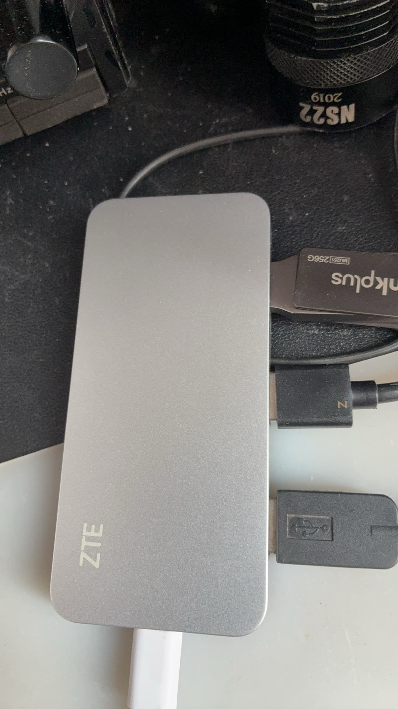

### 原理：已从镜像里核实，不是猜的

原厂安卓的 u-boot 有一个 **update 模式**。进去以后它会到 U 盘上找并运行
**`aml_autoscript`**——这个脚本就在镜像的启动分区里，内容是：

```
setenv bootcmd 'run start_autoscript; run storeboot'
setenv start_autoscript '... SD 卡 → USB(0..3) → eMMC ...'
setenv upgrade_step 2
saveenv        # 写入 u-boot 环境
reboot
```

**它做的就是把启动顺序改成「先 U 盘/SD、再 eMMC」，存进 u-boot 环境，然后重启。** 重启后 u-boot
从 U 盘加载 `s905_autoscript` → 读 `uEnv.txt`（里面写着本板的
`FDT=/dtb/amlogic/meson-g12a-w103d.dtb`）→ 引导 Linux 内核。

所以整件事的关键只有一条：**让原厂 u-boot 进 update 模式。**

### ⚠️ 更正一处说法

之前写「eMMC 一个字节不动」**不准确**——上面的 `saveenv` **确实会写 eMMC**（写的是 u-boot 环境变量，
不是 Android 的分区数据）。

准确的说法：**不碰 Android 的分区与数据，只改 u-boot 的启动顺序偏好。** 回滚依然简单（见下）。

### 三种触发方式（按独立性排）

**① 复位孔（最不依赖原厂软件，第一次建议用它）**

1. 断电，U 盘插好
2. 用回形针按住复位孔里的按钮
3. 通电，按住约 10 秒再松手

**② adb（原厂安卓里打开了 USB/ADB 调试）**

```bash
adb connect <盒子IP>:5555
adb shell reboot update
```

**③ 盒子上的终端 App**

```bash
su -c 'reboot update'
```

`reboot update` 就是让安卓把 u-boot 的 `upgrade_step` 置位——u-boot 下次启动看到它就运行 U 盘上的
`aml_autoscript` ✅

### 成功的样子

**HDMI 上是 Linux 内核日志**（不再有安卓开机动画）。因为 `uEnv.txt` 里配的控制台是
`console=ttyAML0,115200n8 console=tty0`——**串口和 HDMI 都能看**，所以刷机失败时**接上 HDMI 就能看到卡在哪** ✅

第一次开机要几分钟：扩 rootfs、生成 SSH 密钥。

> **回滚**：断电 → 拔 U 盘 → 上电。u-boot 在 U 盘上找不到脚本，走 eMMC → 回安卓。
> （u-boot 环境里那条“优先 U 盘”的偏好还在，但没有 U 盘时它是无害的。）

## 6. 首启会自动完成什么

镜像里已经烘好了不需要硬件的全部东西（用户、代码、venv、依赖、frpc、FTDI 库、11 份机型配置、systemd 单元）。
首启只做**必须碰硬件**的几件事：

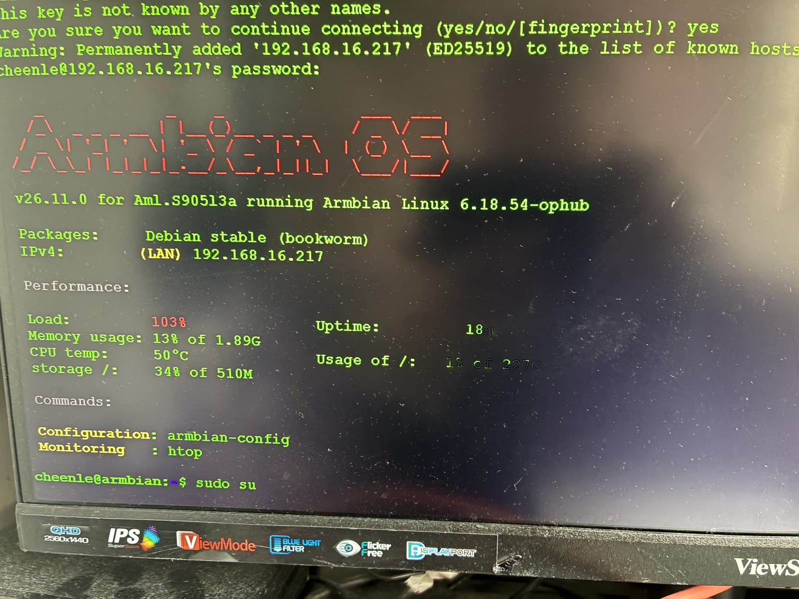

| 首启做 | 为什么不能提前做 |
| --- | --- |
| **Web 登录口令** | 对外下载的镜像是发货版：构建期固定成一组公开口令（§7）。不传 `--preflash` 自建时才在首启现生成，每台不同 |
| 生成**自签证书** | 证书要绑定本机名/IP，且私钥不该随镜像分发 |
| 探测**串口**（`/dev/ttyUSB*` / `ttyACM*`） | 端口号只有在真机上插了电台才知道 |
| 探测**声卡**（电台的 USB 声卡） | 同上 |

**首启不需要联网**：上面几件事全在本机完成（写入口令、生成自签证书、探测串口与声卡），
不下载任何东西。开机后 `mrrc-firstboot.service` 跑完会把自己标记成"已做"，之后不再重复
（**没定型时不会标记**，见下）。

> **2026-10-17 更正（对当时 1.28.1 产物的只读检查）**：上表里**两条探测在 2026-10-17 的 firstboot 修复之前构建的镜像上从未运行过** ——
> 包装器在“env 文件存在”（即所有镜像）那条分支上带 `MRRC_PRESEED=1` 调 `first_run.py`，而那个键在第一行
> 就短路返回。**当时的镜像也没有预置口令**（口令由服务启动时 `server.py` 生成）。**自那次修复起（对外下载的
> 1.28.1 就是修好的版本）**，两条探测真的会跑，且完成
> 判据改成“配置已定型”（`needs_first_run` 为假、且记下的串口节点在场）：**没插电台的盒子下次开机再探一次**，
> 探到为止。顺带一个不在本次范围内的现状：`/setup` 的免密引导窗口（§9.8）同样因为“口令已存在”而
> **从未打开过**；改它等于重新开一个免口令窗口，是安全决策，另开一次变更处理。

**首次上线有两条路**：最省事是**插网线**（eth0 默认 DHCP，插上就拿地址，见 §9.2）；没有网线时，
刷盘前在 FAT 启动分区写一份 **`/boot/mrrc-wifi.txt`**（`SSID=`/`PSK=`），首启会用它把盒子连上
Wi-Fi 并删掉这个文件（见 §9.3）。两个都不可用时，接 HDMI + USB 键盘在盒子上用 `nmtui` 直接连
（§9.4）。⚠️ 曾经用于这一步的**开放热点已在 W103D 上退役**：MT7663S 起得来 AP 却不发信标，
手机扫不到，2026-10-11 真机验证失败（详见 §9.6）。

## 7. 进系统，第一件事改口令

从路由器 DHCP 列表里找到盒子的 IP，然后：

```bash
ssh root@<盒子IP>       # 对外下载的 1.28.1 镜像：root 口令 abcd1234
```

**进去第一件事就改掉它：**

```bash
passwd root
```

⚠️ 这组口令是公开知识，不改等于把盒子送人。

### 口令一览（初始值都在这里，别去别处找）

**对外下载的 1.28.1 镜像就是发货版**：三条口令固定、时区与区域已设，开箱不需要任何初始化。
只有自己构建、且**不传** `--preflash` 时，才是“每台现生成”的那一套。

| 用途 | 对外下载镜像（预置） | 自己构建（不带 `--preflash`） | 怎么改 |
| --- | --- | --- | --- |
| SSH `root` | **`abcd1234`** | `1234`（ophub Armbian 出厂值） | `passwd root`（SSH/HDMI），或 `/settings` 的「系统账号口令」 |
| 系统用户 `mrrc` | **`abcd!1234`** | 无口令（锁定） | `passwd mrrc`，或 `/settings` 的「系统账号口令」 |
| **Web 登录** | **`abcd!1234`** | 首启当场生成，每台不同 | `/settings` 的「登录口令」；非预置镜像用 `mrrc-show-password` 取回 |
| 收听专用 | 空＝未启用 | 同左 | 自己写 `MRRC_LISTEN_PASSWORD`（§13） |
| Cloud Hub | 无，要自己申请 | 同左 | `/settings` 的「公网入口」，或界面「设置 → Cloud Hub」（§14） |
| Wi-Fi | 卖家预置的 AP（若有） | 无 | `/boot/mrrc-wifi.txt` 预置（§9.3）、`/settings` 页面（§9.8）、或 `nmcli`（§9.4） |

> 镜像里**不含任何私钥**：自签证书仍是首启在盒子上现生成。预置的只有上面这组**公开**口令——
> 拿过镜像或任意一台同批盒子的人都能进同批的所有盒子，所以第一件事就是改掉它们。

### 发货版（`--preflash`）的构建细节

**对外下载的镜像和卖家代刷的盒子**都走这条构建通道：`bash packaging/box/build-image.sh --preflash`。
它把下面三条固定下来，用户开箱**不需要任何初始化**（插上电、浏览器登录即可）：

| 用途 | 发货版初始值 | 怎么改 |
| --- | --- | --- |
| SSH `root` | `abcd1234` | `passwd root`（SSH/HDMI），或构建时 `MRRC_PREFLASH_ROOT_PASSWORD=…` |
| 系统用户 `mrrc` | `abcd!1234` | `passwd mrrc`，或构建时 `MRRC_PREFLASH_USER_PASSWORD=…` |
| **Web 登录** | `abcd!1234` | `/settings` 页面的「登录口令」，或构建时 `MRRC_PREFLASH_WEB_PASSWORD=…` |

同一通道还会把时区定为 `Asia/Shanghai`、区域定为 `zh_CN.UTF-8`（可用 `MRRC_PREFLASH_TIMEZONE` /
`MRRC_PREFLASH_LOCALE` 覆盖）。**默认关**：不传 `--preflash` 的镜像一字不改，口令照旧每台现生成。

⚠️ **固定口令就是公开知识**：拿到镜像或任何一台同批盒子的人都能进同批的所有盒子。这是“先固定”的
已知代价；Web 口令在页面上能改，`root`/`mrrc` 要改得上 SSH 或 HDMI。

## 8. 拿到 Web 口令，打开界面

```bash
mrrc-show-password
```

这个命令必须用 `root` 跑——口令存在一个 `0640 root:root` 的文件里。
**对外下载的预置镜像不需要这一步**：口令就是 §7 表里的 `abcd!1234`；这句话适用于自己构建的镜像。

首启时 **HDMI 控制台的横幅**上也会印一次；之后想不起来就用这个命令取回。

浏览器打开：

```
https://<盒子IP>:8888
```

自签证书会警告一次 → **高级 → 继续前往**。

⚠️ **必须走 HTTPS，不要关。** 手机浏览器要调用麦克风发射（PTT），而在 HTTP 下浏览器不给麦克风权限——
**这是浏览器安全策略，不是我们的设置问题。**

登录后你应该看到主界面：频率、模式、S 表、瀑布图。**这时候还没有电台——下一步接上。**

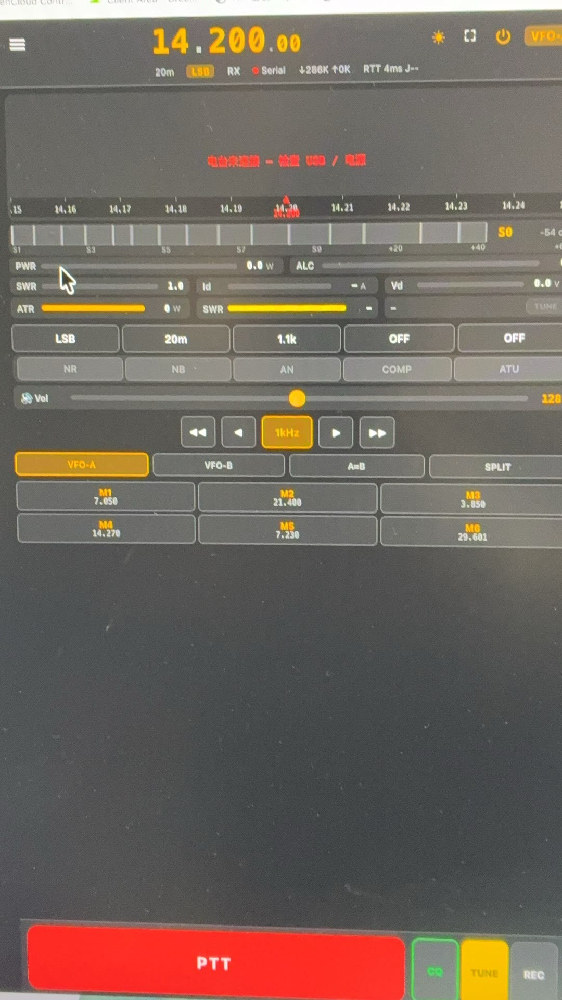

## 9. 接网络（有线 / Wi-Fi）

> ⚠️ **这条的第一版是「盒子自己开热点」，它在 W103D 上真机验证失败（2026-10-11）** ——
> MT7663S 的驱动能把 AP 模式激活（系统日志一切正常），但**信标不上空**，手机扫不到
> `MRRC-Setup`。现在的版本是**「盒子接入你的局域网 → 打开网页配置盒子 OS」**：首次上线走
> 网线（§9.2）或预置 Wi-Fi（§9.3），没有网线也没预置时用 HDMI + `nmtui`（§9.4）。热点的
> 退役说明见 §9.6（设计见 2026-10-11 的 LAN 盒子设置页 spec）。

### 9.1 按你手边有什么选

| # | 你手边有 | 方式 | 现在能用吗 |
| --- | --- | --- | --- |
| 1 | **一根网线** | 直接插网线（最省事） | ✅ 能用 → §9.2 |
| 2 | **电脑 + 读卡器** | 预置：刷盘前把配置写进启动分区 | ✅ 能用 → §9.3 |
| 3 | **HDMI + USB 键盘** | `nmtui`：盒子上的全屏文字界面 | ✅ 能用 → §9.4 |
| 4 | **只有一台手机** | 热点引导：盒子自己发热点 | ❌ **已退役**（2026-10-11 真机验证失败）；改用预置 Wi-Fi（§9.3）或网线（§9.2） |

⚠️ **预置分两份文件、各写各的域**：口令与电台设置走 `/boot/mrrc.env`（§9.3），Wi-Fi 凭据走
`/boot/mrrc-wifi.txt` —— Wi-Fi 归 NetworkManager 管，**不写进 env 文件**（设计 D-4：两个域各有
唯一写入者；env 文件会被复制进 `0640` 的配置层、可能进支持包，Wi-Fi 密码不能和配置键混在一起）。
两份都用得上时同时写即可。（第 4 条本板已退役，见 §9.6。）

**接上网络之后**，盒子的名字、时区、Wi-Fi 切换、有线口、重启都在**局域网配网页**上做（§9.8），
不必回到 HDMI 控制台。

### 9.2 第 1 条：网线（推荐）

插上就通，确认一下：

```bash
ip a                    # 看有没有拿到地址
nmcli device status     # eth0 应显示 connected
```

### 9.3 第 2 条：预置（刷盘时就写进去，零键盘零网线）

镜像的 **FAT 启动分区**会被挂到 `/boot`（在别的电脑上打开，macOS 上那个分区叫 `BOOT`，
直接拖文件进去也行）。这里可以放**两份**文件，各写各的域：

**① 电台与口令 → `/boot/mrrc.env`**：首启会采纳它并改名成 `mrrc.env.applied`。支持任意
`MRRC_*` 键（就是 §13 那张表里的那些）✅

```bash
cat > /Volumes/BOOT/mrrc.env <<'EOF'
MRRC_WEB_PASSWORD=你自己定一个
MRRC_RADIO_MODEL=ft710
MRRC_PTT_MAX_TX_SECONDS=120
EOF
```

**② Wi-Fi 凭据 → `/boot/mrrc-wifi.txt`**：让盒子**没有网线也能自己连上 Wi-Fi**。两行，
键名不分大小写，值两端的空格与 Windows 编辑器留下的 `\r` 会被去掉：

```bash
cat > /Volumes/BOOT/mrrc-wifi.txt <<'EOF'
SSID=我的WiFi
PSK=密码
EOF
```

首启时 `mrrc-wifi-preseed.service` 会读这个文件、用 `nmcli` 连上那个 Wi-Fi，然后**把文件删掉**
（FAT 没有权限位，明文 PSK 不能一直躺在卡上）。它**刻意与 `mrrc.env` 分开**：Wi-Fi 是
NetworkManager 的领域，不走 `MRRC_*` 配置层——env 文件会被复制进 `0640` 的配置层、可能进支持包，
一条 Wi-Fi 密码一旦落进那儿就和配置键混在一起了（设计 D-4）。这也是文件名用 `.txt` 而不是
`.env` 的原因：别把两份文件弄混。

**Guided/发货流程不用预置这条路**（2026-10-17 起）：实际流程是刷完 eMMC → 上电 → 插 LAN 线 →
在 `/settings` 页面里改 Wi-Fi（§9.8），那已经是零键盘的一条路；预置能力**仍在镜像里**，
将来想用随时可用，只是操作单不再要求它。

⚠️ **这条只在"镜像刷到 U 盘/SD 卡"时成立**：把系统写进 eMMC 时没有用户能碰到的 FAT 分区
（§17 的 eMMC 路线不适用预置）。

连上以后想确认，接 HDMI 看控制台，或 SSH 进去看：

```bash
journalctl -u mrrc-wifi-preseed -b     # 连上后该 unit 应显示文件已删、网络已就绪
```

### 9.4 第 3 条：HDMI + `nmtui`（没有任何网络时最省事）

盒子接 HDMI + 一个 USB 键盘，登录 `root` / `abcd1234`（对外下载的预置镜像；自建未预置时是 `1234`），然后：

```bash
nmtui
```

方向键选「**启用连接 / Activate a connection**」→ 选你的 SSID → 输密码。
这是**全屏文字界面**，既不需要网络也不需要图形环境 ✅

**已经在 SSH 里**（有网线）就用 `nmcli`：

```bash
nmcli device status                              # 先看 wlan0 在不在
nmcli device wifi list                           # 扫（要等几秒）
nmcli device wifi connect "你的SSID" password "你的密码"
nmcli connection show --active                   # 确认连上了
ip a show wlan0                                  # 拿到 IP 没
```

盒子换了网络导致 IP 变了，就去路由器里重新找一下。

### 9.5 无线起不来时，按顺序查

每一条排除的东西都不一样，别跳步：

| 检查 | 命令 | 说明 |
| --- | --- | --- |
| 硬件在不在 | `rfkill list` | 显示 `Soft blocked: yes` → `rfkill unblock wifi`；**看不到 wlan0 才往下查** |
| 驱动加载没 | `lsmod \| grep mt76` | 应有 `mt7663s` 与 `mt76_sdio`；没有就 `modprobe mt7663s` |
| 固件加载成功没 | `dmesg \| grep -i mt76` | 有 `firmware` 失败字样 = 固件没加载上（本镜像带 4 个 mt7663 固件） |
| 网卡认出来没 | `iw dev` | 应列出 `wlan0` |
| 扫描有结果没 | `nmcli device wifi list` | 空列表且 `dmesg` 里有 `mailbox write … failed: -110` → **芯片楔死了**，按右列重启；空列表但无报错 → 天线或信道问题 |
| 芯片是否还活着 | `dmesg \| grep -c "mailbox write"` | 计数 > 0 = 已楔死，**重启**（钉版固件实测软重启 47 秒即复位，见 §20.5）；连接期间别再选 5 GHz |
| 监管域 | `iw reg get` | 显示 `country 00` 时部分信道不可用；`iw reg set CN` 后重试 |

**背景（决定你该查什么）**：W103D 的无线是 **MT7663S**，WiFi 与**蓝牙同一颗芯片**，走 **SDIO**
而不是 USB。这块板的驱动是 ophub 专门适配的（上游 **PR #3658 / #3659**），所以
**内核绝不能换**——换通用内核 = **静默丢 WiFi**（见 §19 红线③）。

**固件状态（决定你该期待什么）**：**1.26.0 起**对外下载的镜像带的就是出厂 2021 版 N9 固件
（`7663mp1827`，见 §20.5），1.28.1 同样。只有 **1.25.5 及更早**的镜像才是 linux-firmware 的
2020 版、会渐进式挂死（那些镜像已下架）。无论哪版，无线抖动都大，长时间听音频容易卡。
**实时音频始终优先走有线。**
2026-10-12 在 1.26.0 真机上实测：**2.4 GHz 下关联、上网、拿 IPv6、NTP 全通，扫描正常且扫完芯片不挂**；
**5 GHz（ch149）能关联、能拿到 DHCP 地址，但数据面是死的**，约 100 秒后 MCU 开始超时（详证见 §20.5）。
结论：**无线只用来配网，实时音频始终优先走有线。**

### 9.6 第 4 条：热点引导（**已退役**）

> ⚠️ **2026-10-11 真机结论：这条路在 W103D 上走不通，已退役。** 原因是**硬件边界**，不是
> 软件没写完：MT7663S 的驱动与 NetworkManager 都报 AP 已激活（`COMPLETED`、`10.42.0.1/24`
> 就位、零报错），但**信标不上空**，手机与 Mac 都扫不到 `MRRC-Setup`（源码走查：`mt7615_ops`
> 没有 `start_ap`，mac80211 缺 op 时静默返回成功）；折腾 AP 还会把驱动楔死，只能断电复位。
> 换 `prefer_offload_fw=0` 会改载 `_rebb` 固件，芯片则**根本不初始化**：
> `MCU initialization failed: -110`。上游移植记录本身也只验证过 STA 模式。

**为什么改成局域网页面**：一个谁也扫不到的热点，比没有引导更糟。现在「上线」这一步交给
**你自己已经在用的网络**——插网线（§9.2）或刷机时预置 Wi-Fi（§9.3），然后用任意设备打开
`https://<盒子地址>:8888/`：未配置的盒子会落到引导页 **`/setup`**，先设登录口令，再从页面
列出的 Wi-Fi 列表里选一个连上去；之后一切在 **`/settings`** 设置页。

> **首次开机请在你信任的网络里完成设置。** 引导页在"盒子从未被用户设过口令"期间，对**同一个
> 子网**内的请求免口令开放（网线/预置通常发生在家里私网）。宿舍网、公司网、咖啡馆这类共享
> 网络存在"被同网段的人抢先设口令、接管盒子"的风险——这是为了"买回来只有一台手机的人也能
> 开始"而接受的**明知的弱化**，不是缺陷。

被退役的实体：`MRRC-Setup` 热点、`10.42.0.1` 地址、30 分钟窗口与它的重试行为、
`mrrc-setup-ap.service` 与 `linux/setup_ap.py`、以及 `/run/mrrc/setup-ap/state.json` 和
`wizard.json` 两个跨用户信箱。设计见
`docs/superpowers/specs/2026-10-11-w103d-lan-box-settings-design.md`。

### 9.7 盒子名字与 mDNS

盒子在局域网里有一个**名字**，默认 **`MRRC-Modern`**（打包时用 `hostnamectl set-hostname` 落下，
否则镜像里还是 `armbian`）。于是你可以直接在浏览器里用 **`https://MRRC-Modern.local:8888`** 这样
的地址找到它，不必先去路由器后台翻 IP。

- **多台同网段会撞名**：avahi（Linux 上的 mDNS 实现）发现 `MRRC-Modern.local` 已被占用时，会
  **自称 `MRRC-Modern-2.local`**。设置页 `/settings` 显示**当前实际可达的那个名字**；同网段有
  多台盒子时，建议在页面上给它们各改一个名字。
- **大小写**：`MRRC-Modern` 含大写，但 DNS 名字本身大小写不敏感——`mrrc-modern.local` 一样能解析。
- **`<名字>.local` 不是万能的**：**iOS / macOS 完美**，**Windows 需要装 Bonjour**（否则解析不了），
  **Android 看机型**。所以**退路是 DHCP 主机名**（NetworkManager 默认会把它报给路由器）：无论
  什么客户端，去路由器后台的**客户端列表**里按主机名就能找到盒子的 IP。设置页**两个都显示**：
  mDNS 名字 + 当前 IPv4。
- **改名字**：`/settings` → 盒子身份，填新名字提交（走 root helper 的 `set-hostname`，会一并
  同步 `/etc/hosts`）。

### 9.8 局域网配网页：`/setup` 与 `/settings`（1.26.0 新增）

盒子接入你的网之后，**用任意设备的浏览器**就能把盒子的系统配置完 —— 不用 HDMI、不用键盘。
地址就是平时那个，自己会被路由到对应页面：

| 页面 | 地址 | 干什么 |
| --- | --- | --- |
| **引导页** | `https://<盒子IP>:8888/setup` | 首次上线：设登录口令 + 从扫到的列表里选 Wi-Fi |
| **设置页** | `https://<盒子IP>:8888/settings` | **盒子身份**（名字 / mDNS / 当前地址 / 时区 / 重启）、**网络体检**、**Wi-Fi**（扫描 + 手输 SSID + 连）、**有线口**（DHCP / 静态）、**公网入口**（填呼号申请，见下） |
| 主界面 | `https://<盒子IP>:8888/` | 电台控制（平时用的那个） |

**引导窗口只在"盒子从未被用户设过口令"期间开放**：首次开机它对你**同一子网**的请求免口令；
一旦设过一次口令（比如你在页面上改了，或者 `MRRC_WEB_PASSWORD` 已存在），`/setup` 就 **302 跳到
`/settings`**，此后所有页面一律要登录。所以：

> **首次开机请在你信任的网络里完成设置**（家里私网）。宿舍网/公司网/咖啡馆这类共享网络存在
> "被同网段的人抢先设口令接管盒子"的风险——这是为了"买回来只有一台手机的人也能开始"而
> 接受的**明知的弱化**（设计见 §9.6 引的那份 spec）。

**Wi-Fi 面板的三条硬约束（2026-10-12 真机；第一、二条 2026-10-17 有更新）：**

1. **只连 2.4 GHz。** 5 GHz 能关联、能拿到地址，但**数据面不通**，而且会把 MT7663 拖到
   MCU mailbox 超时（`-110`），此后**扫描返回空表**、Wi-Fi 彻底没法用（详证见 §20.5）。
2. **可以直接手输 SSID**（2026-10-17 起）：面板上那格「网络名（SSID）」就是输入框，点扫描结果会把
   它**带入**这个框。所以隐藏网络、以及“芯片刚重启、扫描返回空表”这两种情况都有出路了。
   密码框旁的「显示/隐藏」只切换输入框的显示方式，不改变值。**已保存的 Wi-Fi 密码不会回显** ——
   那需要向 NetworkManager 索要明文口令，而“Wi-Fi 密码只进 `nmcli` 的 argv”是这套系统的一条硬约束（NFR-068）。
3. **扫不到任何网络时页面会给一句提示**（2026-10-17 起；以前是一片空白，看起来像“没点对”）。
   判断芯片状态的旁证仍是：`nmcli device wifi list` 与 `dmesg | grep -c "mailbox write"`。

**「公网入口」面板（2026-10-17 新增）：**填上呼号 → 点「申请公网入口」→ 状态行告诉你“已提交，等待批准”；
运维在门户批准后，**盒子自己会接通**（服务端每 30 s 轮一次），页面不用开着。接通后面板显示入口地址
（`https://<label>.mrrc.vlsc.net/`）。两条要记住的边界：**改呼号 = 重新申请**（旧入口不会自动迁移）；
已申请过的盒子按钮会变成「查询状态」—— 门户对同一呼号的重复申请是查重拒绝的（要换人或转移走申诉）。
联系人、批准码认领、隧道/证书细节仍在主界面 ☰ 菜单的「Cloud Hub」对话框里（§14）。

**网页只监听 IPv4（盒子线的设计取舍）：**

```bash
ss -ltn | grep 8888     # 0.0.0.0:8888  → IPv4 通、IPv6 不通
                        # [::]:22       → SSH 两边都通
```

所以盒子就算拿到了全局 IPv6，`https://[<它的IPv6>]:8888` 也**打不开**（直连 IPv6 只能 SSH）。
想让它也听 IPv6，改一行就行（`::` 是 dual-stack，IPv4 照旧能连）：

```bash
sed -i 's/^MRRC_WEB_HOST=.*/MRRC_WEB_HOST=::/' /opt/mrrc_modern/env/mrrc.env
systemctl restart mrrc-modern
ss -ltn | grep 8888     # 现在应是 [::]:8888
```

> **不要反复点扫描**：正常一次就够。如果列表是空的，先看 `dmesg` 判断是芯片挂了还是真没网，
> 而不是继续点（芯片挂的时候点也没用，只有重启能恢复）。

## 10. 接电台

**FT-710 的线插口别搞错**：用**上方 `Enhanced` 口**，它同时承载 CAT 串口和 FT4222 scope。
插 Standard 口的话 CAT 可能通但**没有真频谱**。

接好后确认三样东西都出现了：

```bash
ls -l /dev/ttyUSB* /dev/ttyACM*     # CAT 串口
arecord -l                          # 电台的 USB 声卡（RX）
aplay -l                            # 播放设备（TX）
```

⚠️ 这三样**一样都不能少**。少串口 = 没有 CAT 控制；少声卡 = 没有声音。

**FT-710 面板上还要动四项**（都在 `FUNC` 里，设好再开页面）：

| 菜单 | 设成 | 为什么 |
| --- | --- | --- |
| `RADIO SETTING` → 各模式 `MOD SOURCE` | `USB` | 不设，PTT 按下没有调制 |
| `RADIO SETTING` → `RPTT SELECT` | `OFF` | PTT 走 CAT，不走 RTS/DTR |
| `OPERATION SETTING` → `GENERAL` → `SCU-LAN10` | `ON` | 第三方远程软件靠这条通道取频谱；本服务端不用它，但开着不冲突 |
| `OPERATION SETTING` → `GENERAL` → `CAT-1 RATE` | `38400` | 与本机 `MRRC_BAUD_RATE` 一致；第三方软件也读这个速率 |

**再设一个发射兜底**：`OPERATION SETTING` → `GENERAL` → `TX TIME OUT TIMER`（TOT），
连续发射到设定时间自动切回接收，**远程操作建议 3 分钟**；**FT8 / RTTY 长时间发射时设 `OFF`**，
否则一个时隙序列会被切断。注意别和同页 `CAT-1/2/3` 的 `TIME OUT TIMER`（毫秒，CAT 指令超时）搞混。

电台侧 TOT 管「物理上不许一直发」，服务端 `MRRC_PTT_MAX_TX_SECONDS`（本镜像默认 `120`）管
「远端会话断了也要松键」——两个都开才完整。操作指南里那份带截图的步骤见
`docs/OPERATION_GUIDE.md` §0.6.3。

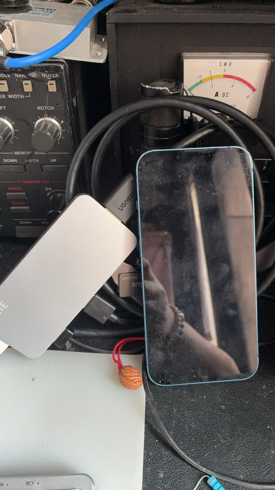

## 11. 选机型

```bash
mrrc-radio list        # 11 个型号，带 ✅已验证 / ⚠实验性
```

已验证的三个：`ft710`、`ic7300`、`ic7300mk2`。其余 8 个是实验性（默认只收不发，见下）。

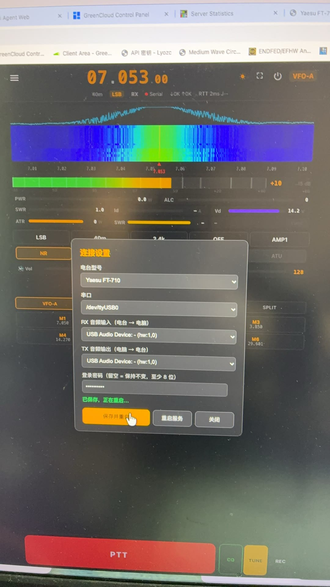

```bash
mrrc-radio use ft710                          # 自动探测串口 → 写配置 → 重启服务
mrrc-radio use ic7300 --port /dev/ttyACM0     # 或者你直接指定端口
mrrc-radio show                               # 核对当前生效的配置
```

`use` 做了四件事：**停服务 → 探测串口（真发包问电台）→ 写配置 → 起服务**。
所以它需要电台是开机状态。

> **换机型时旧串口会被自动清掉。** FT-710 是 `ttyUSB0/1`、IC-7300 是 `ttyACM0`——
> 留着上一个型号的串口等于配了一条**没有报错的死链路**。

### 关于 8 个实验性机型（重要）

`ic705` `ic7610` `ic7760` `ftdx10` `ftdx101d` `ftdx101mp` `ftx1` `ft891` —— 这些机型的指令表来自
Hamlib 与设备手册，**不是真机实测**。默认**只收不发**。

（在镜像里看得出来：这三个已验证机型的 profile **根本不写** `MRRC_ALLOW_UNVERIFIED_TX` 这一行，
而那 8 个都显式写着 `=0`——默认是安全的，要发射得主动改。）

理由（AD-019）：在没有实测过的频率/功率语义上发射，对电台和天线都不好。

要发射必须显式开门：

```bash
vi /opt/mrrc_modern/env/mrrc.env      # 加一行 MRRC_ALLOW_UNVERIFIED_TX=1
systemctl restart mrrc-modern
```

**换回已验证机型时这个键会自动重置为 0**，不会带着开着。

## 12. 验收：确认"真的能工作"

```bash
scp packaging/box/verify.sh root@<盒子IP>:/tmp/
ssh root@<盒子IP> 'bash /tmp/verify.sh'
```

**12 项，每项失败都会给出排查命令。先跑这个，再动手调别的。**

| 项 | 查什么 |
| --- | --- |
| 1/12 | **有线网络**（`nmcli device status`） |
| 2/12 | **电台串口**（`/dev/ttyUSB*` / `ttyACM*`） |
| 3/12 | **电台 USB 声卡**（`arecord -l`） |
| 4/12 | Python 与依赖 |
| 5/12 | 服务在跑 |
| 6/12 | **8888 上的 HTTPS** 真的在应答（只看有没有应答，**不看证书是否受信**——自签证书本来就不受信） |
| 7/12 | **配置一致性**（设计 D-11：`EnvironmentFile` 与 `MRRC_CONFIG_FILE` 同一文件） |
| 8/12 | Cloud Hub 隧道客户端（`fleet/frpc`） |
| 9/12 | Cloud Hub 公网入口（**未接入时自动跳过**） |
| 10/12 | **PTT 安全上限**（`MRRC_PTT_MAX_TX_SECONDS` 有值） |
| 11/12 | **盒子身份与权限通道**（NM polkit 规则、`avahi-daemon`/`hostname.local` 解析、`mrrc-box-helper` 套接字——LAN 引导页写网络全靠它们） |
| 12/12 | **WiFi N9 固件**（必须是出厂 2021 版，SHA `223f73f1…`——linux-firmware 的 2020 版会渐进式挂死 WiFi，见上面 MT7663 固件节） |

前 3 项就是硬件三件套。**第 7 与第 10 项都是“没有报错也会出问题”的那类**：第 7 项不合格时界面会显示
“已连接”而公网 TLS 校验失败；第 10 项没值时少一道防线①/② 中的第②道。

第 11 项查的是"出问题时你还能不能**找到这台盒子**、网页还能不能**写网络**"——
`<hostname>.local` 解析、NM 授权规则、box-helper 套接字都在，LAN 引导页才玩得转；
因为出问题的时刻你正好连不上盒子、没法查。第 12 项**只认出厂 2021 版 N9 固件**：
对外下载的 1.28.1 镜像（`ee1fba1e…`）已带钉版，这一项**应当绿**；只有 1.25.5 及更早的
镜像会红，现场换法见 §20.5。

> **软重启能不能救活芯片？2026-10-12 修正：钉版固件下能。** 老结论（“必须断电”）来自
> 2020 版固件的年代，当时实测“软重启继承挂死态”；换成钉版 2021 后实测**软重启 47 秒即完整复位**
> （`N9 Firmware Version` 重新打印、mailbox 报错归零、扫描恢复）。拿不准时先软重启，不行再断电。

> **2026-10-11 固化到 eMMC 那一轮的实测判读**（自建镜像，版本串同为 1.25.5）：第 12 项**绿**
> （`7663mp1827`，2021 版）；第 11 项**红** —— 该镜像构建于 10-11 中午，早于 `box_helper` / NM polkit 规则 /
> `avahi-daemon` 落地，三件都不在，**不是盒子故障**，要用上得重刷含它们的镜像；第 9 项**红**是判定偏严：
> 公网入口未登录时返回 302（跳 `/login`）**就是正常应答**，脚本目前只认 200/401。

然后**实际用一次**——打开界面，调频率、看瀑布、按 PTT 说一句。这才是真的验收。

## 13. MRRC 的全部可调项

配置文件：**`/opt/mrrc_modern/env/mrrc.env`**。改完 `systemctl restart mrrc-modern` 生效。

| 变量 | 作用 |
| --- | --- |
| `MRRC_WEB_PASSWORD` | Web 登录口令（预置镜像里是 `abcd!1234` 这组公开值，登录后改掉；不传 `--preflash` 的自建镜像则首启生成） |
| `MRRC_LISTEN_PASSWORD` | **收听专用口令**：用它登录是只读访客（能听、能改频率/模式，不能发射、不能改设备设置）。留空=不启用 |
| `MRRC_WEB_PORT` / `MRRC_WEB_HOST` | 监听端口（默认 8888）/ 绑定地址 |
| `MRRC_RADIO_MODEL` | 当前机型（**用 `mrrc-radio use` 改，别手改**） |
| `MRRC_SERIAL_PORT` / `MRRC_BAUD_RATE` | CAT 串口与波特率（同上，让 `mrrc-radio` 管） |
| `MRRC_ALLOW_UNVERIFIED_TX` | 未验证机型的发射门禁（§11） |
| `MRRC_PTT_MAX_TX_SECONDS` | **发射时长上限**（镜像默认 `120`）——防线② |
| `MRRC_REMOTE_SESSION_TX_HEARTBEAT_S` | 会话活性闸门；Cloud Hub 接入后自动写 `5`——防线① |
| `MRRC_SCOPE_PORT` / `MRRC_SCOPE_BAUD` | FT-710 的 FT4222 scope 串口 |
| `MRRC_FTDI_LIB_DIR` | FTDI 库目录（镜像里已预置 aarch64 版本） |
| `MRRC_RX_BUFFER_MS` | **接收音频的宿主缓冲深度**（毫秒，默认：盒子/其他 Linux `100`，macOS/Windows `20`）。见下方「声音卡顿」 |
| `MRRC_AUDIO_RX_DEVICE` / `MRRC_AUDIO_TX_DEVICE` | 指定音频设备（多声卡时有用） |
| `MRRC_RECORDINGS_DIR` | 通联录音目录（服务端存 MP3） |
| `MRRC_RECORDINGS_MAX_SESSION_MIN` / `MRRC_RECORDINGS_BITRATE` | 单次录音时长上限 / 码率 |
| `MRRC_RECORDINGS_MIN_FREE_MB` | 剩余空间低于此值（默认 200）**拒绝开始**录音；`0` 关闭。只拒绝、从不删除已有录音 |
| `MRRC_ATR1000_HOST` / `MRRC_ATR1000_PORT` | ATR-1000 天调的地址（§15） |
| `MRRC_SESSION_METRICS_INTERVAL_S` | 会话遥测上报间隔（默认 300 秒，`0`=关） |

**常用场景：**

```bash
# 给朋友开一个"只能听"的入口
echo 'MRRC_LISTEN_PASSWORD=换个好记的' >> /opt/mrrc_modern/env/mrrc.env
systemctl restart mrrc-modern
# 之后访问 https://<盒子IP>:8888/listen 用这个口令登录

# 发射时长上限调长一点
sed -i 's/^MRRC_PTT_MAX_TX_SECONDS=.*/MRRC_PTT_MAX_TX_SECONDS=300/' /opt/mrrc_modern/env/mrrc.env
systemctl restart mrrc-modern
```

**`MRRC_RX_BUFFER_MS`（声音卡顿才需要动）**：接收方向的采集缓冲深度。盒子上的
USB 声卡（ALSA）只给 1–2 个 20 ms 周期，读得稍慢就溢出；**溢出之后采集接口会静默停摆**
（PyAudio 仍报流是开的、内核也不报错），于是声音先被切碎、随后彻底安静。镜像默认已经
给到 `100`，调大可换稳定性、代价是延迟：

```bash
sed -i 's/^MRRC_RX_BUFFER_MS=.*/MRRC_RX_BUFFER_MS=200/' /opt/mrrc_modern/env/mrrc.env
systemctl restart mrrc-modern      # 判定：journalctl -u mrrc-modern | grep -i "capture stalled"
```

## 14. 公网接入（Cloud Hub）

让盒子在公网可用（`https://<呼号>.mrrc.vlsc.net/`，例：`https://bg1sb.mrrc.vlsc.net/`）。界面上 **设置 → Cloud Hub**：

1. **apply**：填呼号 + 联系方式，提交申请。
2. 等批准。
3. **connect**：自动完成——签证书、enroll、写隧道配置、起 frpc，并自动写两个配置键：
   - `MRRC_SSL_CERT` / `MRRC_SSL_KEY`（这个机型的入口证书）
   - `MRRC_REMOTE_SESSION_TX_HEARTBEAT_S=5`（防线①：PTT 半开时自动释放）

之后用 `https://<呼号>.mrrc.vlsc.net/` 访问（例：`https://bg1sb.mrrc.vlsc.net/`）。

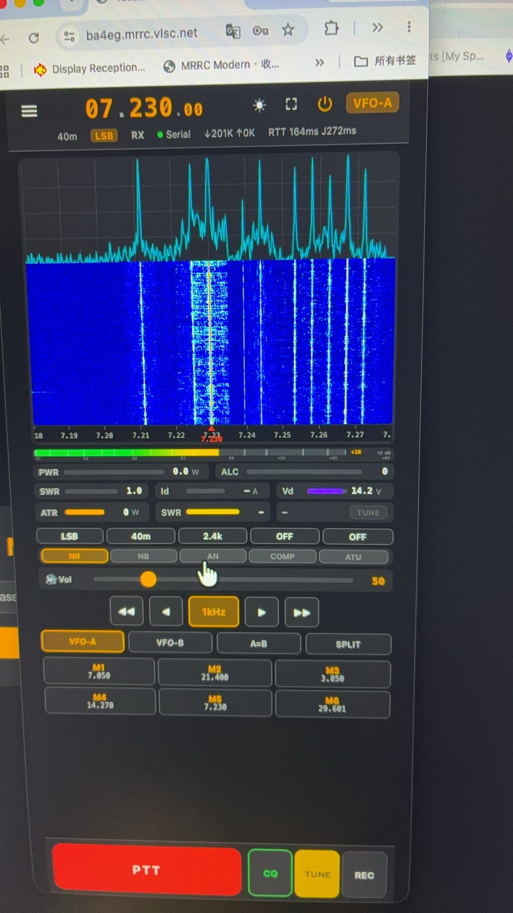

**两条 PTT 防线互相独立，都要在**：防线①＝会话活性闸门（公网必经），防线②＝时长上限（`MRRC_PTT_MAX_TX_SECONDS`）。
公网路径下 NAT 掉表、换 Wi-Fi、静默丢包都不会产生"断线"，只有这两条能兜住。

## 15. 天调 ATR-1000（可选）

盒子支持 ATR-1000 自动天调。配好地址就能用：

```bash
cat >> /opt/mrrc_modern/env/mrrc.env <<'EOF'
MRRC_ATR1000_HOST=<天调IP>
MRRC_ATR1000_PORT=<端口>
EOF
systemctl restart mrrc-modern
```

配好之后：**发射中驻波超阈值会自己发一次完整调谐**（一次，不是反复试），调谐有效才写回学习库。
它**绝不自行键控电台**——触发前提是操作者自己在发射。

## 16. 日常运维

**日志：**

```bash
journalctl -u mrrc-modern -n 100 --no-pager     # 服务日志
tail -f /opt/mrrc_modern/logs/server-stdout.log # 服务 stdout
```

**升级：**

```bash
MRRC_UPDATE_SRC=<git url 或本地目录> mrrc-update
```

只做四件事：拉代码 → 装依赖 → 盖版本号（`version.txt`/`VERSION`）→ 重启。**配置不会被碰。没有自动回滚**——升级前先备份（下面）。

> **热升级只换代码，不装 systemd 单元。** 服务层（`mrrc-service-layer.sh`）里的单元和
> 系统集成只有镜像构建时装：`mrrc-box-helper`（设置页的 Wi-Fi/系统面板）、`mrrc-localctl`
> （蓝牙遥控器）、`mrrc-cpufreq`（锁频）、`mrrc-logrotate.timer`（日志轮转）。升级前就
> 没有它们的盒子，升级后仍然没有 —— 表现是 `/api/box/status` 报 `helper_available: false`、
> 设置页那几个按钮是灰的。要补就按 `packaging/common/mrrc-service-layer.sh` 里的单元原文
> 手装一次（并把 `RuntimeDirectory=mrrc` 加进 `mrrc-modern.service`，否则 `/run/mrrc` 建不出来），
> 然后 `daemon-reload` + `enable --now`。

**备份（升级前做）：**

```bash
tar czf /root/w103d-backup-$(date +%F).tgz \
  /opt/mrrc_modern/env/ /opt/mrrc_modern/mem_channels.json /var/lib/mrrc/
```

（`/opt/mrrc_modern/env/` 里有口令与 Cloud Hub 证书路径。这份备份**含私钥**，别乱放。）

**手动装机内容检查：**

```bash
bash /tmp/verify.sh        # §12 那份，随时可重跑
```

## 17. 写进 eMMC（推荐的最终形态）

U 盘路线跑通、验收过了就做这一步 —— **它是推荐的最终形态**：盒子 + 一根电源线 + 一根网线，
不再需要 U 盘，28.9 GB eMMC 全归它自己。**这一步会覆盖 eMMC**；做法是在跑着的 U 盘系统里执行
ophub 自带的安装器，它把当前系统**克隆**进 eMMC 并自动处理引导 —— 不需要线刷工具、不需要重打镜像。

> **2026-10-11 在真机上完整走了一遍**：盒子现在就从 eMMC 启动（`findmnt /` = `/dev/mmcblk2p2`，
> 28 GB 全用上），原厂引导逐字节保留。下面每一步都是那一次的实操记录。

### 17.1 先备份（务必先做）

```bash
armbian-ddbr        # 交互里选 b
```

全盘（29 GB，含原厂引导）压到 `/ddbr/BACKUP-arm-64-emmc.img.gz`（实测 2.2 GB），**留在 U 盘上别删**。

> ⚠️ **这份备份是唯一的回原厂路径，而它就在这根 U 盘上。** 重刷镜像（`dd` 写整盘）会把
> `/ddbr` 一起冲掉——2026-10-12 就遇到过：那根盘是当时全机唯一一份。**重刷前先把
> `/ddbr/BACKUP-arm-64-emmc.img.gz` 拷到别处**（U 盘预留空间不够时先按 §4.1 扩容——
> 根分区只有 2.9 G 时**装不下**这 2.3 G 的备份）。
单线程 gzip 在这块 SoC 上约 10 MiB/s（≈40 分钟）；先装 `pigz` 手动跑三线程只要 ≈9 分钟，
产物同样是标准 gzip 流，`armbian-ddbr` 的恢复路径不变：

```bash
apt-get install -y pigz
mkdir -p /ddbr
nohup sh -c 'dd if=/dev/mmcblk2 bs=4M | pigz -c -p 3 > /ddbr/BACKUP-arm-64-emmc.img.gz' >/ddbr/backup.log 2>&1 &
# 跑完自检：pigz -t -p 3 /ddbr/BACKUP-arm-64-emmc.img.gz  → TEST-OK
```

### 17.2 安装进 eMMC

```bash
armbian-install        # 不要加 -m yes
```

交互只有两个问题：

| 提示 | 答 |
| --- | --- |
| `Please Input ID:` | **`307`**（设备表里的 `ZTE-W103D`） |
| `Please Input ID (1/2):` | **`1`**（ext4，与镜像一致） |

它会自动完成（输出可逐步核对）：备份并回写原厂引导 → `ampart` 重建 Amlogic 分区表 →
建 `p1`（512 MB FAT，引导）+ `p2`（其余全部，ext4）→ 拷 `/boot` 并改写 `boot.scr` / `uEnv.txt` 的
新 UUID → `tar` 克隆整个根文件系统（约 2.5 GB）→ 提示
`Installation completed successfully. Run [ poweroff ], remove the installation media…`。

板级身份是钉死的（`/etc/ophub-release` 与 ophub `model_database.conf` 核对过）：`MODEL_ID=307`、
`FDTFILE=meson-g12a-w103d.dtb`、启动器 `u-boot-w103d.bin`、`BOARD=s905l3a-w103d`。
**`-m yes` 会换主线 u-boot，本板不行**。安装器还会重新生成 machine-id（写进 eMMC 那份），副作用见 17.4。

### 17.3 切换：关机 → 拔 U 盘 → 上电

```bash
poweroff
```

断电，**拔掉 U 盘**，重新上电。启动顺序是 SD → USB → eMMC，没有 U 盘就落在 eMMC 上。

### 17.4 起来之后核对

```bash
findmnt -no SOURCE /        # 应为 /dev/mmcblk2p2
df -h /                     # 约 28 GB
systemctl is-active mrrc-modern
bash /tmp/verify.sh         # §12 那份
```

**IPv6 地址会变**：machine-id 重生成，SLAAC 的接口标识跟着变（`…c4c1:3f5e:173f:96d1` → `…e7c0:4b51:b64e:8b49`）。
域名解析 / Cloud Hub 入口几分钟内自愈（DDNS 类脚本与隧道都会自己跟上）；IPv4 由 DHCP 按 MAC 发放，一般不变。
口令、`env/mrrc.env`、证书、录音、`/opt` 下的附加件都随系统搬过去了。判读 verify.sh 的红项前先看 §12 的注。

**最终形态**：盒子、一根电源线、一根网线 —— 不再需要 U 盘；28.9 GB eMMC 全是它自己的。
那根 U 盘留着当**救砖盘**（整盘备份就在里面）。

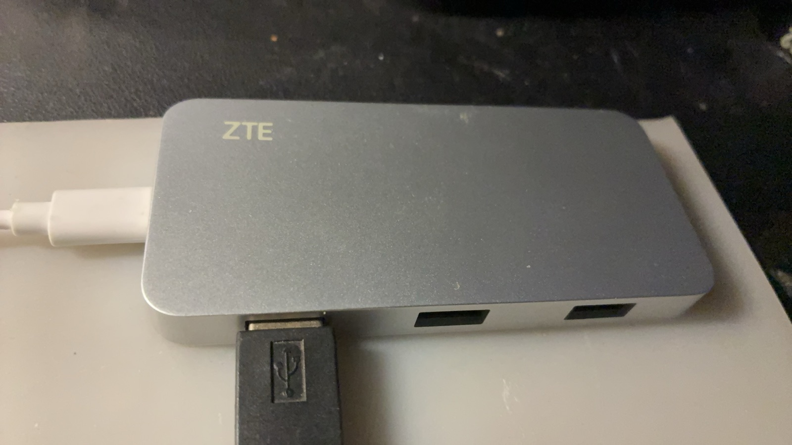

> ⚠️ **变砖兜底**：Amlogic 的 **MaskROM 在 SoC BootROM 里**（短接可重新进刷写模式），
> 加上你手上的**原厂线刷固件包**，就能恢复。这两样在手，这一步的风险才是可控的。

## 18. 退回去

- **U 盘路线（eMMC 没写）**：断电 → 拔 U 盘 → 上电 = 原厂安卓。零痕迹。
- **已写 eMMC**：
  - 最省事：**把 U 盘插回去** —— u-boot 的启动偏好仍优先 U 盘，插上就从 U 盘跑（安装器回写的是原厂 u-boot，偏好没变）。
  - 用备份恢复：从 U 盘启动后 `armbian-ddbr` 选 `r`，从 `/ddbr/BACKUP-arm-64-emmc.img.gz` 还原。
  - 回原厂安卓：原厂线刷固件包 + MaskROM 短接重刷（§20.5）。

## 19. 三条红线（会踩出"没有报错的故障"）

**① 停服务只用 `systemctl`，不要 `kill` 进程。**

Linux 上 frpc 的残留清理是 Windows-only 的。一个残留的 frpc 会占住 proxy 名，导致下次启动
**隧道起不来而界面毫无提示**。`systemctl stop` 会连带清掉 frpc，`kill` 不会。

**② 登录限流是全局桶，误锁影响所有人。**

经公网访问时所有登录共享同一个来源 IP，限流是 `5 次失败 / 300 秒`，而且**全局**。
不是你一个人被锁 5 分钟——是**所有人**。

**③ 内核升级只走 `armbian-update`，保持 `w103d` 变体。**

W103D 的 WiFi 完全依赖专属内核补丁 + MT7663S 固件 overlay。
换成通用内核 = **静默丢 WiFi**：没有报错，只是连不上。

## 20. 排障

| 症状 | 先看 | 多半是 |
| --- | --- | --- |
| 打不开网页 | `ip a`；`systemctl status mrrc-modern` | 网线/服务；`journalctl -u mrrc-modern -n 50` |
| 网页只转圈 | 换 `https://`（不是 http） | 端口 8888 + 自签证书警告要放行 |
| 手机按 PTT 没反应 | 地址栏是不是 `https://` | HTTP 下浏览器不给麦克风权限 |
| 没有网口地址 | `nmcli device status` | 换网线/换口；路由器 DHCP |
| **扫描列表是空的 / 页面列不出 Wi-Fi** | `dmesg \| grep -c "mailbox write"` | 计数 > 0 = 无线芯片已楔死（多半是连过 5 GHz）→ 重启盒子 |
| **Wi-Fi 连上去了但没网** | `ip route` 看默认路由走哪个口；`ping <网关>` | **别用 5 GHz**：能关联、能拿地址，但数据面不通（§20.5）；只连 2.4 GHz |
| **IPv6 直连打不开网页** | `ss -ltn \| grep 8888` | 盒子线的网页只绑 `0.0.0.0`（IPv4）；想听 IPv6 就把 `MRRC_WEB_HOST` 改成 `::`（§9.8） |
| **公网 `w103d.vlsc.net` 指向的地址不对** | `dig +short AAAA w103d.vlsc.net @223.5.5.5` 与盒子实际 IPv6 对比 | 镜像里**没有** DDNS 组件（`/opt/w103d-ddns`）；重刷后 machine-id 变 → IID 变，记录就陈旧了 |
| 没有串口 | `ls /dev/ttyUSB* /dev/ttyACM*` | USB 线；**FT-710 要插上方 Enhanced 口**；电台菜单 `MOD SOURCE = USB` |
| 有串口但连不上 | `mrrc-radio show` 的串口对不对 | `mrrc-radio use <model> --port /dev/ttyXXX` |
| 没声音 | `arecord -l` 有没有电台声卡 | 换线/换口；服务日志里的 PyAudio 设备列表 |
| **声音卡顿/断续、听一会儿就没了** | `cat /proc/asound/card1/stream0`（看 Capture 是不是 `Status: Stop`）；`journalctl -u mrrc-modern \| grep -i "capture stalled"` | 采集缓冲溢出后**静默停摆**（本机 ALSA 只给 1–2 个 20 ms 周期）。服务会自己重开并把原因写进日志；若反复出现，把 `MRRC_RX_BUFFER_MS` 调大（§13） |
| 瀑布图是合成谱（S 表） | `ls -l /opt/mrrc_modern/vendor/ftdi/`；`ls -l /etc/udev/rules.d/99-mrrc-ftdi.rules` | 缺 FTDI 库，或没插 Enhanced 口（`cat /sys/bus/usb/devices/*/idProduct \| grep 601c`）；**或 udev 规则缺失** —— 真 FFT 要服务用户 `mrrc` 能写那个 USB 节点，判定：`sudo -u mrrc test -w /dev/bus/usb/001/00N && echo ok` |
| **Cloud Hub 显示"已连接"但公网 502** | `verify.sh` 第 8、9 项 | 多半 `fleet/frpc` 缺失（`connect()` 会返回 `tunnel_started:false`） |
| 公网证书报错 | `verify.sh` 第 7 项 | `EnvironmentFile` 与 `MRRC_CONFIG_FILE` 必须指向**同一个文件**（设计 D-11） |
| 服务反复重启 | `journalctl -u mrrc-modern -n 100` | Python traceback；核对机型与串口 |
| 发射没功率 | 状态行的 `TX[... pk:...]` | 采集源/音量；FT-710 的 `mic_gain`；SSB 无话音即无功率 |
| 延迟越来越大 | 状态行 `J:` | 正常 100–300 ms；长期 >500 说明抖动缓冲在追，查网络 |

## 20.5 另一条路线：线刷（USB Burning Tool，直接写 eMMC）

> 来自网上另一个人给 W103D 做的 Armbian 桌面版。**它走的是完全不同的路线**：不烧 U 盘，而是用晶晨的
> 线刷工具**直接把系统写进 eMMC**（覆盖原厂安卓）。

**代价与收益**：一步到位、不占 USB 口、32 GB 全用上；但**原厂安卓被覆盖**，回滚要靠线刷固件包 +
MaskROM 短接。想先零风险试跑，走本文 §4–§5 的 U 盘路线。

| | U 盘路线（本文主线） | 线刷路线（本节） |
| --- | --- | --- |
| 工具 | `dd` / Etcher 烧 U 盘 | **Amlogic USB Burning Tool**（导入 `.img`，**不是**写盘工具） |
| 目标 | 从 U 盘运行 | **直接写 eMMC** |
| 原厂系统 | 保留 | **被覆盖** |
| 进模式 | update 模式（复位孔 / `reboot update`） | **线刷模式**（见下） |

**进线刷模式**（W103D 特有的做法）：

1. 用 **晶晨线刷 HDMI 短接器**（短接 HDMI 口内特定引脚）
2. **USB 公对公线插「靠 HDMI 那个 USB 口」**
3. 工具识别到设备后开始刷写

**工具里的擦除选项**：选「擦除 flash / 普通擦除 / 擦除 bootloader」，**不要选「强制全擦除」**。
刷到 **100% 再点停止**。

**首次启动**：会建立 eMMC 启动入口并**自动重启一次**，然后扩容文件系统、建 swap。
**给足 3–5 分钟**，别以为死机了。

**首次登录**：`root / abcd1234`（对外下载的预置镜像；自建未预置时是 `1234`）—— **进去第一件事改口令**（同 §7）。
SSH 主机密钥是首启新生成的，所以旧指纹会变（客户端会警告，正常）。

### MT7663 固件：出厂 2021 版已钉进仓库（2026-10-11 真机定案）

W103D 的无线是 **MT7663S**（WiFi 与蓝牙同一颗芯片），开源驱动是这块板最麻烦的部分；
上游适配见 ophub 的 **PR #3658 / #3659**。

**2026-10-11 真机定案**：基底镜像自带的 linux-firmware 2020 版 N9 固件（`3.1.1 / 20200604`）
在这块板上会**渐进式挂死**（能连、每 ~30 秒掉线一次、扫描楔死、~16 分钟后 MCU 无响应、
软重启都不复位）。可用的是**出厂 Android 里的 2021 版**（`7663mp1827 / 20210308`）：

```
SHA-256  223f73f17f0f986dc4e7167daa6eef14ffb41c713f22d70f9645eb049bdec80a
```

**这份固件已经钉进仓库、随构建装入镜像**（`vendor/mediatek/` → `/lib/firmware/mediatek/`，
构建期校验 SHA，`dpkg-divert` 防包升级覆盖），**1.26.0 起随对外镜像发布**；当前下载的
1.28.1（SHA `ee1fba1e…`）里就是它。⚠️ 只有 **1.25.5 及更早**的镜像（SHA `5d74f737…`）
没有它、N9 还是 2020 版，WiFi 会渐进式挂死（症状见上）——那些镜像已下架。现场核实方法：

```bash
sha256sum /lib/firmware/mediatek/mt7663_n9_v3.bin   # 必须是 223f73f1 开头
dmesg | grep "N9 Firmware"   # 必须是 7663mp1827, Build Time: 20210308205639
```

修好后实测（2.4G）：200 包 0.5% 丢包、平均 6.3 ms、零掉线。**两个仍然成立的边界**：
5GHz 能连上但数据面严重丢包（别用）；**AP 模式不发信标**（初始化热点在这块板上
起不来，首次配置走网线、预置 Wi-Fi 或 HDMI）。

**老镜像（1.25.5 及更早）现场换法**：拿到钉版文件后

```bash
cp mt7663_n9_v3.bin /lib/firmware/mediatek/mt7663_n9_v3.bin
dpkg-divert --add --no-rename /lib/firmware/mediatek/mt7663_n9_v3.bin
# 钉版固件下**软重启就能重载**（2026-10-12 实测 47 秒复位）；拿不准就断电
systemctl reboot
```

### 2026-10-12 真机记录：2.4 GHz 能用、5 GHz 会拖死芯片（1.26.0 首次完整验收）

那一晚在一台刚刷好的 1.26.0 盒子上把无线这条路从头走到尾，结论如下
（**局域网配网页的扫→选→连全链路真机跑通**，每条都有可复现的命令）：

| 事实 | 证据 |
| --- | --- |
| **钉版固件确实装上了** | `dmesg` 打 `N9 Firmware Version: 7663mp1827, Build Time: 20210308205639`；`dpkg-divert --list \| grep mt7663` 有记录；`sha256sum` = `223f73f1…` |
| **2.4 GHz 全绿**（`CMCC-cnham`，ch11） | 关联 → DHCP `192.168.1.217` → 网关 `192.168.1.1` 通 → 外网通 → 拿到全局 IPv6 → `NTPSynchronized=yes`；全程 `mailbox 报错 0 / MCU 超时 0` |
| **5 GHz（ch149）会拖死芯片** | 关联成功、DHCP 地址也拿到了，但**网关不通**（数据面死）；约 100 秒后 `Message 000500c0 (seq 7) timeout` 开始，接着 `W103D mailbox write … failed: -110` 连续出现 → 扫描从此返回空表 |
| **扫描本身没问题** | 芯片健康时一次 `nmcli … wifi list --rescan yes` 列出 11 个网络，扫完再查 `mailbox 报错` 仍然是 `0` |
| **`/settings` 扫→选→连全链路跑通** | 服务端日志：`box: switching to WiFi 'CMCC-cnham'` + `POST /api/box/wifi 200` + 两次 `GET /api/box/wifi/status 200`；NM 落地 `CMCC-cnham.nmconnection`（**0600**、`autoconnect=yes`） |
| **软重启能复位**（修订老结论） | 老结论“必须断电”来自 2020 版固件时代；钉版 2021 下 `systemctl reboot` 后 **47 秒**回来，固件重新加载、报错归零、扫描恢复 |
| **网页只听 IPv4** | `ss -ltn \| grep 8888` = `0.0.0.0:8888`（无 `[::]:8888`）；`nc -6 <盒子IPv6> 8888` = CLOSED，而 `[::]:22` 的 SSH 通 |
| **镜像里没有 DDNS 组件** | `ls /opt/w103d-ddns` 不存在、`systemctl list-timers \| grep ddns` 为空 → `w103d.vlsc.net` 的 AAAA 不会跟着新 IPv6 走（老盘那份是手工装的，实现计划见 `docs/superpowers/plans/2026-10-11-w103d-ddns.md`） |
| **扫描空表时页面不给提示** | `GET /api/box/wifi` 返回 200 + `{"networks":[]}`，页面渲染空白列表（无错误文案）——已知小缺陷 |

**一句排障口诀**：扫描空 → 先看 `dmesg | grep -c "mailbox write"`；**> 0 就重启**（软重启即可），
并回想刚才是哪条 SSID（连过 5 GHz 就是这个下场）；**列表正常但一条不连** → 看是不是真没信号。

---

## 21. 打勾清单：从零到 "MRRC 能干活"

**刷机段**

- [ ] 认准芯片是 **S905L3A**（不是 GK6323/RK3566）
- [ ] 镜像 SHA-256 = `ee1fba1e…`，字节数 = `1,221,443,860`
- [ ] U 盘烧好、安全弹出
- [ ] （可选，但推荐）按 §4.1 把根分区扩到整盘：`df -h /` 不再是 2.9 G
- [ ] 按复位孔（或 `reboot update`）从 U 盘启动，屏幕上是 Linux 日志不是安卓动画
- [ ] `ssh root@<IP>` 进得去，**并且已经 `passwd root` 改掉 `abcd1234`**
- [ ] `mrrc-show-password` 拿到 Web 口令
- [ ] Web 口令收好了（改过一次就会关掉 `/setup` 的免密窗口，之后只能靠这个口令进）
- [ ] `https://<IP>:8888` 打得开、登录成功

**MRRC 配置段**

- [ ] 网线插好（`ip a` 有地址）
- [ ] 电台 USB 线插在**上方 Enhanced 口**
- [ ] `/dev/ttyUSB*` 出现、`arecord -l` 能看到电台声卡
- [ ] `mrrc-radio use ft710`（或你的机型）跑通、`mrrc-radio show` 对得上
- [ ] 界面上频率/模式跟着电台走（CAT 通）
- [ ] 瀑布图是**真频谱**（不是 S 表合成谱）
- [ ] 按下 PTT 能发射、松开能收到（**这一步才算真的能用**）
- [ ] （没有网线时）预置了 `/boot/mrrc-wifi.txt`（§9.3），或改用 HDMI + `nmtui`（§9.4）；原"只用手机走通 §9.6"的热点引导**已退役**（2026-10-11 真机验证失败）
- [ ] （用 Wi-Fi 时）连的是 **2.4 GHz**（`nmcli -f GENERAL.CONNECTION,GENERAL.STATE dev show wlan0`），**没连带 `-5G` 的那个**（5 GHz 能连上但没数据面，见 §20.5）
- [ ] （装了 1.26.0+）`https://<IP>:8888/settings` 打得开：盒子身份 / 网络体检 / Wi-Fi / 有线口都在这一页（§9.8）
- [ ] `verify.sh` 12 项全过
- [ ] （可选）`MRRC_LISTEN_PASSWORD` 给朋友开了收听入口
- [ ] （可选）Cloud Hub 接入，公网 `https://<呼号>.mrrc.vlsc.net/` 打得开
- [ ] 固化进 eMMC（**推荐的最终形态**；先 `armbian-ddbr` 备份原厂）：从此不插 U 盘，接线只剩电源 + 网线
